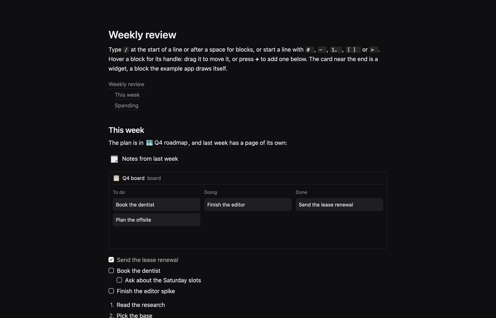
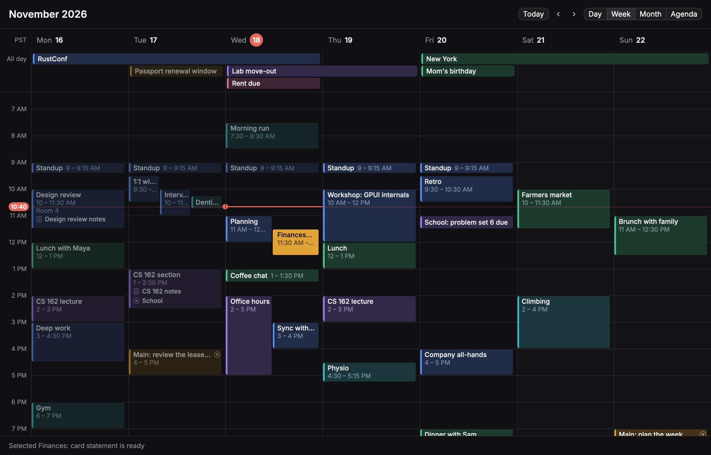
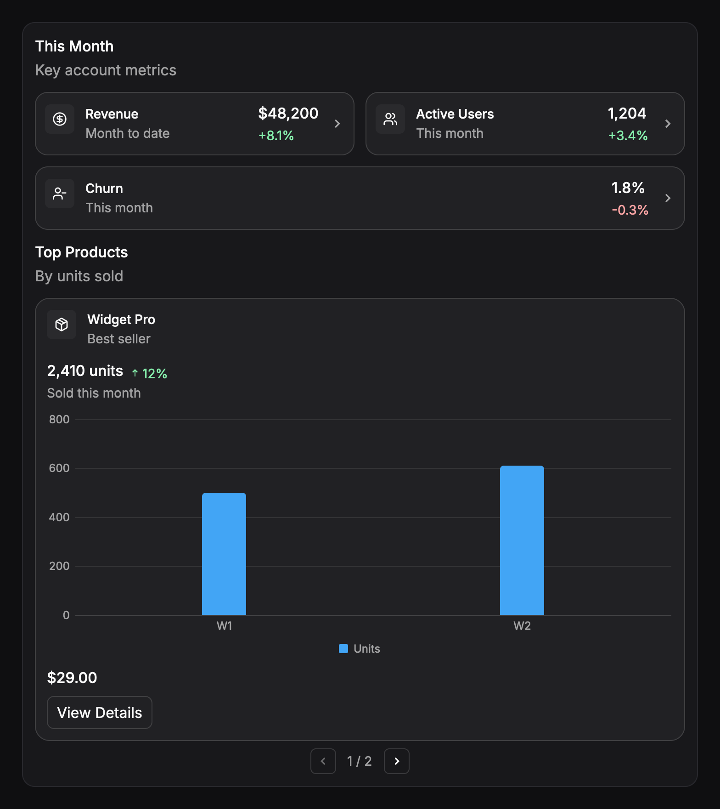
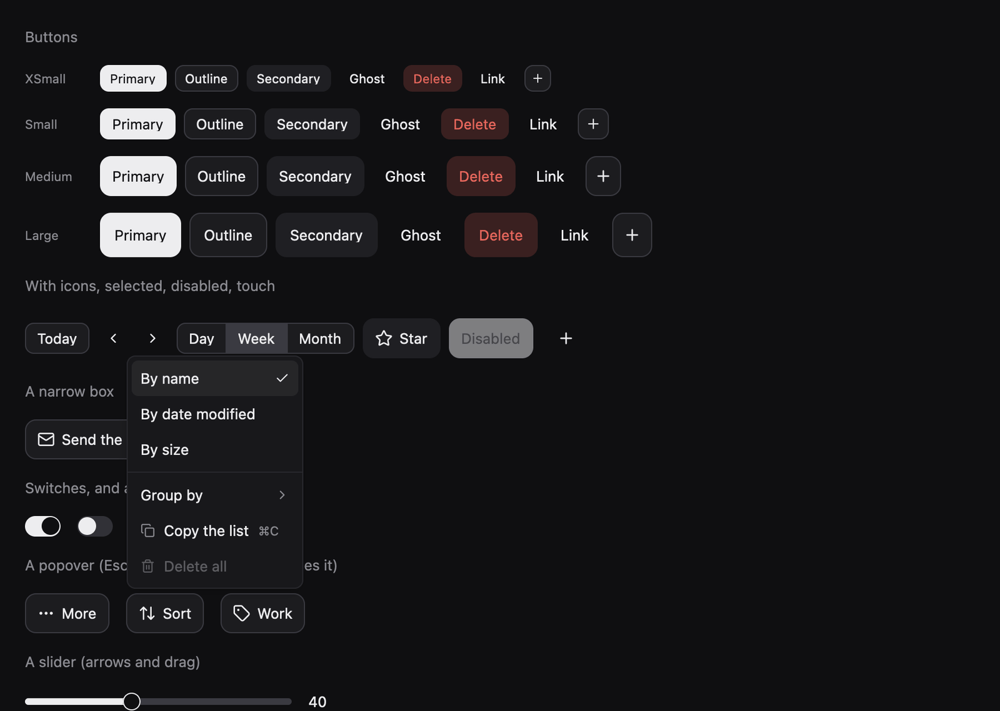
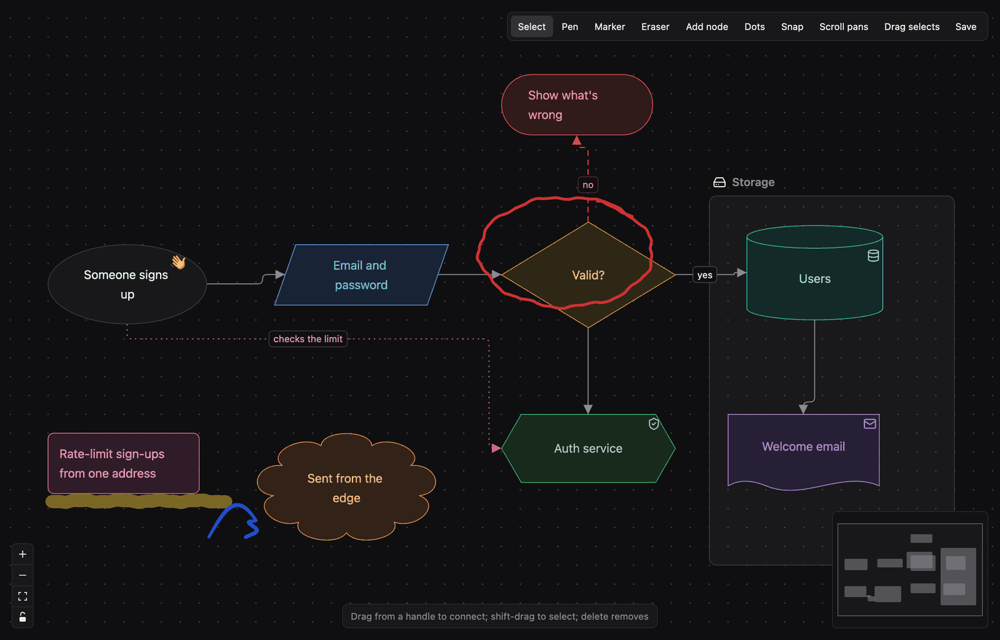
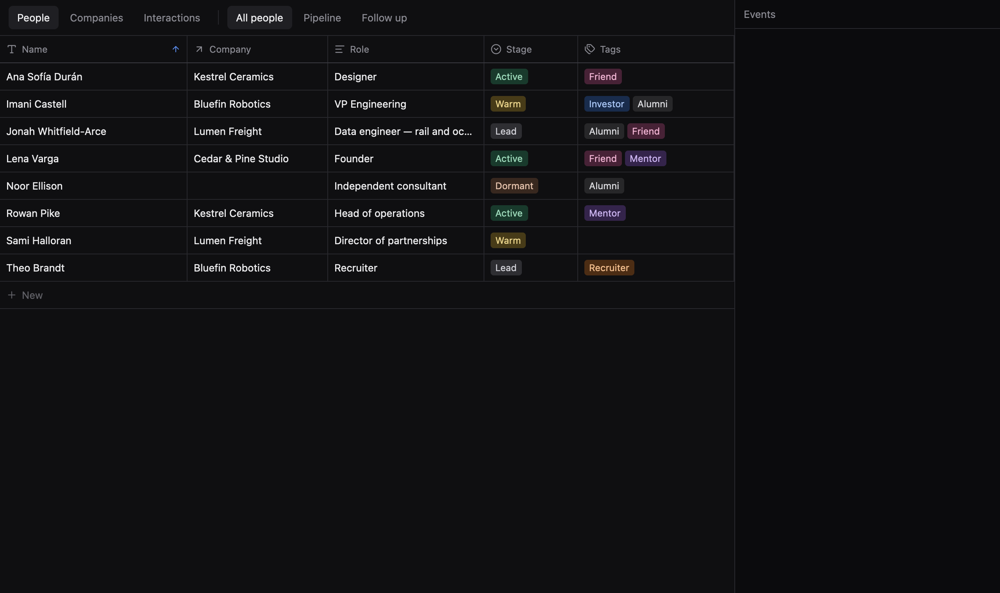

# gpui-essentials

Components for [GPUI](https://www.gpui.rs) apps, one crate per folder, built and tested
together so they link one GPUI. Each draws in the host's theme through gpui-core and works with
the keyboard, the mouse and touch.

Each folder has its own README with what the crate does, how to use it, its example window and
its tests.

## The crates

### [gpui-blocks](gpui-blocks)

A Notion-like block editor: Markdown documents with a slash menu, drag handles, callouts,
toggles, tables, find and replace, and widget blocks the host draws.



### [gpui-calendar](gpui-calendar)

Day, week, N-day, month and agenda views with a time grid; drag to create, move and resize;
time zones, recurring events, an event panel and a compact phone layout.



### [gpui-chatwidgets](gpui-chatwidgets)

Draws AI agents' [OpenUI](https://openui.com) cards (cards, tables, charts, forms, buttons)
natively, with a parser that builds without GPUI.



### [gpui-core](gpui-core)

The components the others build on: theme, window root, buttons, inputs, menus, popovers,
sheets, date pickers and Markdown text, with an optional code highlighter.



### [gpui-flow](gpui-flow)

A node-and-edge editor in the manner of React Flow: custom nodes, edges with labels, groups,
shapes and ink, a minimap and controls, and JSON in and out.



### [gpui-tables](gpui-tables)

Notion-style databases: typed properties, saved table, board and list views, filters, sorts and
groups, with a model and engine that build without GPUI.



## Requirements

- **Rust 1.100.0**, pinned in [rust-toolchain.toml](rust-toolchain.toml). rustup installs it
  on the first build here and leaves your default alone. The crates declare
  `rust-version = "1.100"`.
- **macOS** to build and run the examples and tests: GPUI draws through Metal. The crates also
  build for iOS (GPUI's `gpui-pre-ios`) with touch. gpui-chatwidgets' parser and gpui-tables'
  engine build without GPUI on any platform.
- **GPUI as `gpui-pre` `=0.3.12`**, a snapshot of Zed's GPUI, pinned exactly. Your app must use
  the same version, or two GPUIs would be linked. No crate here uses GPUI Kit any more.

## Installation

None of the crates is on crates.io yet. Take them from this repository by name, pinned to one
commit (the same commit for all of them, since any commit can change an API):

```toml
[dependencies]
gpui = { package = "gpui-pre", version = "=0.3.12" }
gpui-core = { git = "https://github.com/trevin-lee/gpui-essentials", rev = "<rev>" }
gpui-blocks = { git = "https://github.com/trevin-lee/gpui-essentials", rev = "<rev>" }
# Any of the others the same way: gpui-calendar, gpui-chatwidgets, gpui-flow, gpui-tables.

# The app's window. Without `font-kit`, GPUI draws no text on macOS.
gpui_platform = { package = "gpui-pre-platform", version = "=0.3.12", features = ["font-kit"] }
```

Replace `<rev>` with a commit hash from this repository's `main`. At startup, call
`gpui_core::init(cx)`, set a theme with `gpui_core::Theme::set`, and serve gpui-core's icons:
`gpui_platform::application().with_assets(gpui_core::Icons)`. Each crate's README has a small
example that compiles (its README is built as a doctest).

## Running the examples

From the repository's root; each opens a window:

```sh
cargo run --release -p gpui-blocks --example editor       # a sample document
cargo run --release -p gpui-calendar --example calendar   # a week of sample events
cargo run --release -p gpui-chatwidgets --example gallery # every card kind
cargo run -p gpui-core --example gallery                  # every component
cargo run --release -p gpui-flow --example flow           # the canvas
cargo run --release -p gpui-tables --example crm          # a CRM: people, companies, interactions
```

The pictures above were drawn offscreen by the same examples with the `shots` feature, for
example `cargo run --release -p gpui-calendar --features shots --example calendar -- --shot
week.png --scene week`; each crate's README lists its scenes.

## Working here

```sh
cargo test -p gpui-calendar   # one crate
cargo test --workspace        # all of them
```

Each crate has its own CI workflow in `.github/workflows`, run on GitHub's macOS runners when
its folder, gpui-core (for the crates built on it) or the shared files change, and built for the
iOS simulator; gpui-chatwidgets' parser-only build and gpui-tables' engine-only build are also
tested on Linux.

## History

gpui-blocks and gpui-calendar began as repositories of their own, and gpui-chatwidgets as a
local one; their histories are kept here, each in its folder. gpui-flow came in as one commit.

## License

Apache-2.0. See [LICENSE](LICENSE) and [NOTICE](NOTICE), which carries every crate's
third-party notices: GPUI Kit, from which gpui-blocks' engine derives, the
gpui-kit-markdown-editor fork it is, OpenUI (MIT) for gpui-chatwidgets, and the Inter font in
the examples.
