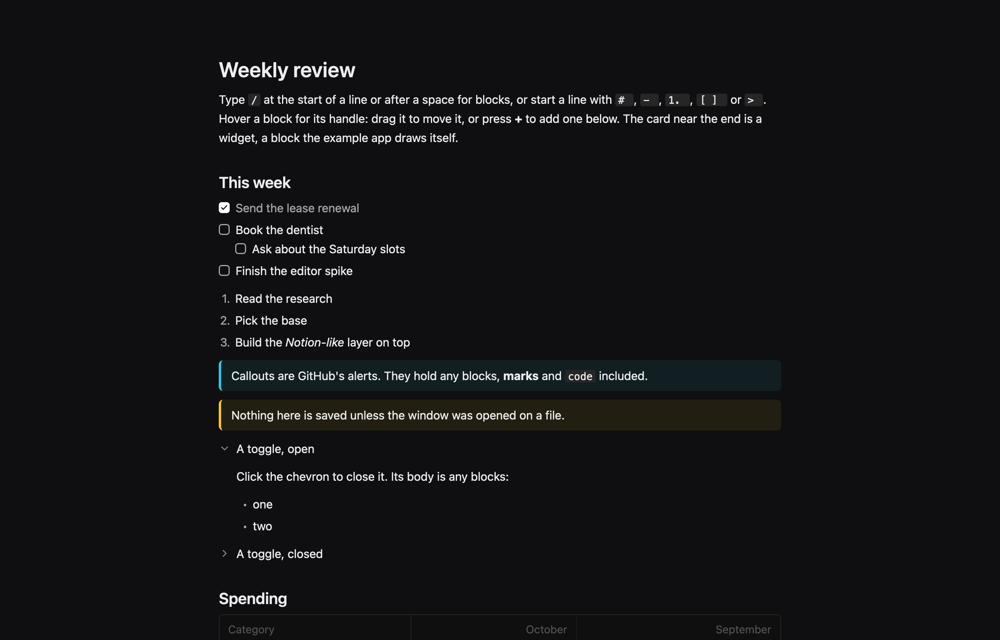
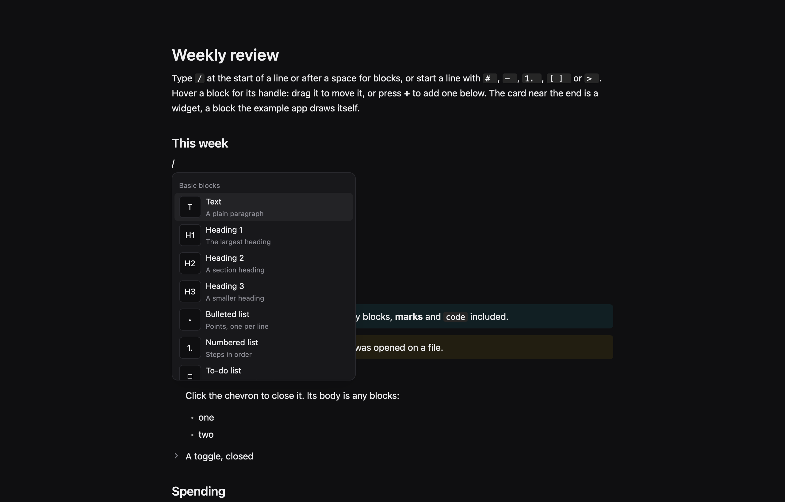
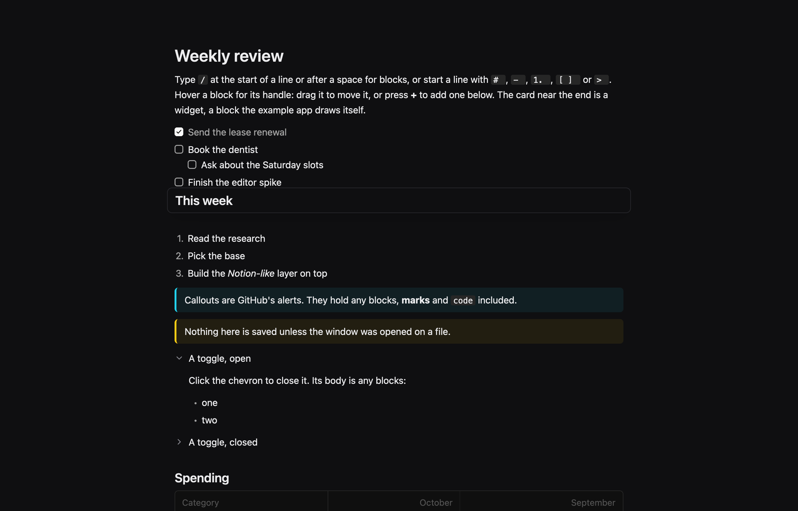

# gpui-blocks

A Notion-style block editor for [GPUI](https://www.gpui.rs) apps built with
[GPUI Kit](https://github.com/longbridge/gpui-kit) 0.9. Documents are blocks you can type into,
turn into other blocks with `/`, and drag around, and they're kept as Markdown.

It uses GPUI Kit's types throughout (GPUI Kit builds on `gpui-pre`, a snapshot of Zed's GPUI), so
it works in GPUI Kit apps but not with Zed's own `gpui` crate.



## What it does

- **Blocks:** paragraphs, headings (three in the slash menu, all six with `#`), nested bullet,
  numbered and to-do lists, quotes, callouts, toggles, code with syntax highlighting, dividers,
  tables you can edit, and pictures.
- **Slash menu:** type `/` at the start of a line or after a space. Narrow the list by typing,
  pick with ↑ ↓ and Enter, and close it with Esc.
- **Side menu:** hover a block for its handles. "+" adds a line below with the menu open, and the
  grip drags the block.
- **Motion:** while you drag, the blocks you pass slide aside to open a gap, and the block
  springs into it when you let go. Moving a top-level block with ⌘⇧↑ or ↓ (Ctrl on Linux and
  Windows), or undoing a move, slides the blocks to their new places. List items move within
  their list, without motion.
- **Markdown shortcuts as you type:** `# `, `- `, `1. `, `[ ] `, `> `, `**bold**`, `*italic*`,
  `~~strike~~`, `` `code` `` and `[text](url)`, and three backticks, `---` or `| a | b |`
  followed by Enter.
- **Editing:** undo and redo, selection across blocks, IME, and copy and paste as Markdown.
- **Widgets:** blocks your app draws itself, such as a chart, kept in the file as fenced code.

| The slash menu | The side menu | Dragging a block |
|---|---|---|
|  |  |  |

## Use it

It needs Rust 1.100 or newer, as GPUI Kit 0.9 does.

```toml
[dependencies]
gpui-kit = "0.9.1"
gpui-blocks = { git = "https://github.com/trevin-lee/gpui-blocks", rev = "<a commit>" }
```

Pin a commit: until it's on crates.io, any commit can change the API.

```rust,no_run
use gpui_kit::*;

fn main() {
    gpui_kit::application().run(|cx| {
        gpui_kit::init(cx);
        gpui_blocks::init(cx);
        gpui_kit::open_window(WindowOptions::default(), cx, |window, cx| {
            let editor = cx.new(|cx| gpui_blocks::Editor::new("# Hello\n\nType `/` for blocks.", window, cx));
            editor.update(cx, |editor, cx| editor.focus(window, cx));
            editor
        })
        .unwrap();
    });
}
```

Try the example. It rewrites a file you open in the editor's own Markdown (see below), so try it
on a copy:

```sh
cargo run --release --example editor               # a sample document, not saved
cargo run --release --example editor -- notes.md   # a file of yours, saved as you type
```

## Putting it in an app

- **Layout:** `Editor` fills the view it's in and scrolls itself. The text sits in a 720 px
  column, with room on its left for the side menu.
- **Look:** it draws with GPUI Kit's `Theme` and paints no background, so put it in a view that
  does (`.bg(cx.theme().background)`). The pictures here use the example's dark theme
  (`apply_theme` in `examples/editor.rs`).
- **The document:** `editor.markdown(cx)` returns it and `editor.set_markdown(..)` replaces it.
  YAML front matter at the top is kept aside and written back unchanged.
  `editor.set_readonly(true, cx)` blocks edits and hides the side menu.
- **Events** (`EditorEvent`): `Changed` after every edit. `EditLinkRequested { url }` on ⌘K: show
  a field for the link, then call `set_link` on `editor.state()`. `LinkClicked { url }` on
  ⌘-click: the editor never opens links itself.
- **Keys:** the view's actions are in `gpui_blocks::actions`, and its key context is
  `BlocksEditor`. Bind them to other keys after `gpui_blocks::init`.
- **Everything else:** `editor.state()` is the underlying gpui-kit-markdown-editor
  `BlockEditorState` (see below). Its API follows the fork and can change with it.

## Widgets

A widget is a fenced block whose info string is the widget's name:

````markdown
```chart
kind: bar
values: 3, 5, 2
```
````

Your app draws it, and any other Markdown tool shows it as a code block. In the editor it's one
unit, like a picture: it's selected, moved and deleted whole. It's written back with the same
name, info string and body, inside quotes, callouts and lists too.

```rust,no_run
use gpui_blocks::slash::{SlashAction, SlashItem};
use gpui_blocks::widget::{Widget, fenced};
use gpui_blocks::{Editor, Options};
use gpui_kit::*;

struct Chart;

impl Widget for Chart {
    fn name(&self) -> &str {
        "chart"
    }

    fn render(&self, body: &str, _window: &mut Window, _cx: &mut App) -> AnyElement {
        // Read `body` and draw the chart.
        div().child(body.to_string()).into_any_element()
    }
}

fn editor(markdown: &str, window: &mut Window, cx: &mut App) -> Entity<Editor> {
    let options = Options::default().widget(Chart).slash_item(
        SlashItem::new("Chart", SlashAction::Markdown(fenced("chart", "kind: bar").into()))
            .hint("A bar chart")
            .aliases(["graph", "plot"]),
    );
    cx.new(|cx| Editor::with_options(markdown, options, window, cx))
}
```

A widget draws from its body alone: it gets no block id and can't write a new body back, so two
widgets with the same body look the same to it. The example's `answer` card
(`examples/editor.rs`) is a complete one.

## The Markdown it writes

CommonMark, with GitHub's tables and task lists:

- **Callouts** are GitHub's alerts (`> [!NOTE]`, `> [!WARNING]` and the rest, with the marker
  alone on its line). GitHub and Obsidian draw them too.
- **Toggles** are HTML's `<details>` with a `<summary>`. The body is written at the toggle's own
  level between blank lines, so it stays Markdown, and an open toggle says `open`.
- **Widgets** are fenced blocks, as above.

Saving writes the editor's own form of Markdown, so a file it didn't write can change in how
it's written, though not in what it says:

- one way to write each thing: `*italic*`, `**bold**`, `-` bullets, `1.` numbers, `#`
  headings, backtick fences, `---` rules, `[x]` for done tasks, and tables padded with
  `| --- |` rows;
- reference links become inline links, and entities such as `&copy;` become their characters;
- one blank line between blocks, line breaks within a paragraph become spaces, hard breaks
  become `<br>`, and line endings become LF;
- a `$` is written `\$`, because the parser reads `$…$` as math.

A document the editor wrote reads back to the same text.

## Performance

Measured with `cargo run --release --example editor -- --bench` on an Apple Silicon Mac, in a
1280×820 window at 2x on a 120 Hz display:

| | |
|---|---|
| Keystroke to painted frame | not measured yet since the bench was corrected (it stopped its clock before the frame was drawn) |
| Opening a 5,000-line document (152 KB) | not measured yet, for the same reason |
| Scrolling it end to end | every frame at 120 a second, about 2 ms of work each (median) |
| Memory (footprint, as Activity Monitor counts it) | 85 MB with the sample open; 162 MB with the 5,000-line document |
| Idle, window in the background | nothing drawn, no CPU |

"Painted" is when the frame has been drawn, before the display shows it at its next refresh.
Nothing draws while nothing changes, apart from the caret's blink twice a second while the editor
has focus. Blocks being moved draw every frame until they come to rest: most of the way in about
150 ms, and at rest after 160 to 390 ms, depending on how far they move.

## How it's built

The document model, input, selection, undo and text drawing come from
[gpui-kit-markdown-editor](https://github.com/wabzqem/gpui-kit-markdown-editor), which draws
through GPUI Kit's editor host API. They come through
[a fork](https://github.com/trevin-lee/gpui-kit-markdown-editor) that adds callouts,
toggles, block motion, and the hooks this crate needs to draw its menus. This crate adds the slash
menu, the side menu, the widget API and the example.

## Status

Early, and used for one app so far. It's tested on macOS. GPUI also runs on Linux and Windows,
but this crate hasn't been tried there.

It isn't on crates.io yet. It depends on the fork by git commit, and crates.io won't accept a git
dependency. The fork's changes haven't been offered upstream yet.

Not done yet:
- Dragging blocks nested inside lists, quotes and toggles.
- A menu on the drag handle (turn into, duplicate, delete), and Esc to select a block.
- Pasting or dropping pictures.
- A link field for ⌘K. The editor sends `EditLinkRequested`, and the app shows the field.
- Table grips in centred and right-aligned columns land slightly off.

## License

Apache-2.0, as gpui-kit-markdown-editor and GPUI Kit are. See [LICENSE](LICENSE) and
[NOTICE](NOTICE). Notion is a trademark of Notion Labs, Inc., and this project isn't affiliated
with it.
