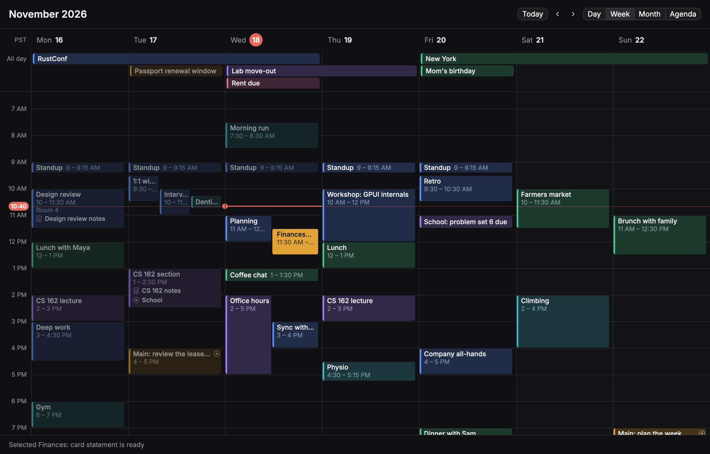
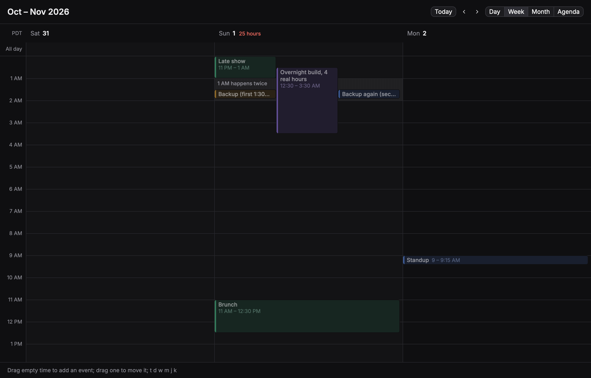
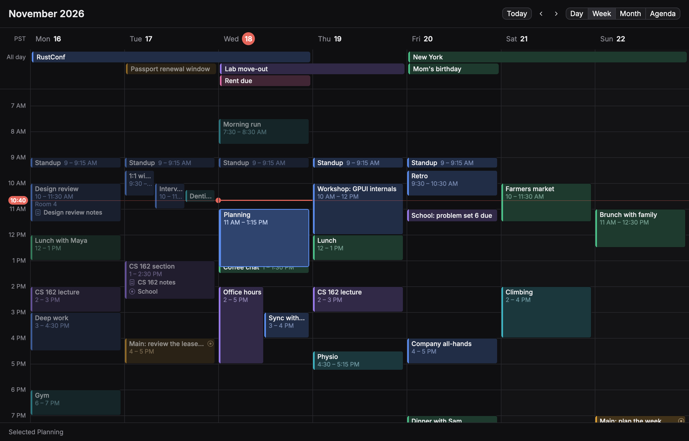
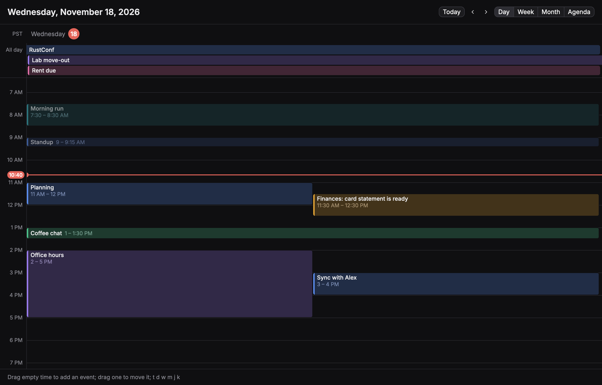
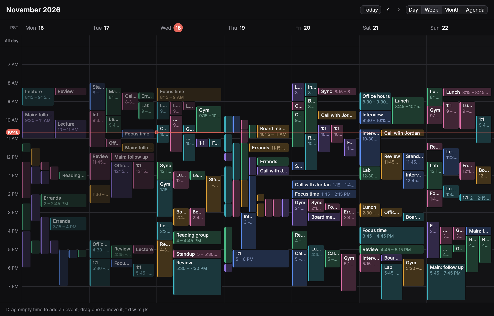
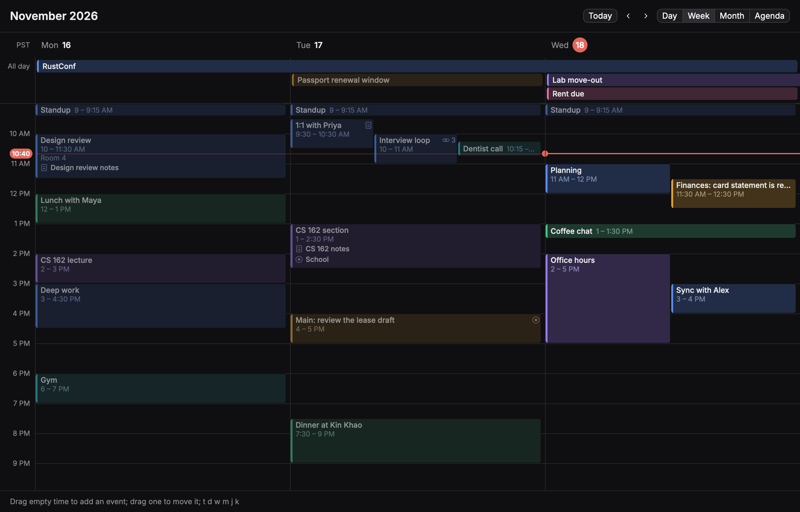
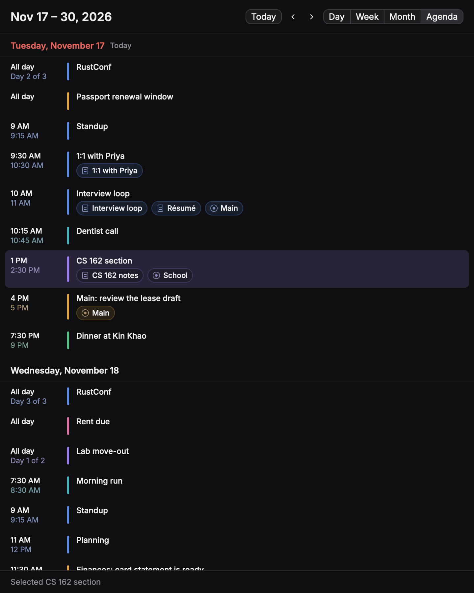

# gpui-calendar

Day, week, N-day, month and agenda calendar views for [GPUI](https://www.gpui.rs) apps built with
[GPUI Kit](https://github.com/longbridge/gpui-kit) 0.9. GPUI Kit has a date picker and a month
picker; this adds the time grid and the views a calendar app needs. You drag empty time to make
an event, drag an event to move it, drag its edge to change its length, and press Delete to
delete it, and every change comes back to your app as a proposal. Your app supplies the calendars
(their colours, which are shown, which are read-only) and the events, recurring ones already
expanded, and the crate never touches a network.

It uses GPUI Kit's types throughout (GPUI Kit builds on `gpui-pre`, a snapshot of Zed's GPUI), so
it works in GPUI Kit apps but not with Zed's own `gpui` crate. It follows how FullCalendar,
react-big-calendar and Notion Calendar behave, without their code or their look.



## What it does

- **Views:** day, week, N days (`CalendarView::Days(n)`), month and agenda
  (`CalendarView::Agenda(n)`, two weeks from the header's button). Day and week share a time
  grid. It has a row of day names with today marked, an all-day row (three rows of spans, then
  "+N more", which opens the row), hour lines, and a line at the current time with the time in the
  gutter. The grid opens with the current time a third of the way down. The month shows spans for
  all-day and multi-day events, a dot, time and title for the rest, and "+N more", which opens
  that day.
- **Agenda:** a list of the days that have events (and today), each under a header that stays
  at the top while its day scrolls by. A row has the time (or "All day", "Day 2 of 3",
  "Until 2 AM"), the calendar's colour, the title, the place and every link as a pill. It opens
  at today and scrolls with the wheel or a trackpad. Nothing in it is dragged; a click selects,
  a double-click opens, a click on a day's header opens that day, and a link opens its link. It
  is the layout meant for a phone, and it fits from 320 pixels wide.
- **Layout:** timed events that overlap sit side by side. Each group of overlapping events gets as
  many columns as it needs at its busiest. Each event takes the leftmost column free when it
  starts, then widens over the columns to its right that stay free for its whole length; this is
  FullCalendar's and Google Calendar's layout. Events a day or longer, and all-day ones, are spans
  stacked in the lowest free row, longer first. A shorter event that crosses midnight is drawn as
  a piece on each day.
- **Dragging:** drag empty time to make an event, drag an event to move it (to other days too),
  and drag its bottom edge to change its end (an all-day event's right edge, in the all-day row
  and the month). Drags snap to 15 minutes (`snap_minutes`), show a ghost of where the event would
  land with the original faded, and Escape drops them. Near the grid's top or bottom a drag
  scrolls it. Read-only events, and events in read-only calendars, can be selected and opened
  but not moved.
- **Links:** an event can link to docs and agents. A chip with room lists them under its text,
  each with a mark (a page for a doc, a ring for an agent) and its label. A smaller chip shows
  the one link's mark by its title, or a chain and a count for several. A click on a link asks
  your app to open it; a drag that starts on one moves the event.
- **Clicks:** a click selects, and a double-click opens an event or makes one in empty time.
- **Keys:** the arrows move the selection: a 30-minute slot on the grid, a day in the month, or
  from event to event. With nothing selected, ← and → change the period. `j` or `n` goes to the
  next period and `k` or `p` to the previous one. `t` goes to today, and `d`, `w`, `m` and `a`
  switch views. In the agenda the arrows go from event to event down the list. Enter opens the selected event or makes one in the selected slot, Delete or Backspace
  asks to delete the selected event, and Escape drops a drag or the selection.
- **Time zones:** times are shown in a display zone from chrono-tz, which bundles the IANA
  database, so a DST day doesn't depend on the machine's zone files.
- **Theming:** each calendar's colour, the week's first day, 12- or 24-hour time, and colours
  from GPUI Kit's theme. It scales with the window's rem, so it follows an app's zoom.

| Overlapping events | The month |
|---|---|
|  |  |

## Use it

It needs Rust 1.100 or newer, as GPUI Kit 0.9 does.

```toml
[dependencies]
gpui-kit = "=0.9.1"
gpui-calendar = { git = "https://github.com/trevin-lee/gpui-essentials", rev = "<a commit>" }
```

Pin a commit: until it's on crates.io, any commit can change the API.

```rust,no_run
use chrono::{Duration, Utc};
use gpui_calendar::{Calendar, CalendarEvent, CalendarSource, CalendarView, Event};
use gpui_kit::*;

fn main() {
    gpui_kit::application()
        // The header's chevrons are GPUI Kit's icons, so the app needs GPUI Kit's assets.
        .with_assets(gpui_kit::assets::Assets::new(""))
        .run(|cx| {
            gpui_kit::init(cx);
            gpui_calendar::init(cx);
            gpui_kit::open_window(WindowOptions::default(), cx, |_, cx| {
                let now = Utc::now();
                let calendar = cx.new(|cx| {
                    Calendar::new(cx)
                        .with_options(|o| {
                            o.time_zone = chrono_tz::America::Los_Angeles;
                            o.week_start = chrono::Weekday::Sun;
                        })
                        .with_calendars(vec![
                            CalendarSource::new("work", "Work", 0x5b8def),
                            CalendarSource::new("holidays", "Holidays", 0x8b8b93).read_only(true),
                        ])
                        .with_view(CalendarView::Week)
                        .with_events(vec![
                            // One occurrence of a recurring event: its own id and its series'.
                            Event::timed("standup@1", "Standup", now, now + Duration::minutes(15))
                                .calendar("work")
                                .series("standup"),
                        ])
                });
                cx.subscribe(&calendar, |calendar, event: &CalendarEvent, cx| match event {
                    // The app owns the events: it agrees to a move by setting the event again.
                    // `event.series` says it's one occurrence of a recurring event.
                    CalendarEvent::Move { event, time } | CalendarEvent::Resize { event, time } => {
                        calendar.update(cx, |c, cx| {
                            if let Some(mut e) = c.event(&event.id).cloned() {
                                e.time = *time;
                                c.upsert_event(e, cx);
                            }
                        });
                    }
                    CalendarEvent::Delete(event) => {
                        calendar.update(cx, |c, cx| c.remove_event(&event.id, cx));
                    }
                    // Fetch the events in this range, then call `set_events`.
                    CalendarEvent::RangeChange { .. } => {}
                    _ => {}
                })
                .detach();
                calendar
            })
            .unwrap();
        });
}
```

## Putting it in an app

- **Calendars:** a `CalendarSource` has an id, a name, a colour and two flags, `visible` and
  `read_only`. Give the list with `with_calendars` or `set_calendars` (say, when someone hides
  one in your sidebar). An event takes its calendar's colour. A hidden calendar's events aren't
  drawn, selected or counted. A read-only calendar's events can be selected and opened but not
  moved, resized or deleted, and new events never go in it. An event whose calendar isn't in
  the list is shown, editable, and gets a palette colour chosen by its calendar id.
- **Events:** an `Event` has an id, a series id for an occurrence of a recurring event, a title,
  an `EventTime`, a calendar id, a location, a read-only flag of its own and, rarely, a colour of
  its own. An `EventTime` is either two instants or all-day dates. The end is exclusive, as
  iCalendar's DTEND: a one-day event on the 14th ends on the 15th. Your app supplies the events
  for the range it's told about in `RangeChange`.
- **The calendar never changes an event.** Making, moving, resizing and deleting are proposals,
  sent as `CalendarEvent::{Create, Move, Resize, Delete}`. `Create` says which calendar:
  `default_calendar` if it's shown and can be edited, or else the first that is. The others
  carry an `EventRef` with the event's id, its series and its calendar. `Select` and `Open`
  report clicks.
  Your app agrees by calling `set_events` or `upsert_event`, or `remove_event` for a delete.
- **Links:** `Event::link(EventLink::doc(id, label))` or `EventLink::agent(id, label)`. A
  click on one sends `CalendarEvent::OpenLink { event, link }`; the calendar never fetches or
  opens anything. `link_bounds(id, index)` gives where a link was drawn.
- **Recurring events:** your app expands them, supplying each occurrence in the range as an
  event of its own, with an id of its own and the series' id in `series`. An edit names the
  occurrence it touched and its series, and your app decides whether it changes that one or all
  of them.
- **Options** (`CalendarOptions`, through `with_options` or `set_options`): `time_zone`,
  `week_start`, `hour12`, `snap_minutes`, `slot_minutes`, `default_duration`, `hour_height`,
  `scroll_time`, `default_calendar`, `dim_past` and `all_day_rows`.
- **The header:** the title, Today, previous and next, and Day / Week / Month are GPUI Kit's
  buttons. Turn it off with `.with_header(false)` and drive `go_to`, `next`, `previous` and
  `set_view` from your own.
- **Keys:** the actions (`gpui_calendar::Today`, `SelectLeft` and the rest) work in the
  `Calendar` key context. Bind them to other keys after `gpui_calendar::init`.
- **Placing your own popovers:** `event_bounds(id)` gives where an event was drawn, and
  `point_at(date, minute)` gives where a time is on the grid.

## Time zones and DST

The grid is the wall clock, with every hour the same height. On a 23-hour day the skipped hour is
shaded and holds nothing. On a 25-hour day the repeated hour's two passes share its rows, and two
events in them sit side by side. The day's name says "23 hours" or "25 hours".

A place on the grid becomes an instant as RFC 5545 and JavaScript's Temporal say: a time in the
repeated hour is its first pass, and a time in the skipped hour moves forward by the gap (2:30
becomes 3:30). Moving an event keeps its real length, so a two-hour event moved across the spring
change ends three wall-clock hours after it starts. The tests cover 23- and 25-hour days, a zone
that skips midnight itself (America/Santiago), and moves across a change.

| The autumn change: 1 AM happens twice | The spring change: 2 AM is skipped |
|---|---|
|  |  |

## Trying it

```sh
export CARGO_TARGET_DIR=$TMPDIR/gpui-calendar-target   # or anywhere you like
cargo test
cargo run --release --example calendar
cargo run --release --example calendar -- --bench [--events 2000] [--packed]
cargo run --release --features shots --example calendar -- --shot out.png --scene week
```

`cargo test` also draws every view at widths from 720 to 2,200 pixels, and the agenda from 320,
with long titles, locations and links, laid out with Core Text and Inter as on screen, and fails
if any text runs out of the area it's drawn in or into other text.

The example is a week of sample events and a host that agrees to every proposal and says what
happened at the bottom of the window. For pictures and the bench it pretends it's Wednesday 18
November 2026, 10:40 in Los Angeles. Pictures and the bench draw a window that's never shown and
never takes the keyboard. The scenes are `week`, `day`, `month`, `overlap`, `drag-create`,
`drag-move`, `resize`, `dst`, `dst-spring`, `dense`, `month-drag`, `links` and `agenda` (drawn
720 pixels wide).

The example draws in Inter, which it loads from `examples/fonts` (three fixed weights, under the
SIL Open Font License; see `examples/fonts/OFL.txt`). The crate itself takes its font from GPUI
Kit's theme.

| Dragging out a new event | Moving an event to another day |
|---|---|
|  |  |
| **Changing an event's end** | **Moving an all-day event in the month** |
|  |  |
| **A day** | **A busy week (160 events)** |
|  |  |
| **Links to docs and agents** | **The agenda** |
|  |  |

## Performance

Measured with `cargo run --release --example calendar -- --bench` on an Apple M4 Pro. This is the
CPU time to lay out and paint a frame, from drawing a hidden window directly. The GPU's part and
presenting the frame aren't counted.

| 2,000 events over a year (41 in the week on screen) | median | p95 |
|---|---|---|
| Scrolling the grid | 0.27 ms | 0.32 ms |
| Dragging an event across the week | 0.25 ms | 0.36 ms |
| Changing the week every frame (a fresh layout each time) | 0.63 ms | 0.81 ms |
| The month | 0.53 ms | 0.86 ms |

With all 2,000 events in the week on screen (`--packed`), scrolling takes 1.9 ms and dragging
2.0 ms at the median.

Layout runs only when the events, the period or the options change, never on every frame. It
covers only the events in range, found by binary search, and painting skips what isn't scrolled
into view. Nothing draws while nothing changes, apart from the line at the current time, which
moves once a minute.

## Status

Early, and used for one app so far. It's tested on macOS. GPUI also runs on Linux and Windows,
but this crate hasn't been tried there.

Not done yet:
- Recurrence editing (expanding recurring events, and asking "this event or all of them", is
  the app's job, as above).
- A context menu (Delete is the key for now).
- Year, resource and timeline views.
- Dragging a timed event into the all-day row, or back.
- A scrollbar on the grid.
- A drag that keeps scrolling while the pointer rests at the grid's edge. Today it scrolls only
  while the pointer moves.
- In narrow columns, titles are cut to one line with "…" rather than wrapped.

## License

Apache-2.0. See [LICENSE](../LICENSE) and [NOTICE](../NOTICE). The example's Inter fonts are under the
SIL Open Font License 1.1 (`examples/fonts/OFL.txt`).
