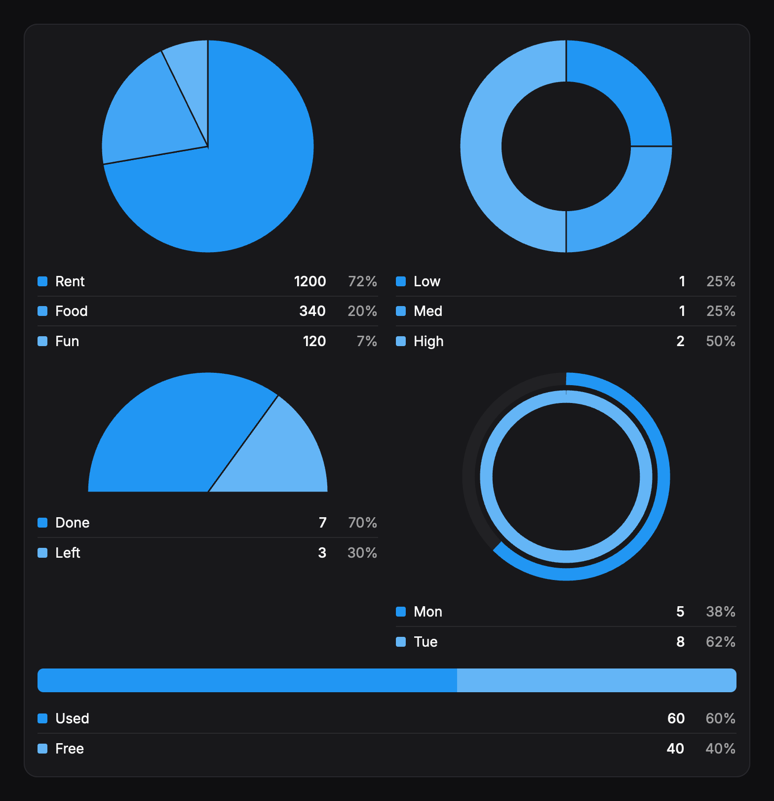
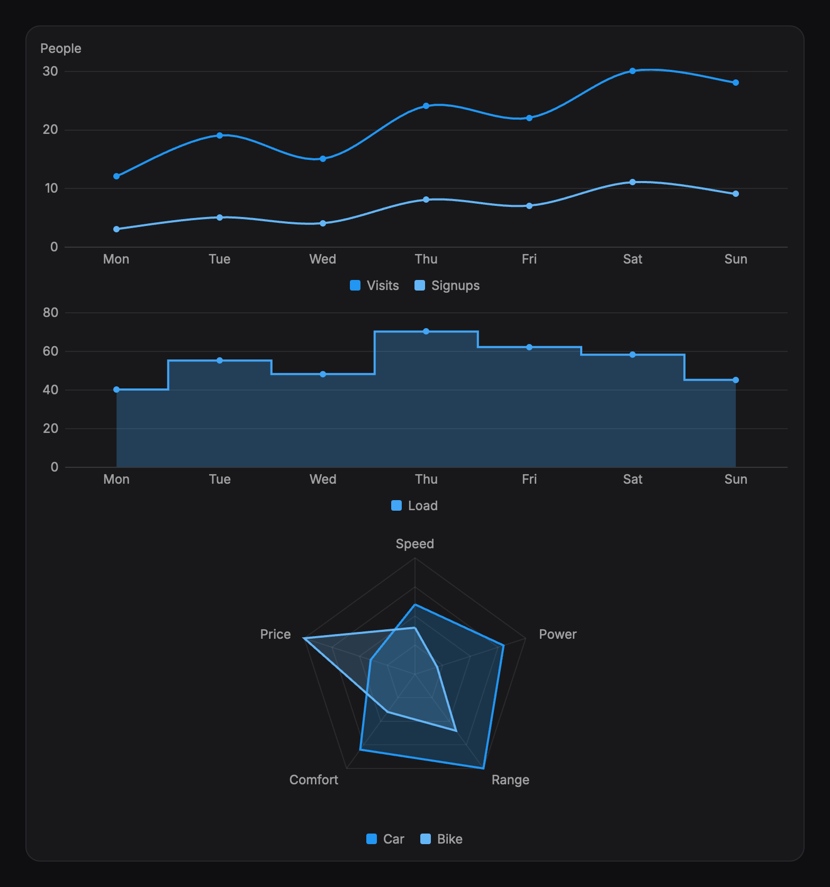
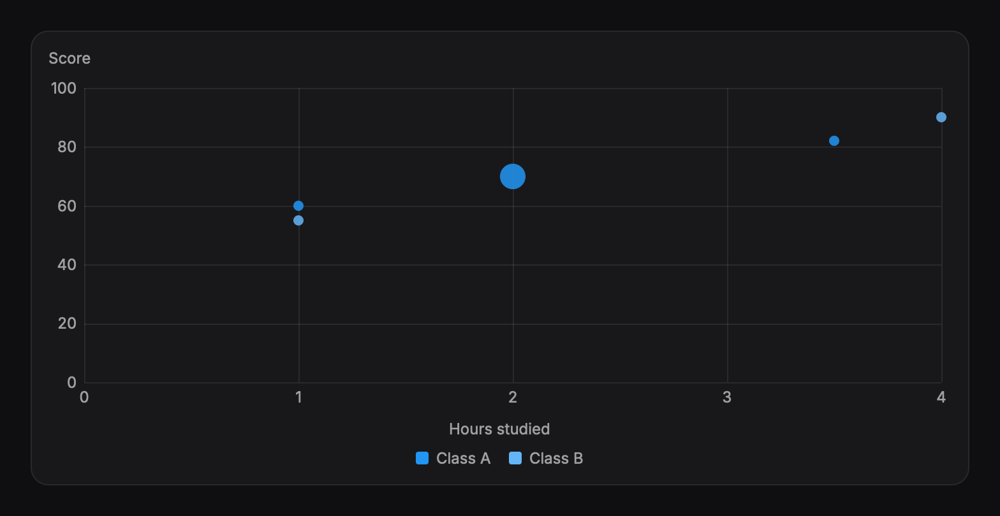
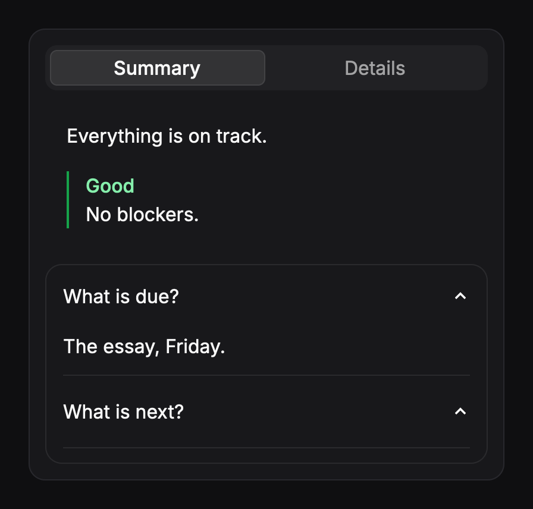
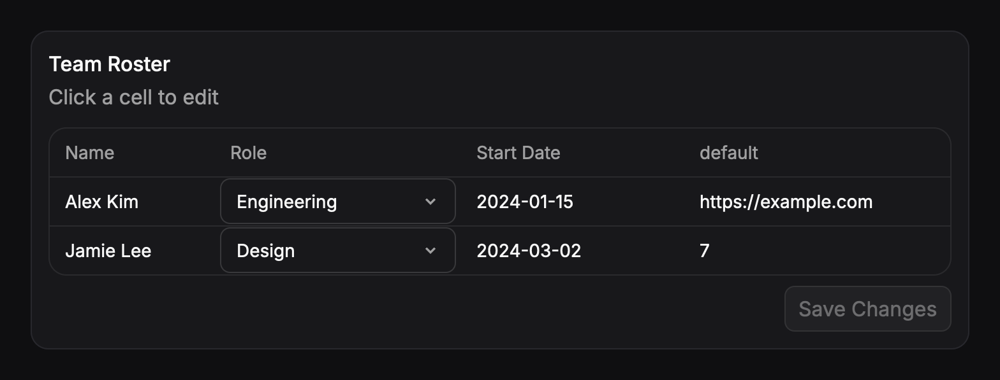
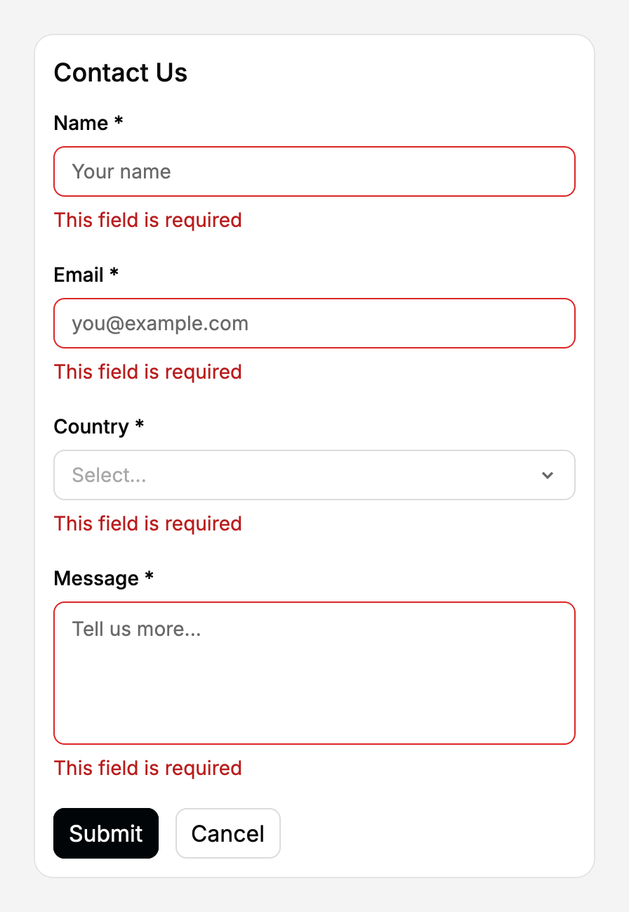
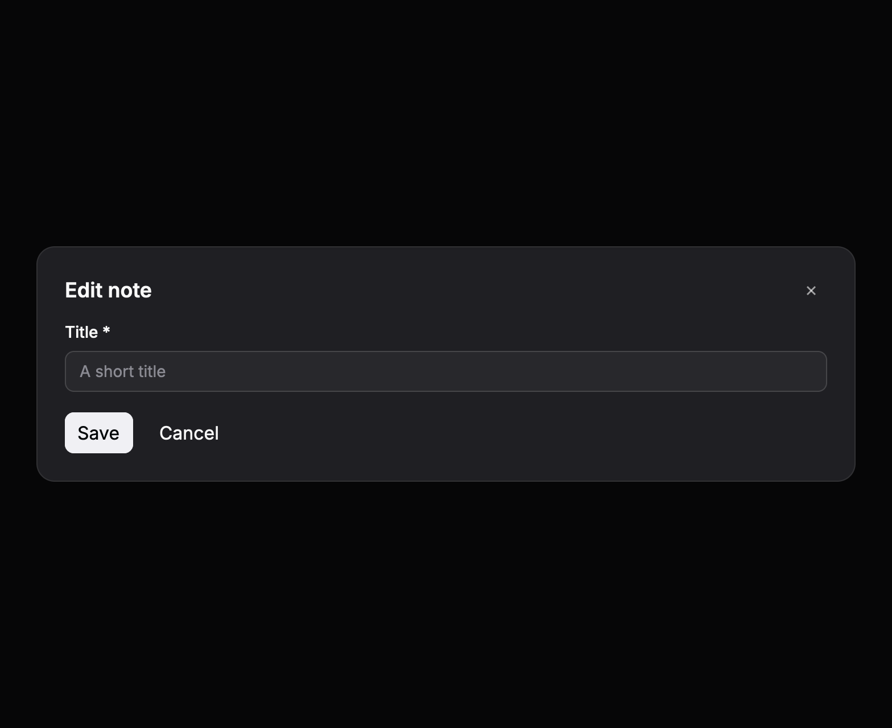
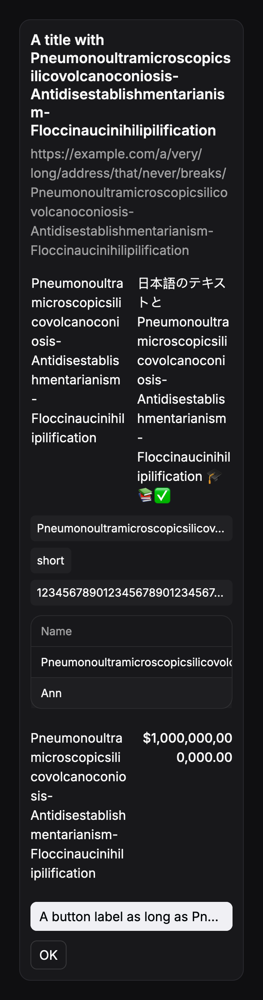

# gpui-chatwidgets

Draws AI agents' OpenUI cards natively in [GPUI](https://www.gpui.rs) apps built with
[GPUI Kit](https://github.com/longbridge/gpui-kit) 0.9.

[OpenUI](https://openui.com) is a small language an agent writes to answer with UI instead of
text: cards, tables, charts, forms and buttons. This crate reads an agent's program and draws it
as GPUI elements in your app's theme. Presses, form values and links come back to your app as
events; the crate itself sends nothing, opens nothing and fetches nothing.

Reads OpenUI Lang (openui.com, MIT, by Thesys). An independent port, not affiliated.


## What's in it

- **`gpui_chatwidgets::openui`**, the parser and the card model. It reads programs the way
  OpenUI's own parser (`@openuidev/lang-core` 1.1.0) does, and 43 golden files written by that
  parser check it (`tests/openui`, made by `tests/openui/golden.mjs`). It turns a program into a
  typed tree of components with their props defaulted, runs presses against the card's state
  (`$variables`, form fields) and words the message for the agent as the web does. It has no
  GPUI in it.
- **`CardView`**, the renderer: a GPUI entity that draws one card and keeps its state between
  frames (the chosen tab, an open section, the text in a field).

Every component of OpenUI's library is drawn: Stack and Card, Tabs, Accordion, Steps, Carousel,
Separator, Modal, CardHeader, TextContent, MarkDownRenderer, Callout and TextCallout, Image,
ImageBlock and ImageGallery, CodeBlock, InlineHeader, Table, EditableTable, the charts (bar,
horizontal bar, line, area, radar, pie and donut, whole or half, radial, single stacked bar,
scatter), Form with its controls (Input, TextArea, Select, DatePicker, Slider, CheckBoxGroup,
RadioGroup, SwitchGroup, Chips, OptionCards), Label, Button, Buttons and IconButton, TagBlock and
Tag, Icon, EntityList, ListBlock, the five card blocks, Text and BoldText, IconText, ImageText and
ImageTextLarge, and the metric indicators. A component the model doesn't know draws nothing.

Text fields, the date picker and the slider are GPUI Kit's. Everything else is drawn with GPUI's
own elements, everything pressable through gpui-core's `Press` (in this workspace) so the
keyboard reaches it (Tab to move, Enter or Space to press) and shows a focus ring there. Markdown goes through GPUI Kit's text view, so it can be selected
and copied; a code block has a Copy button.

| Charts | A form |
|---|---|
|  |  |

## Use it

It needs Rust 1.100 or newer, as GPUI Kit 0.9 does.

```toml
[dependencies]
gpui-kit = "=0.9.1"
gpui-chatwidgets = { git = "https://github.com/trevin-lee/gpui-essentials", rev = "<a commit>" }
```

Pin a commit: until it's on crates.io, any commit can change the API. The crate pins
`gpui-kit = "=0.9.1"` (which pins `gpui-pre` 0.3.12), so your app must use the same, or two GPUIs
would be linked.

The parser turns on `serde_json`'s `preserve_order` feature, so a program's properties keep
the order they were written in. Cargo unifies features across a build, so every crate in your
app that uses `serde_json` gets ordered maps too (an `IndexMap` in place of a `BTreeMap`).
Nothing should depend on the old sorted order, but if something does, that's why it changed.

### Only the parser

A crate that reads cards but doesn't draw them (a server, or the part of an app that isn't UI)
turns the renderer off and gets no GPUI at all:

```toml
gpui-chatwidgets = { git = "https://github.com/trevin-lee/gpui-essentials", rev = "<a commit>", default-features = false }
```

```rust
use gpui_chatwidgets::openui;

let program = openui::parse(r#"root = Stack([Button("Approve")])"#).unwrap();
let mut store = program.store();
let card = program.render(&store).unwrap();
let openui::Component::Stack(stack) = &card.root else { unreachable!() };
let openui::Component::Button(button) = &stack.children[0] else { unreachable!() };
let effects = program.act(&button.action, &button.label, None, &mut store);
assert_eq!(effects, [openui::Effect::Send("Approve".into())]);
```

### A host

The app around a card implements `CardHost`: the theme, images, icons, and where a press's
message or link goes. A card is made from the program's text with an id prefix of its own (a
message id), so several cards in one window don't collide.

```rust,no_run
use std::rc::Rc;

use gpui_chatwidgets::openui::{ImageSrc, Link};
use gpui_chatwidgets::{CardHost, CardTheme, CardView, ImageLoad, ImageReply};
use gpui_kit::*;

struct Host;

impl CardHost for Host {
    fn theme(&self, _: &App) -> CardTheme {
        // Sizes are CSS pixels drawn as rems; GPUI Kit's Root makes the rem its theme's font size.
        CardTheme { rem_base: 16., ..CardTheme::dark() }
    }

    fn send(&self, text: &str, _: &mut App) {
        // Send it to the agent as the user's message.
        println!("to the agent: {text}");
    }

    fn open_link(&self, link: &Link, _: &mut App) {
        // Always http or https; open it in the browser, after any check of your own.
        println!("open: {}", link.as_str());
    }

    fn image(&self, src: &ImageSrc, _: ImageReply, _: &mut App) -> ImageLoad {
        // Only images from your own server, by path; fetch them and hand over the bytes.
        match src.same_origin("https://my.app.example") {
            Some(_path) => ImageLoad::Pending, // later: reply.deliver(Some(image), cx)
            None => ImageLoad::Refused,        // the alt text shows instead
        }
    }
}

struct Chat {
    card: Entity<CardView>,
}

impl Render for Chat {
    fn render(&mut self, _: &mut Window, _: &mut Context<Self>) -> impl IntoElement {
        div().w(px(560.)).p(px(16.)).child(self.card.clone())
    }
}

fn main() {
    gpui_kit::application().run(|cx| {
        gpui_kit::init(cx);
        gpui_kit::open_window(WindowOptions::default(), cx, |window, cx| {
            let host: Rc<dyn CardHost> = Rc::new(Host);
            let program = r#"root = Stack([TextContent("Ready to send?"), Button("Send it")])"#;
            let card = cx.new(|cx| CardView::new(program, "message-1", host, window, cx));
            cx.new(|_| Chat { card })
        })
        .unwrap();
    });
}
```

`CardView::new` never fails: a program it can't read draws "This card couldn't be shown." and
`CardView::error` says why. A host that would rather show the message's text checks
`openui::parse` first and makes the card with `CardView::from_program`.

### Theme

`CardTheme` carries every colour (text, lines, the recessed and raised fills, the accent for
primary buttons, the four tones for callouts and tags, the code block's colours, the chart
series), the font families, text sizes, corner radii and spacing. `CardTheme::dark()` and
`CardTheme::light()` are OpenUI's own look; change what your app's look says. Sizes are CSS
pixels and are drawn as `rems(size / rem_base)`, so a host that zooms by changing the window's
rem zooms its cards too. `frame` draws the card in a rounded, bordered box, as a chat bubble.

GPUI Kit's text fields, date picker and slider take their colours from GPUI Kit's own theme,
which is also the host's. The ring around a button, tab, chip or choice focused from the
keyboard is the theme's `colors.focus_ring`.

### Hooks and events

| `CardHost` | When |
|---|---|
| `theme` | Every draw. Call `CardView::refresh` when it changes. |
| `send(text)` | A press that reaches the agent (`@ToAssistant`, or a button with no action). The text is the press's words, then any context and the form's values as JSON, as OpenUI's web renderer writes it. |
| `open_link(link)` | `@OpenUrl`, or a link in Markdown: only http and https, never with a user name or password. |
| `image(src, reply)` | Once per image reference. Return the bytes, `Pending` (then `reply.deliver`), or `Refused`. |
| `icon(name)` | A Lucide icon name; return an SVG asset path. `lucide_icon` finds one in gpui-core's Lucide set, which its `Icons` asset source serves. |
| `scroller(selector)` | Each region that scrolls sideways or clips its own text, for a host's overflow test. |
| `changed(store)` | The card's state changed; keep `CardView::store` to restore it later with `with_store`. |

The same presses and changes are also `CardEvent`s (`Send`, `Open`, `Changed`) for anything
subscribed to the card. Every host call comes after the card's own update has finished, so a host
may update the card from inside one.

## iOS

The renderer builds for iOS (`aarch64-apple-ios`, `aarch64-apple-ios-sim`) with no change to
your dependencies: GPUI Kit pulls in no platform there, and your app hands GPUI its iOS platform
itself (`Application::with_platform(gpui_pre_ios::current_platform(false))`, from `gpui-pre-ios`
0.3.12, the same GPUI snapshot). CI builds it for the simulator. `tests/touch.rs` drives cards
with real touch events on macOS, with the touch settings forced, through the same recognizer.

GPUI turns touches into what a card already listens to: a tap is a mouse press and release, and
a pan is scroll events locked to the way it started, with momentum after a flick. So on iOS:

- **Every control the crate draws can be hit across 44 points each way**, Apple's minimum
  touch target. A smaller one (a carousel's arrows, a modal's close, a small button, a chip, a
  checkbox row) also takes taps in an invisible margin around it, so it looks and lays out as
  on the Mac.
- **Sideways scrolling follows the finger.** A wide table or a code block moves with a sideways
  pan and keeps it from the chat; an up-and-down pan over it scrolls the chat instead.
- **A carousel turns with a swipe.** The slide follows the finger and turns past 40 points, or
  eases back; the arrows still work. A swipe that starts on a wide table in a slide scrolls the
  table first.
- **Nothing needs hover.** GPUI drops hover styles after a touch, and they only ever shade what
  can also be tapped. An icon button's name, a tooltip on the Mac, shows on a long press.
- **Text fields** focus on a tap and raise the keyboard: they're GPUI Kit's, and GPUI's iOS
  backend shows the keyboard for whichever field has the focus. The slider follows a finger's
  drag (GPUI Kit claims it).

The 44-point targets and the sideways-only scrolling come from the theme, which defaults by
platform:

```rust
use gpui_chatwidgets::CardTheme;

// On iOS and Android: min_hit 44 and touch on. Elsewhere: 0 and off.
let theme = CardTheme::dark();
// Forced either way, say for an iPad with a trackpad, or a test on the Mac.
let theme = CardTheme::dark().with_touch(true);
// Or each on its own: min_hit is in points (it doesn't zoom with rem_base).
let theme = CardTheme { min_hit: 48., touch: true, ..CardTheme::dark() };
```

Known gaps:

- Where two small controls sit closer than 44 points (icon buttons in a tight row), the one drawn
  later takes the strip between them.
- GPUI Kit's own controls (the date picker and its calendar, the slider's thumb) have GPUI
  Kit's sizes, not `min_hit`.
- GPUI's text input has no keyboard type yet, so an email or number field shows the ordinary
  keyboard. Keeping a focused field above the keyboard is the host's: GPUI reports the
  keyboard's height in the window's insets.
- The gallery example is a desktop app: on iOS it builds but doesn't run.

## Security

Every string in a card comes from an agent, and an agent's context can be injected, so the crate
treats it as hostile.

- **No network, no files, no commands.** Images are only ever asked of the host, by the reference
  the card wrote (`ImageSrc`); with no answer the alt text shows. Markdown images become their
  alt text and HTML is shown as the characters it is. Links and messages are handed to the host,
  never opened or sent.
- **Limits on reading:** 256 KB of program, 64 levels of recursion (what fits a 512 KB stack in a
  debug build), 20 levels of components, 2,000 components, 200 children per list, 500 rows and 24
  columns per table, 1,000 points and 24 series per chart, 20,000 characters per text and a million
  in all, and two million steps of work. Past these a card fails with a `CardError`, or a list is
  cut short. A test checks that the deepest cards fit a 512 KB stack.
- **Limits on drawing** (`Limits`, changeable with `CardView::with_limits`): 200 table rows, 100
  editable rows, 400 points and 12 series per chart, 24 gallery images, 100 items in a list or tag
  block, 20,000 characters of code. Past these a note says what was left out.
- **Never a panic:** the parser's tests and `tests/hostile.rs` feed random, cut-off and spliced
  programs, draw them at three widths and press them at random.

## How it behaves

- Nothing draws while nothing changes: no timers and no frames while a card is still. The only
  timer is a toast's (a Callout bound to a `$variable` hides itself after three seconds, as on
  the web), and it runs once.
- Motion is eased over real frames and stops: an accordion's chevron turns and its content fades
  in, and a carousel's slide moves in from the side it came from.
- No text runs out of its box at any width: text wraps, one-line text ends in an ellipsis, and
  wide tables and code scroll sideways. `tests/overflow.rs` lays every golden program out with
  Core Text, as written and with the worst text added to every label (a word with nowhere to
  break, a 300-character address, Japanese, Arabic and emoji), at 280, 400, 720 and 736 pixels,
  and fails on any glyph drawn past its clip, its card or the window.

## The gallery

```sh
cargo run --release --example gallery
cargo run --release --features shots --example gallery -- --shots docs
```

The gallery shows every golden program, with light and dark and four widths, and logs what each
card hands its host. With `--shots` it draws these pictures from a window that's never shown.

| Light, 400 wide | Pies, donuts and rings |
|---|---|
|  |  |

| Lines, areas, radar | A scatter plot |
|---|---|
|  |  |

| Text, callouts, code | Tabs and accordion |
|---|---|
|  |  |

| A table | An editable table |
|---|---|
|  |  |

| Card blocks | Lists and entities |
|---|---|
|  |  |

| A form after Submit | A modal |
|---|---|
|  |  |

| The worst text, 280 wide | Hostile text |
|---|---|
|  |  |

## License

Apache-2.0. See [LICENSE](../LICENSE) and [NOTICE](../NOTICE), which credits OpenUI (MIT), GPUI Kit
(Apache-2.0) and Inter (OFL), bundled with the example.
