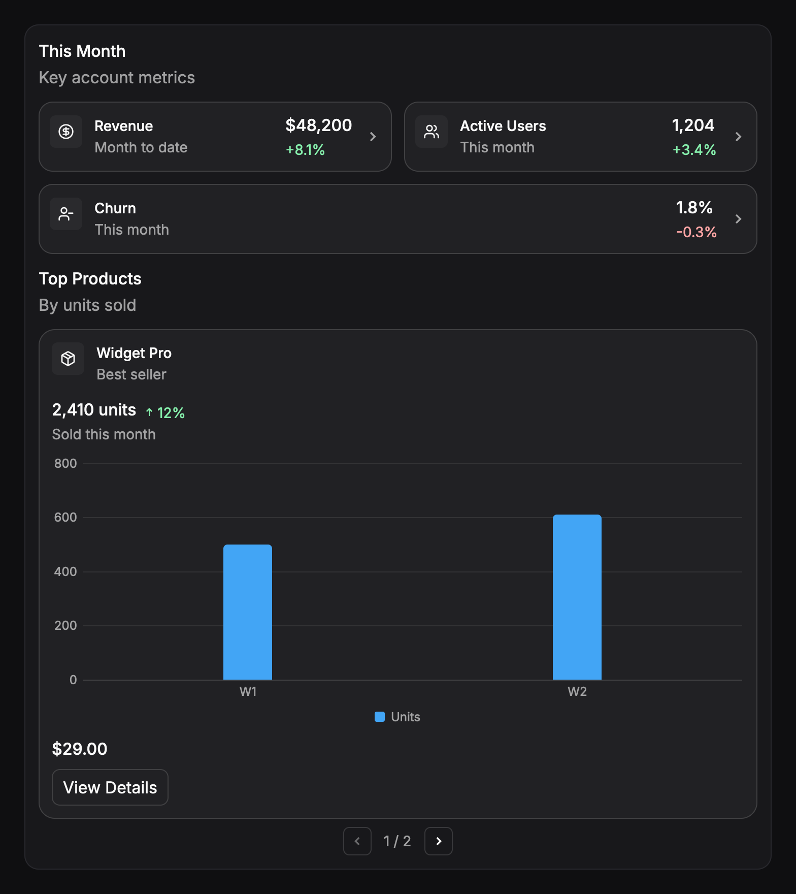
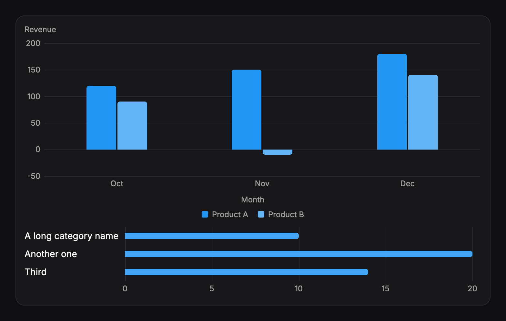
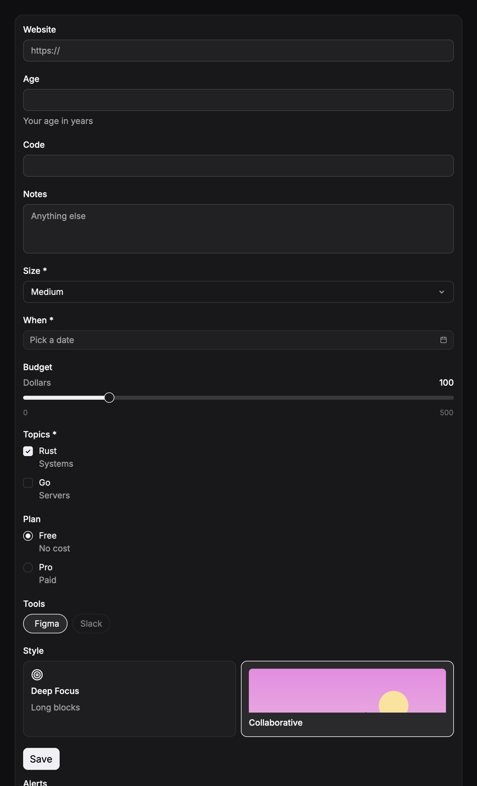
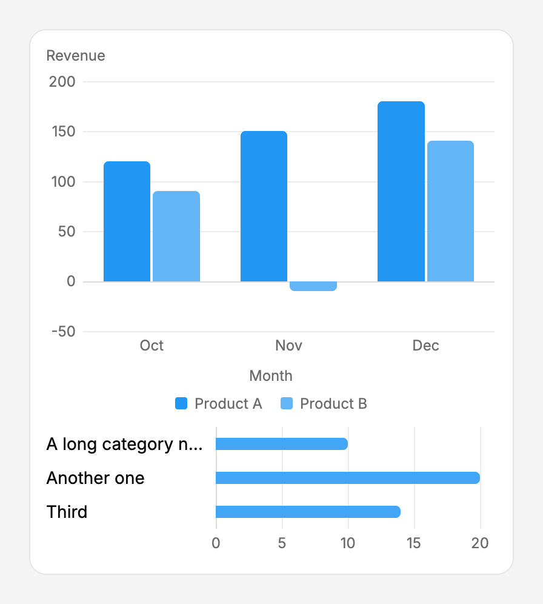
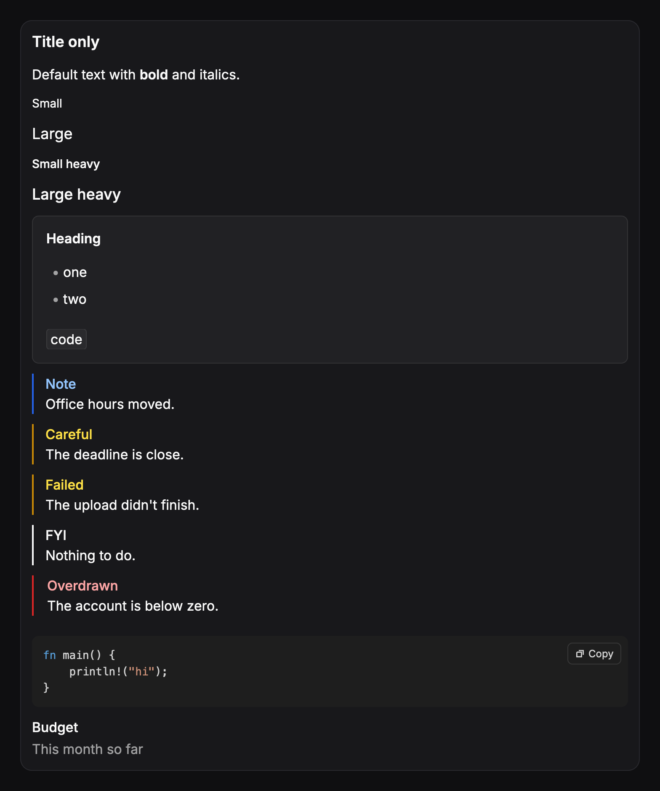
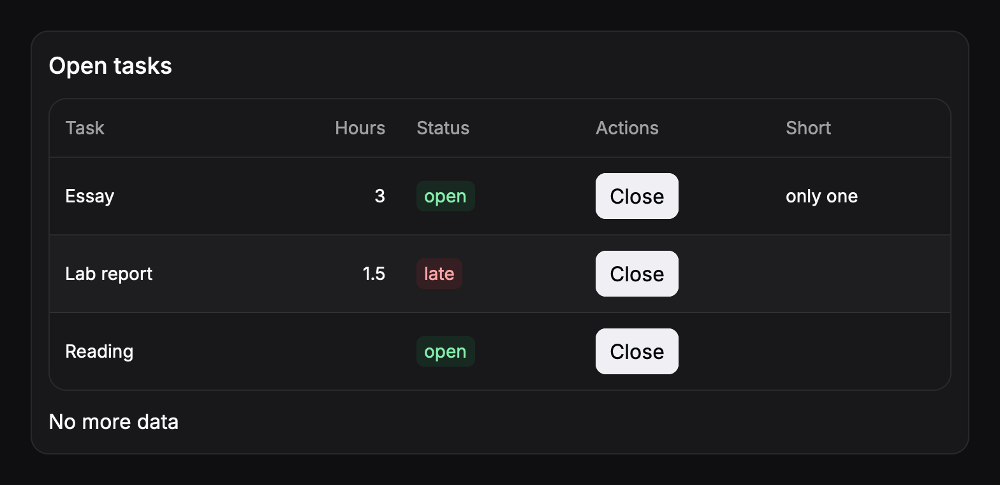
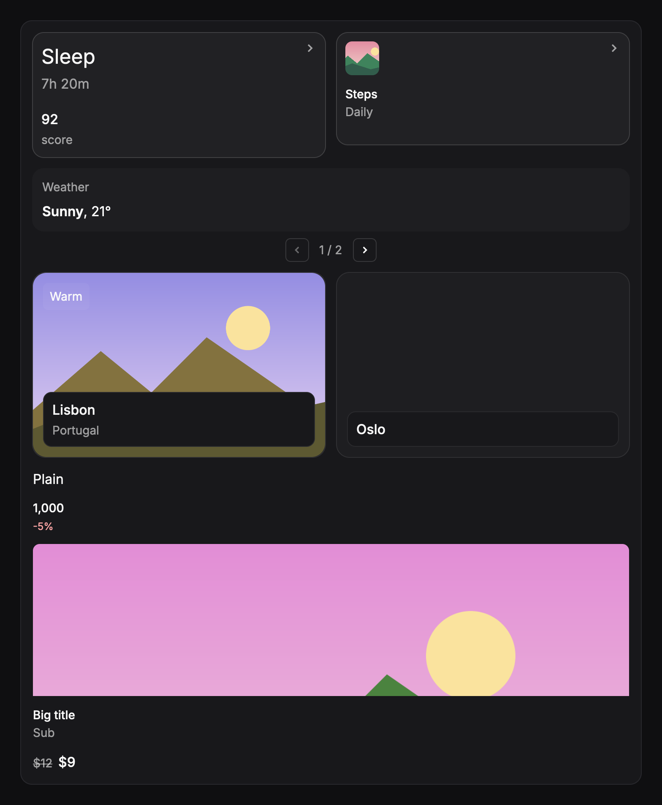
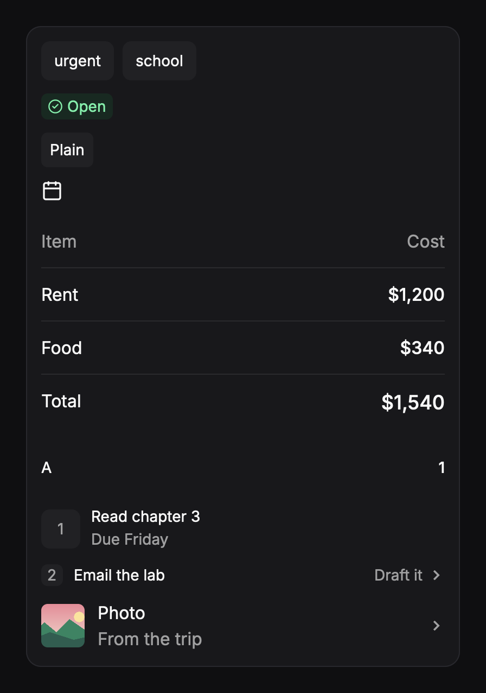
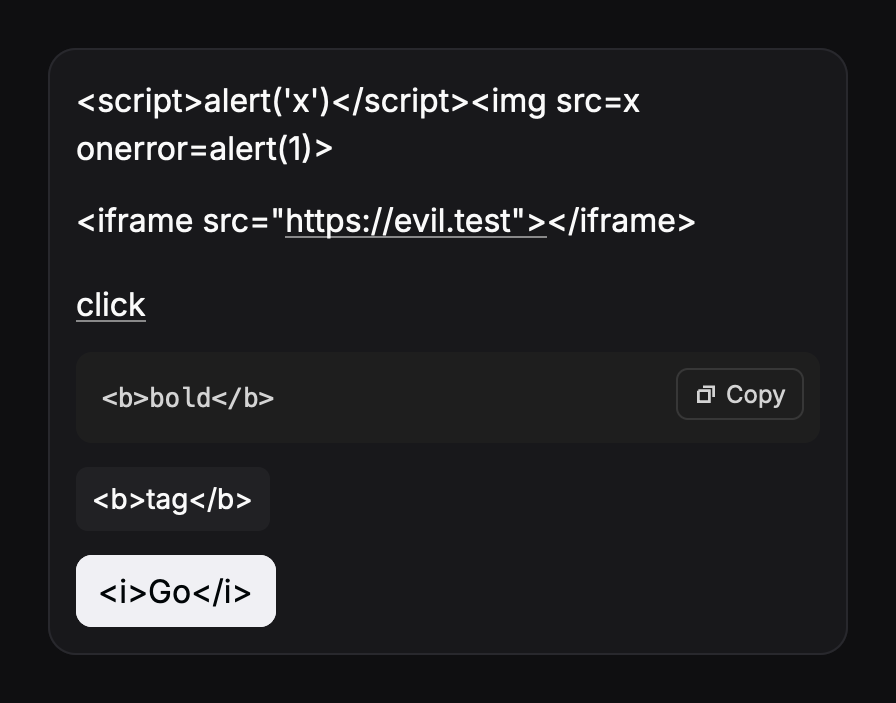

# gpui-chatwidgets

Draws AI agents' OpenUI cards natively in [GPUI](https://www.gpui.rs) apps, with
[gpui-core](../gpui-core)'s components.

[OpenUI](https://openui.com) is a small language an agent writes to answer with UI instead of
text: cards, tables, charts, forms and buttons. This crate reads an agent's program and draws it
as GPUI elements in your app's theme. Presses, form values and links come back to your app as
events; the crate itself sends nothing, opens nothing and fetches nothing.

Reads OpenUI Lang (openui.com, MIT, by Thesys). An independent port, not affiliated.



## What's in it

- **`gpui_chatwidgets::openui`**, the parser and the card model. It reads programs the way
  OpenUI's own parser (`@openuidev/lang-core` 1.1.0) does, and 43 golden files written by that
  parser check it (`tests/openui`, made by `tests/openui/golden.mjs`). It turns a program into a
  typed tree of components with their props defaulted, runs presses against the card's state
  (`$variables`, form fields) and words the message for the agent as the web does. It has no
  GPUI in it.
- **`CardView`**, the renderer: a GPUI entity that draws one card and keeps its state between
  frames (the chosen tab, an open section, the text in a field).

Every component of OpenUI's library is drawn: Stack and Card, Tabs, Accordion, Steps, Carousel,
Separator, Modal, CardHeader, TextContent, MarkDownRenderer, Callout and TextCallout, Image,
ImageBlock and ImageGallery, CodeBlock, InlineHeader, Table, EditableTable, the charts (bar,
horizontal bar, line, area, radar, pie and donut, whole or half, radial, single stacked bar,
scatter), Form with its controls (Input, TextArea, Select, DatePicker, Slider, CheckBoxGroup,
RadioGroup, SwitchGroup, Chips, OptionCards), Label, Button, Buttons and IconButton, TagBlock and
Tag, Icon, EntityList, ListBlock, the five card blocks, Text and BoldText, IconText, ImageText and
ImageTextLarge, and the metric indicators. A component the model doesn't know draws nothing.

Text fields and text areas are gpui-core's `Input` (in this workspace), with the platform's
input methods (on iOS, a tap raises the keyboard); the slider, an icon button's tooltip and the
date picker (one date or a range) are gpui-core's too, all drawn in the card's colours. Everything else is drawn with GPUI's own elements, everything pressable through gpui-core's `Press` so the
keyboard reaches it (Tab to move, Enter or Space to press) and shows a focus ring there.
Markdown goes through gpui-core's text view, so it can be selected and copied; a code block has
a Copy button.

| Charts | A form |
|---|---|
|  |  |

## Use it

It needs Rust 1.100 or newer, as the workspace does.

```toml
[dependencies]
gpui = { package = "gpui-pre", version = "=0.3.12" }
gpui-core = { git = "https://github.com/trevin-lee/gpui-essentials", rev = "<the same commit>" }
gpui-chatwidgets = { git = "https://github.com/trevin-lee/gpui-essentials", rev = "<a commit>" }
# The app's window. Without `font-kit`, GPUI draws no text on macOS.
gpui_platform = { package = "gpui-pre-platform", version = "=0.3.12", features = ["font-kit"] }
```

Pin a commit: until it's on crates.io, any commit can change the API. The crate pins GPUI
exactly (`gpui-pre` 0.3.12), so your app must use the same, or two GPUIs would be linked.

The crate drew with GPUI Kit until its date picker moved to gpui-core. An app built on GPUI Kit
0.9.1 links the same GPUI and hosts cards as before; the date picker takes the card's colours,
and only its sizes and corners come from gpui-core's `Theme` (see [Theme](#theme)).

The parser turns on `serde_json`'s `preserve_order` feature, so a program's properties keep
the order they were written in. Cargo unifies features across a build, so every crate in your
app that uses `serde_json` gets ordered maps too (an `IndexMap` in place of a `BTreeMap`).
Nothing should depend on the old sorted order, but if something does, that's why it changed.

### Only the parser

A crate that reads cards but doesn't draw them (a server, or the part of an app that isn't UI)
turns the renderer off and gets no GPUI at all:

```toml
gpui-chatwidgets = { git = "https://github.com/trevin-lee/gpui-essentials", rev = "<a commit>", default-features = false }
```

```rust
use gpui_chatwidgets::openui;

let program = openui::parse(r#"root = Stack([Button("Approve")])"#).unwrap();
let mut store = program.store();
let card = program.render(&store).unwrap();
let openui::Component::Stack(stack) = &card.root else { unreachable!() };
let openui::Component::Button(button) = &stack.children[0] else { unreachable!() };
let effects = program.act(&button.action, &button.label, None, &mut store);
assert_eq!(effects, [openui::Effect::Send("Approve".into())]);
```

### A host

The app around a card implements `CardHost`: the theme, images, icons, and where a press's
message or link goes. A card is made from the program's text with an id prefix of its own (a
message id), so several cards in one window don't collide.

```rust,no_run
use std::rc::Rc;

use gpui_chatwidgets::openui::{ImageSrc, Link};
use gpui::*;
use gpui_chatwidgets::{CardHost, CardTheme, CardView, ImageLoad, ImageReply};
use gpui_core::Theme;

struct Host;

impl CardHost for Host {
    fn theme(&self, _: &App) -> CardTheme {
        // Sizes are CSS pixels drawn as rems; gpui-core's Root makes the rem its theme's font
        // size (16 below).
        CardTheme { rem_base: 16., ..CardTheme::dark() }
    }

    fn send(&self, text: &str, _: &mut App) {
        // Send it to the agent as the user's message.
        println!("to the agent: {text}");
    }

    fn open_link(&self, link: &Link, _: &mut App) {
        // Always http or https; open it in the browser, after any check of your own.
        println!("open: {}", link.as_str());
    }

    fn image(&self, src: &ImageSrc, _: ImageReply, _: &mut App) -> ImageLoad {
        // Only images from your own server, by path; fetch them and hand over the bytes.
        match src.same_origin("https://my.app.example") {
            Some(_path) => ImageLoad::Pending, // later: reply.deliver(Some(image), cx)
            None => ImageLoad::Refused,        // the alt text shows instead
        }
    }
}

struct Chat {
    card: Entity<CardView>,
}

impl Render for Chat {
    fn render(&mut self, _: &mut Window, _: &mut Context<Self>) -> impl IntoElement {
        div().w(px(560.)).p(px(16.)).child(self.card.clone())
    }
}

fn main() {
    // An app that serves gpui-core's Lucide icons draws the cards' icons and the date picker's.
    gpui_platform::application().with_assets(gpui_core::Icons).run(|cx| {
        gpui_core::init(cx);
        // The window's rem (the cards draw in their own colours, whatever the theme's).
        Theme::set(Theme { font_size: px(16.), ..Theme::dark() }, cx);
        gpui_core::open_window(WindowOptions::default(), cx, |window, cx| {
            let host: Rc<dyn CardHost> = Rc::new(Host);
            let program = r#"root = Stack([TextContent("Ready to send?"), Button("Send it")])"#;
            let card = cx.new(|cx| CardView::new(program, "message-1", host, window, cx));
            cx.new(|_| Chat { card })
        })
        .unwrap();
    });
}
```

`CardView::new` never fails: a program it can't read draws "This card couldn't be shown." and
`CardView::error` says why. A host that would rather show the message's text checks
`openui::parse` first and makes the card with `CardView::from_program`.

### Theme

`CardTheme` carries every colour (text, lines, the recessed and raised fills, the accent for
primary buttons, the four tones for callouts and tags, the code block's colours, the chart
series), the font families, text sizes, corner radii and spacing. `CardTheme::dark()` and
`CardTheme::light()` are OpenUI's own look; change what your app's look says. Sizes are CSS
pixels and are drawn as `rems(size / rem_base)`, so a host that zooms by changing the window's
rem zooms its cards too. `frame` draws the card in a rounded, bordered box, as a chat bubble.

The text fields, the slider, tooltips and the date picker are gpui-core's, drawn in the card's
colours, so a light card in a dark app (or the other way round) needs no change to gpui-core's
global `Theme`:

| | From `CardTheme.colors` |
|---|---|
| A text field's edge | `line_strong`, `accent` while it has the focus, `danger.emphasis` when refused |
| Its fill | `sunk` on a dark card, none on a light one |
| Its text and caret | `text` |
| Its selection | `accent` at 30% |
| Its placeholder | `text_muted` |
| Its focus ring | `focus_ring`, also the ring around a button, tab, chip or choice focused from the keyboard |
| The slider's track, fill and thumb | `line_strong`, `accent`, `background` with an `accent` edge |
| The slider's keyboard focus ring | `focus_ring` |
| An icon button's tooltip | `popover`, with `text`, a `line_strong` edge and the `body` font |
| A date field's edge, fill, text and focus ring | as a text field's: `line_strong`, `sunk` on a dark card (none on a light one), `text`, `focus_ring` (also its edge while focused from the keyboard, where the web's is `accent`: gpui-core has no separate colour for it yet) |
| Its placeholder and calendar icon | `text_muted` |
| Its month | `popover`, with `text` and a `line_strong` edge |
| A picked day, a range's ends | `accent` with `on_accent` |
| The days between a range's ends | `accent` at 4% (the web's `--openui-highlight`) |
| A day under the pointer, today, the keyboard's day | `highlight`, `accent`, a `focus_ring` edge |
| Days outside the month, the weekdays | `text_muted` |
| Markdown's text and links | `text` |
| Its list markers and an image's alt text | `text_muted` |
| Its rules, quote bars and table lines | `line` |
| Its table's header labels, and every other body row | `text_muted`, `highlight` |
| Its selection | `accent` at 30% |
| Its inline code | `sunk` behind the `body` font in a `line` edge, as the web's |
| A code block | `sunk`, with a `line` edge and the `mono` font |

gpui-core sets itself up when its first Root, text field or date picker is made, so a host
needn't call `gpui_core::init`. Its `Theme` (dark until a host sets it) no longer colours
anything in a card; it still gives the date picker its text size and corners.

A date field stores "YYYY-MM-DD", and a range `{"from": …, "to": …}` (`to` is null until the
second day is picked). The picker shows what's stored when it's made and after a press resets
the field. From the keyboard, Tab reaches it, Enter or Space opens the month, the arrows move
a day or a week, Page Up and Page Down a month, Enter or Space picks and Escape closes.

Markdown is laid out as OpenUI's web renderer lays it out (`markDownRenderer.css` over
Tailwind's reset, measured in Chromium), in CSS pixels whatever the text's size:

| | The web's | Here |
|---|---|---|
| Paragraphs | 18px apart (`p:has(+p)`) | the same |
| Headings, every level | heading-xs: 600 16px/1.25 | semibold at `text.md`, 1.25 tall |
| Above a heading | nothing after a paragraph (the reset's margin, which OpenUI keeps), else the block above's margin | 18px after a paragraph, else the same |
| Below a heading | 8px before a paragraph, 18px before anything else | the same |
| Before a list | 8px after a paragraph in TextContent (`p:has(+ul)`), nothing in MarkDownRenderer | 8px |
| After a list | 24px (`ul`), 20px (`ol`) | the same |
| Around a table | 20px after it, nothing after a paragraph | 20px after it, 18px after a paragraph |
| Around a quote or a rule | 25px, 48px (`blockquote`, `hr`) | the same, a rule's line in the middle of its own line's height |
| Around a code block | nothing (`margin: 0 !important`) | 18px |
| Lists | markers outside a 20px padding, a space (0.27em) before the text, items 8px apart | the same |
| Inline code | the body's font and size on `sunk`, padding 2px 4px, a 1px `border-default` edge, 4px corners: 26px tall | the same; 24px tall in a paragraph's first and last line, where gpui-core clips a paragraph to its lines |
| A table | radius-2xl (14px) corners, a 1px line, no header fill, muted regular header labels, 12px cell padding, every other body row at `highlight-subtle`, 14px text | `radii.xl` corners, a `line` edge, no header fill, `text_muted` regular header labels, 12px cell padding, every other body row at `highlight`, the body's size |

### Hooks and events

| `CardHost` | When |
|---|---|
| `theme` | Every draw. Call `CardView::refresh` when it changes. |
| `send(text)` | A press that reaches the agent (`@ToAssistant`, or a button with no action). The text is the press's words, then any context and the form's values as JSON, as OpenUI's web renderer writes it. |
| `open_link(link)` | `@OpenUrl`, or a link in Markdown: only http and https, never with a user name or password. |
| `image(src, reply)` | Once per image reference. Return the bytes, `Pending` (then `reply.deliver`), or `Refused`. |
| `icon(name)` | A Lucide icon name; return an SVG asset path. `lucide_icon` finds one in gpui-core's Lucide set, which its `Icons` asset source serves. |
| `scroller(selector)` | Each region that scrolls sideways or clips its own text, for a host's overflow test. |
| `changed(store)` | The card's state changed; keep `CardView::store` to restore it later with `with_store`. |

The same presses and changes are also `CardEvent`s (`Send`, `Open`, `Changed`) for anything
subscribed to the card. Every host call comes after the card's own update has finished, so a host
may update the card from inside one.

## Streaming

`StreamingMarkdown` draws an agent's reply in Markdown as it's written, a few words at a time,
the way a chat server's draft of a reply streams in. The host makes one when a draft starts and
feeds it the text; the crate never touches the network.

```rust,ignore
// A draft at the chat's foot, drawn with the style the host draws its finished replies with.
let draft = cx.new(|_| {
    StreamingMarkdown::new(format!("draft-{id}"))
        .style(reply_style())
        .selectable(true)
        .on_link_click(|url, _, _, _| open_if_web_address(url))
});

draft.update(cx, |d, cx| d.append("Paris in May", cx));   // a delta: Markdown cut anywhere
draft.update(cx, |d, cx| d.replace(&whole_so_far, cx));    // the whole draft so far
draft.update(cx, |d, cx| d.end(cx));                       // finished: the caret goes
draft.update(cx, |d, cx| d.finish(&message_body, cx));     // its message's text, in place
```

| | |
|---|---|
| `StreamingMarkdown::new(id) -> StreamingMarkdown` | An empty draft, being written, showing only the caret. `id` prefixes its element ids. |
| `.style(TextViewStyle)`, `.selectable(bool)`, `.on_link_click(f)` | As gpui-core's `TextView`'s. The text's colour, size, line height and font come from around it, as a TextView's do. |
| `append(&mut self, text: &str, cx)` | Adds a delta. |
| `replace(&mut self, text: &str, cx)` | The whole draft so far, in place of what it had. What the two share stays laid out. |
| `end(&mut self, cx)` | The draft is finished: the caret goes and the text stays, read as written. |
| `finish(&mut self, text: &str, cx)` | Ends it with its message's text, which may differ (below). |
| `set_style(&mut self, TextViewStyle, cx)` | A new style, after a theme change. |
| `text(&self) -> &str`, `is_writing(&self) -> bool` | The text so far; whether it's still being written. |

`append` and `replace` after `end` or `finish` are ignored. A draft that's dropped (the person
pressed Stop) is simply a view the host stops drawing.

### Wiring it to a chat's events

For a server that sends a reply's words as `delta` events with a draft id, as the owner's chat
server does (`{id, text}`, `{id, text, whole: true}`, `{id, end: "message" | "drop"}`, then the
message with `stream: id`):

| Event | The host |
|---|---|
| `{id, text}` | Makes the draft at the chat's foot if there's none for `id`, then `append(text)`. |
| `{id, text, whole: true}` | `replace(text)` (making the draft first if need be): a reconnect mid-reply. |
| `{id, end: "message"}` | `end()`. Keeps drawing the draft until its message comes. |
| `{id, end: "drop"}` | Stops drawing the draft. |
| The message with `stream: id`, in Markdown | `finish(body)`, and draws the draft's entity as that message's text from then on, where it was. |
| The message with `stream: id` and a card (`ui`) | Draws the message's `CardView` where the draft was, in the same frame as it stops drawing the draft. A card is drawn whole in its first frame. |
| A `delta` for an id whose message came | Ignored. |

A host that transforms a reply's text before drawing it (escaping dollar signs, say) calls
`replace` with the transformed text so far instead of `append`: only what changed is read again.
A chat list that measures its rows observes the draft (`cx.observe`) and measures it again when
it draws again.

### What it draws while the text comes

Each block of the Markdown (a paragraph, a heading, a list, a code block, a table, a quote) is a
gpui-core `TextView` of its own, spaced as one TextView spaces the same blocks (the style's
`block_gap`, a heading's margins, the paragraph gap). A block settles when the line after it is
whole and can't carry it on or change what it is: a paragraph after a blank line or a block that
interrupts it, a list after something that isn't its next item, a fence once it's closed and the
next line has come. From then on it's laid out once and kept: its text and style don't change,
so gpui-core's layout cache holds. On each delta only the open last block is read and laid out
again, once a frame however many deltas came in it. (The one exception is a block far off screen,
below.)

In the open block:

- **A steady caret** (`StreamingMarkdown::CARET`, ▍, in the text's colour) at the end of the
  text, wrapping with the last word. It doesn't blink or fade: nothing draws while no text
  comes, and nothing draws after the draft ends.
- **Emphasis, strikethrough and inline code open on the last line are closed for now**, after
  the caret: `**bold` draws bold, and the rest of the text never flips bold and back. A marker
  with nothing after it yet isn't drawn.
- **A link being written draws as its words**, without its brackets or address, until it's
  whole: `[the docs](https://exa` draws `the docs`.
- **An open code fence draws as code**, with nothing inside closed or read as Markdown.
- **A line of only Markdown marks waits for its words or its newline** (`1.`, `#`, `---`, a
  fence's backticks), so a paragraph doesn't flash as a heading and back, and **a table's first
  row waits for its delimiter row**, so it doesn't show as text first.

**The height only grows while the draft is written**: should the open block lay out shorter for
a moment (a caret's line turning into a heading), the space it had is kept until the next text
fills it. At a new width the tallest so far starts again.

### When it ends

- **`end`, or `finish` with the same text: nothing moves.** Every block stays where it was, laid
  out as it was; the caret goes from the last line.
- **`finish` with other text: what the two share stays.** The blocks before the first difference
  (and the line after each, which settling it read) keep their places and layouts; the rest is
  read and laid out again. A reply split into several messages ends its draft with the first,
  which is shorter: the draft becomes that message, the blocks before the cut are where they
  were, and the draft is shorter by what follows in the next messages. Its height can shrink
  only here, and by any space kept while it was written.
- **A reference-style link** (`[docs]` with `[docs]: https://…` further down) reads as text
  while it streams, as the definition hasn't come yet; a draft whose text defines one is read
  again whole when it ends, as one view.

### Settling

**Settling is linear in the text, and bounded a frame.** Each new line is read once, into what
the open block is so far (a code fence and its marker, a list and its item's indent, a quote, a
table, a paragraph, after a blank line or not), and only a line that could end the open block is
checked, by reading the block alone and with the line: never the inside of a code fence, a
list's next item or a line inside it, a quote's next line or a paragraph's next line of words.
It settles exactly where checking every line would. A frame's settling reads at most 1 MiB of new
text, and the checks read at most 16 KiB of open blocks again (or a single check, if one is
more); what's left carries on in the next frame. A 50,000-line code block (394 KB) settles in
about 1 ms in one append, in under 10 ms over 50,000 appends of a line each (no frame over
0.15 ms), and through `replace` with no frame over 2 ms; checked at every line, as settling was
before, 4,000 lines took 17 s, growing faster than their square. `tests/stream_performance.rs`
holds it to 5 ms a frame, 1 ms a line and 60 ms for the lines (four times that on CI).

### Cost

Per delta (the text added, the blocks worked out, and the window laid out and painted), with Core
Text laying the text out, in a release build on an Apple-silicon Mac, streaming
`examples/replies/long.md` (10,300 characters) four characters a delta, 560 pixels wide, in a
chat 900 pixels tall that follows the reply's end (medians of three runs):

| Into the reply | Streaming | One TextView of the whole text, for comparison |
|---|---|---|
| 1,000 characters | 0.48 ms | 0.76 ms |
| 5,000 characters | 0.79 ms | 3.13 ms |
| 10,000 characters | 1.07 ms | 6.91 ms |

What's left of the growth is the open block (at 10,000 characters it's a long list, at 1,000 a
short paragraph) and the blocks' places in the window's layout. While the draft is written, a
settled block far off screen (a chat's height or more away, as the start of a long reply is once
the chat has followed its end) is drawn as the space it took, not built and measured each frame;
one that comes back near the screen is drawn as text again from the next frame, and every block
is text again when the draft ends, each where its space was. A block that's off screen but near
it is laid out but not painted.

`tests/stream_performance.rs` measures it, and fails if a delta at 10,000 characters costs more
than three times one at 1,000 (plus half a millisecond), or more than 4 ms, in a release build.
It prints a whole TextView read again each delta alongside, for comparison. CI runs it in release.

### Limits

- **Selection stays within a block**: a paragraph, a list or a code block can be selected and
  copied, but a selection doesn't reach across two blocks, as each is its own TextView.
- **One long block is laid out whole on each delta**: a list or a table that goes on for pages
  without a blank line, or a long code block, is one block until it ends, so a delta inside it
  costs what laying out that block costs.
- **A block kept as space while the draft is written loses its state**: a selection in a block
  the chat has scrolled far past goes, and the block is read and laid out again (once) when it
  comes back near the screen or the draft ends.
- gpui-core's TextView's limits apply to each block (512 KB of text, 32 levels of nesting).
- `examples/stream.rs` replays the long reply at a model's pace (`--cps`, `--delta`), then a
  short one whose message brings a card; `--shots <dir>` saves a picture mid-stream and one at the
  end from a window that's never shown.

## iOS

The renderer builds for iOS (`aarch64-apple-ios`, `aarch64-apple-ios-sim`) with no change to
your dependencies: the crate pulls in no platform there, and your app hands GPUI its iOS platform
itself (`Application::with_platform(gpui_pre_ios::current_platform(false))`, from `gpui-pre-ios`
0.3.12, the same GPUI snapshot). CI builds it for the simulator. `tests/touch.rs` drives cards
with real touch events on macOS, with the touch settings forced, through the same recognizer.

GPUI turns touches into what a card already listens to: a tap is a mouse press and release, and
a pan is scroll events locked to the way it started, with momentum after a flick. So on iOS:

- **Every control the crate draws can be hit across 44 points each way**, Apple's minimum
  touch target. A smaller one (a carousel's arrows, a modal's close, a small button, a chip, a
  checkbox row) also takes taps in an invisible area centred on it that's at least 44 points
  each way along its whole length (gpui-core's `Press::min_hit`), so it looks and lays out as
  on the Mac.
- **A tap that only changes the card's view or picks a value leaves the focus alone**: a tab,
  a carousel arrow, an accordion section, Copy, a chip, a check box, radio or switch row and an
  option card. The chat's text field keeps the focus (and the keyboard stays up); Tab and
  Enter or Space still reach them. Buttons, the select, table cells and a modal's close take
  the focus as before.
- **Sideways scrolling follows the finger.** A wide table or a code block moves with a sideways
  pan and keeps it from the chat; an up-and-down pan over it scrolls the chat instead.
- **A carousel turns with a swipe.** The slide follows the finger and turns past 40 points, or
  eases back; the arrows still work. A swipe that starts on a wide table in a slide scrolls the
  table first.
- **Nothing needs hover.** GPUI drops hover styles after a touch, and they only ever shade what
  can also be tapped. An icon button's name, a tooltip on the Mac, shows on a long press.
- **Text fields** focus on a tap and raise the keyboard: they're gpui-core's, whose input
  handler GPUI's iOS backend shows the keyboard for, with the platform's input methods. An
  email, link or number field asks for no capitals, corrections or suggestions. The slider
  follows a finger's drag and is 44 points tall on touch.

The 44-point targets and the sideways-only scrolling come from the theme, which defaults by
platform:

```rust
use gpui_chatwidgets::CardTheme;

// On iOS and Android: min_hit 44 and touch on. Elsewhere: 0 and off.
let theme = CardTheme::dark();
// Forced either way, say for an iPad with a trackpad, or a test on the Mac.
let theme = CardTheme::dark().with_touch(true);
// Or each on its own: min_hit is in points (it doesn't zoom with rem_base).
let theme = CardTheme { min_hit: 48., touch: true, ..CardTheme::dark() };
```

Known gaps:

- Where two small controls sit closer than 44 points (icon buttons in a tight row), the one drawn
  later takes the strip between them.
- A select's options and an editable table's cells touch each other, so they take taps only
  where they're drawn: a larger area would take the edge of the one above or below.
- The date picker's field and days have gpui-core's sizes (36 CSS pixels), not `min_hit`.
- GPUI's text input has no keyboard type yet, so an email or number field shows the ordinary
  keyboard (without capitals or corrections). Keeping a focused field above the keyboard is the host's: GPUI reports the
  keyboard's height in the window's insets.
- The gallery example is a desktop app: on iOS it builds but doesn't run.

## Security

Every string in a card comes from an agent, and an agent's context can be injected, so the crate
treats it as hostile.

- **No network, no files, no commands.** Images are only ever asked of the host, by the reference
  the card wrote (`ImageSrc`); with no answer the alt text shows. Markdown images become their
  alt text and HTML is shown as the characters it is. Links and messages are handed to the host,
  never opened or sent.
- **Limits on reading:** 256 KB of program, 64 levels of recursion (what fits a 512 KB stack in a
  debug build), 20 levels of components, 2,000 components, 200 children per list, 500 rows and 24
  columns per table, 1,000 points and 24 series per chart, 20,000 characters per text and a million
  in all, and two million steps of work. Past these a card fails with a `CardError`, or a list is
  cut short. A test checks that the deepest cards fit a 512 KB stack.
- **Limits on drawing** (`Limits`, changeable with `CardView::with_limits`): 200 table rows, 100
  editable rows, 400 points and 12 series per chart, 24 gallery images, 100 items in a list or tag
  block, 20,000 characters of code. Past these a note says what was left out.
- **Never a panic:** the parser's tests and `tests/hostile.rs` feed random, cut-off and spliced
  programs, draw them at three widths and press them at random.

## How it behaves

- Nothing draws while nothing changes: no timers and no frames while a card is still. The only
  timer is a toast's (a Callout bound to a `$variable` hides itself after three seconds, as on
  the web), and it runs once.
- Motion is eased over real frames and stops: an accordion's chevron turns and its content fades
  in, and a carousel's slide moves in from the side it came from.
- No text runs out of its box at any width: text wraps, one-line text ends in an ellipsis, and
  wide tables and code scroll sideways. `tests/overflow.rs` lays every golden program out with
  Core Text, as written and with the worst text added to every label (a word with nowhere to
  break, a 300-character address, Japanese, Arabic and emoji), at 280, 400, 720 and 736 pixels,
  and fails on any glyph drawn past its clip, its card or the window.

## The gallery

```sh
cargo run --release --example gallery
cargo run --release --features shots --example gallery -- --shots docs
```

The gallery shows every golden program, with light and dark and four widths, and logs what each
card hands its host. With `--shots` it draws these pictures from a window that's never shown.

| Light, 400 wide | Pies, donuts and rings |
|---|---|
|  |  |

| Lines, areas, radar | A scatter plot |
|---|---|
|  |  |

| Text, callouts, code | Tabs and accordion |
|---|---|
|  |  |

| A table | An editable table |
|---|---|
|  |  |

| Card blocks | Lists and entities |
|---|---|
|  |  |

| A form after Submit | A modal |
|---|---|
|  |  |

| The worst text, 280 wide | Hostile text |
|---|---|
|  |  |

## License

Apache-2.0. See [LICENSE](../LICENSE) and [NOTICE](../NOTICE), which credits OpenUI (MIT) and Inter
(OFL), bundled with the example.
