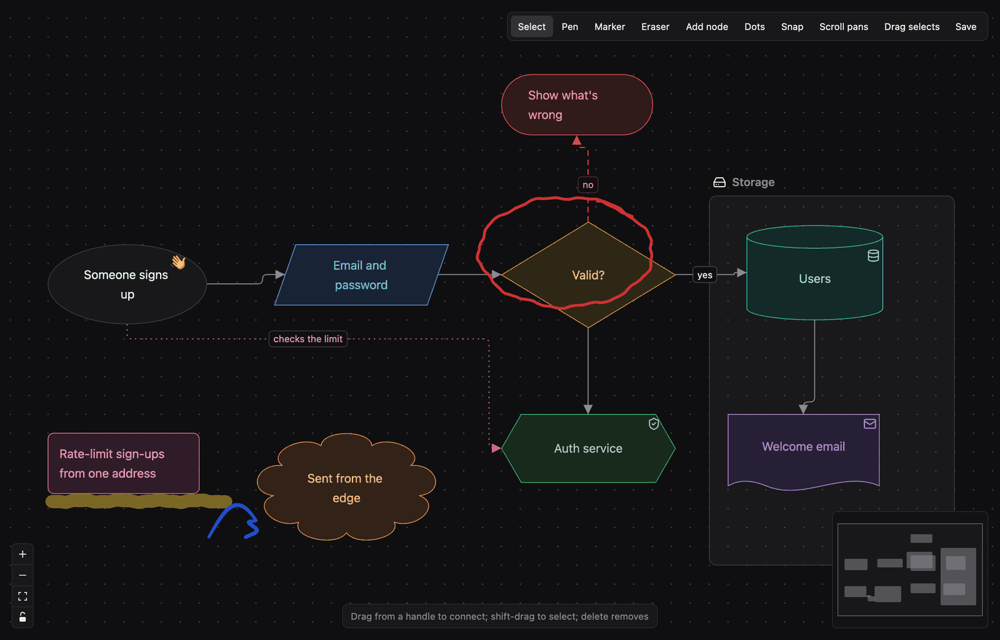

# gpui-flow

A node-and-edge editor for [GPUI](https://www.gpui.rs) apps in the manner of
[React Flow](https://reactflow.dev): a library, and an example window with one of everything.
It's young: the API can change between commits, so pin one.



## Use it

It needs Rust 1.100 or newer. It uses GPUI as `gpui-pre = "=0.3.12"` and takes its colours
from gpui-core's theme, so your app must use the same GPUI, or two would be linked:

```toml
[dependencies]
gpui = { package = "gpui-pre", version = "=0.3.12" }
gpui-core = { git = "https://github.com/trevin-lee/gpui-essentials", rev = "<a commit>" }
gpui-flow = { git = "https://github.com/trevin-lee/gpui-essentials", rev = "<a commit>" }
```

Call `gpui_core::init(cx)` and then `gpui_flow::init(cx)` once at startup. A `Flow` is an
entity; put it in a view like any other:

```rust,no_run
use gpui::*;
use gpui_core::Theme;
use gpui_flow::{Edge, Flow, FlowBackground, Node, xy};

struct Canvas {
    flow: Entity<Flow>,
}

impl Render for Canvas {
    fn render(&mut self, _: &mut Window, _: &mut Context<Self>) -> impl IntoElement {
        div().size_full().child(self.flow.clone())
    }
}

fn run(cx: &mut App) {
    gpui_core::init(cx);
    gpui_flow::init(cx);
    Theme::set(Theme::dark(), cx);
    gpui_core::open_window(WindowOptions::default(), cx, |_, cx| {
        let flow = cx.new(|cx| {
            Flow::new(cx)
                .with_nodes(vec![
                    Node::new("a", xy(0., 0.)).kind("input").label("Start"),
                    Node::new("b", xy(100., 120.)).label("Then"),
                ])
                .with_edges(vec![Edge::new("a-b", "a", "b")])
                .with_background(FlowBackground::dots())
                .with_controls()
                .with_minimap()
                .fit_view_on_start()
        });
        cx.new(|_| Canvas { flow })
    })
    .unwrap();
}
```

The app serves gpui-core's icons: `gpui_platform::application().with_assets(gpui_core::Icons)`.

Run the example from the repository's root, which opens a window with one of everything:

```sh
cargo run --release -p gpui-flow --example flow                 # the canvas
cargo run --release -p gpui-flow --example flow -- --whiteboard # shapes and ink, as above
cargo run --release -p gpui-flow --features shots --example flow -- --shot out.png --whiteboard
```

The last one draws the window offscreen into a PNG without showing it, as the picture above was
made.

## How it works

- **What it is.** A `Flow` is a GPUI entity that holds nodes, edges and a viewport, and emits
  events. It carries React Flow's pieces under their names: the `default`, `input`, `output`
  and `group` node kinds and the host's own; handles; bezier, simple bezier, straight, step and
  smooth step edges (the same routes, ported, up to 12.12.1's corner fix) with labels,
  arrowheads, colors and animation; the dotted, lined or crossed background; the controls; the
  minimap; panels.
- **React Flow's behaviour, checked against its source.** The defaults are React Flow's (zoom
  limits, grid, connection radius in flow units, wheel and scroll speeds, fit padding,
  `setCenter` zooming to the largest), except two kept for speed: nodes off screen aren't
  drawn, and nodes too small to read are drawn as boxes. So are its rules: a plain click on a
  selected node keeps the selection and ⌘ adds or takes away; shift-drag draws a rectangle
  even from a node, and takes the edges of any node it takes; a dragged connection snaps to a
  handle under the pointer, else the nearest in reach, preferring the other kind; grid snapping
  is in the flow, not the parent; `extent` holds on load as well as in a drag; a child is
  always drawn above its parent, selected nodes above the rest, and an edge to a child at that
  child's level (so above the group it's in); an edge whose handle doesn't exist isn't drawn;
  delete takes the children that may go, and leaves one that may not where it is.
- **React Flow's JSON.** A flow saves and loads as React Flow's own `toObject()` JSON:
  camelCase fields, `parentId`, `extent` (`"parent"` or a box), `zIndex`, handles, markers,
  `style.stroke` and `strokeWidth`, custom edge types by name (drawn as bezier), and any field
  it doesn't read kept as it was, so a file comes back without loss.
- **A stored form.** For an app or a server to store, `Flow::document()` gives a versioned
  `json::Document` (`"format": "gpui-flow"`, version 1): the nodes, edges and frames with ids
  that never change, the layout (a mind map's direction), and every field it doesn't know
  kept. Nothing selected is stored, and `Flow::set_document()` keeps the selection. New ids are
  random, so two editors adding at once don't clash. [docs/json.md](docs/json.md) has every
  field.
- **Ink.** A stroke drawn with a pen or the Pencil is an `ink` node holding the iPad's Notes
  payload as is (`tool`, `#RRGGBBAA` colour, width, base64 points with pressure and tilt, and
  a transform), so the same strokes show on iPad and Mac (`ink::InkStroke`, `Node::ink`).
  Strokes are drawn with their width at each point, smoothed, take a press only on their ink,
  and move by their transform, never their points.
- **A pen and an eraser** on the Mac (`Flow::set_tool`: `Tool::Pen(Pen)`, `Tool::Eraser`).
  With a pen, a drag anywhere draws, smoothed and thinned when the button comes up, in a
  palette colour (`Pen::palette`) or any `#RRGGBBAA`, at any width, as a pen, marker or the
  other PencilKit tools; the stroke is one edit. The eraser rubs out every stroke it passes
  over, as one edit, and escape puts back what it took. The example's toolbar has them, and
  `--scene draw` takes a picture of them in use.
- **Limits.** `limits::Limits` checks a document or a batch against what Docs stores (10,000
  nodes, 20,000 edges, 10,000-character texts, frames 16 deep, …), and
  `tests/fixtures/limits` has the cases a server tests against too, with the exact problem
  each gives.
- **Edits as operations.** Each settled edit is sent as one batch (`FlowEvent::Edits`) of
  `addNode`, `patchNode`, `removeNode` and the same for edges, by id, a patch holding only the
  fields that changed (a JSON merge patch). A drag of many nodes is one batch, at its end.
  `Flow::apply()` takes batches from elsewhere without sending them back or losing the
  selection, so a server can merge an agent's edits with the owner's.
- **Undo and redo** (⌘Z, ⇧⌘Z, `Flow::undo`, `Flow::redo`) step over those batches: a drag
  of many nodes, a deletion with its edges, or whatever one update changed, is one step.
  Taking an edit back puts back only the fields it changed and is sent as an edit too; edits
  from elsewhere aren't in the history, and a step whose nodes have since gone is passed over.
- **Copy, cut, paste and duplicate** (⌘C, ⌘X, ⌘V, ⌘D; `Flow::copy_selected`, `cut_selected`,
  `paste`, `duplicate_selected`). A copy is the selected nodes as a document of their own
  (`Flow::selection_document`): what's inside a selected frame or group, in a tree what's
  under a selected node, and the edges between them; a node copied without its parent comes
  out where it is in the flow. It goes on the clipboard as gpui-flow's JSON text, so it pastes
  into another flow, or another app's. A paste or a duplicate gets new ids throughout (what
  pointed at an old one points at its new one), lands 20 points along (each paste of the same
  copy further on; a cut's first paste where it was; one that would land out of view in the
  middle of the view), is selected, and is one edit, so one undo step. Ink keeps its stroke
  with it. In a mind map a paste goes under the one selected node, and a duplicate is its
  original's next sibling. ⌘D leaves the clipboard alone. Clipboard text that isn't a flow,
  and a key with nothing selected, go on to the host. `Flow::insert_document` adds any
  document the same way.
- **With the mouse and keys.** Drag the pane to pan; scroll or pinch to zoom about the pointer;
  drag a node, or all that are selected; ⌘-click to add or take away; shift-drag for a
  rectangle; drag from a handle to another (either direction) to connect, or click (tap) one and
  then the other (`connect_on_click`, as React Flow's; the first is drawn in the selection's
  colour until then, and the same handle again, the pane or escape lets it go); drag an edge's
  end to another handle to move it there, the other end staying put (`edges_reconnectable`,
  `Reconnect` with the edge as it was and is); a node or a
  connection dragged to within 40 points of the pane's edge moves the view that way, faster the
  nearer the edge (`auto_pan_on_node_drag`, `auto_pan_on_connect`, `auto_pan_speed`, as React
  Flow's); click an edge to select it; delete, ⌘A, escape (which also puts back a drag, resize, pan or rectangle), the
  arrows (shift for four steps), ⌘+, ⌘−, ⌘0, ⇧1 to fit. The keys sit on a layer of their own
  beside the nodes, so they only act while the flow itself has the focus, never while a text
  field in a node or panel does, and a key with nothing to do goes on to the host.
- **Inside a node.** A child that takes the focus when pressed (a text field) owns that press:
  the node isn't selected or dragged, and the field keeps the focus. Others are marked as React
  Flow marks them: `nodrag` for buttons and sliders, `nowheel` for lists that scroll.
  Renderers get the `&Flow` to read (the entity is busy while it draws).
- **Events a host can follow.** The events say what someone did: connect (with where a
  dropped connection ended, for "drop on the pane to add a node"), clicks, drag start, move
  and stop (escape included), arrow-key moves, resize start, move and end, delete (once, and
  a host check can refuse it), and the selection and viewport whatever changed them,
  transitions included. Changes made through the flow's methods aren't reported back.
- **A view over the canvas.** A host can lay a native view of its own over the canvas, such
  as a PencilKit canvas for drawing on a mind map with a pencil, and keep it lined up.
  `with_transform_listener` hands over the canvas's `CanvasTransform` (the pane's bounds in the
  window, and the pan and zoom) on the first frame and on every frame it changes, including
  each step of an animated zoom and the pane moving in the window. It's called while that
  frame is drawn, so the view moves in the same frame as the canvas. `canvas_transform()`
  reads it at any time. `set_pointer_mode` says who takes the pointer:
  - `Edit`, the usual;
  - `Navigate`: a drag anywhere only pans, and scrolling and pinching zoom, so fingers move
    the canvas while the pen draws;
  - `Off`: the canvas takes no presses, scrolling or pinches at all.
- **Touch.** On iPhone and iPad, GPUI turns fingers into gestures and the flow takes them as
  React Flow does on a touchscreen, with Apple's sizes.
  - A finger on a node drags it, and a tap selects it; two taps make a double tap.
  - A finger on a handle drags out a connection, and one on a resizer's grip resizes.
  - Anywhere else a finger pans, in any direction, and a tap on an edge selects it.
  - Held still for half a second, a finger asks for a context menu (`FlowEvent::ContextMenu`,
    for a node, an edge or the pane, as a right click does on a Mac). The host shows the
    menu.
  - Handles and grips take a finger from a 44-point area (`touch_target_size`) that grows
    outward but not into the node, and edges take one from 22 points away.
  - A `nodrag` child, such as a button, gets an ordinary tap.
  - GPUI doesn't recognise a two-finger pinch on iOS yet, so the host recognises it natively
    and calls `zoom_by` (or dispatches `PinchEvent`s).
- **Mind maps.** With `layout: Layout::Tree(TreeLayout { .. })` a flow is a mind map. Its
  tree is read from the edges: a node's parent is the source of the first edge into it, so
  a mind map saves and loads as any flow does.
  - **Layout.** Roots stay where they're put. Everything under them is laid out from the
    nodes' sizes: to the right, downward, or to both sides of the root (`TreeDirection`),
    with siblings in edge order.
  - **Motion.** Nodes ease to their new places, and nothing redraws once they're there.
  - **Edges** join the sides of the boxes.
  - **Chips.** A chip on each parent folds its subtree away, showing a count, or shows it
    again (`Node::collapsed`, `FlowEvent::NodeCollapse`).
  - **Tab** adds a child to the selected node and **enter** a sibling after it. The new
    node is selected, and `FlowEvent::NodeAdd` tells the host to start editing it
    (`with_new_node` makes nodes your way).
  - **Arrows** move the selection to the nearest node that way.
  - **Moving.** A node dropped on another becomes its child, with the target outlined
    while you aim (`FlowEvent::NodeReparent`). Dropped on nothing, it goes back.
  - **Delete** takes a node's subtree and selects its parent.
  - **Topics.** The built-in `topic` kind is a label without handles, larger for a root.
  - The example has one: `--mindmap`.
- **Links.** A node can link to something of the host's by id (`Node::link`, saved as
  `"link"`), such as a document in Docs. The built-in kinds then show a small ↗ button
  after their label, and `NodeContext::link_button()` puts the same button into a kind of
  your own. Pressing it, or ⌘↩ with the node selected, sends `FlowEvent::OpenLink`. The
  host decides what the id means and opens it; the flow never opens or follows anything
  itself, so a hostile file can't make it.
- **Whiteboard nodes.** The built-in `shape` kind (`Node::shape`) draws a node as one of nine
  outlines: rectangle, pill (`rounded`), ellipse, diamond, hexagon, cylinder,
  parallelogram, document and cloud. The geometry lives in `shapes`: each outline, the area
  its text may use, where edges meet it, and where its badge goes, so anything that draws a
  flow draws the same shape.
  - **Colours.** Any built-in node can take a colour from the flow's palette by name
    (`Node::color`: red, orange, yellow, green, teal, blue, purple or pink, as in subcanvas).
    Its stroke is the pencil, its fill the pencil mixed into the pane, and its text a shade
    that reads on that fill. Hosts give their theme's palette through `FlowColors::palette`.
  - **Badges.** Nodes take a Lucide icon (`Node::icon`, drawn with gpui-core's bundled icons,
    so serve `gpui_core::Icons` as assets) and an emoji, shown as badges.
  - **Alignment** comes from `Node::text_align` (`LabelAlign`, as GPUI has its own
    `TextAlign`).
  - **Handles.** A shape has a handle of each kind on every side, named `top`, `right`,
    `bottom` and `left`, on its visible edge. They're drawn only while it's selected, and a
    finger takes them only then. The mouse can drag a connection from them at any time.
  - The example draws a whiteboard with `--whiteboard`.
- **Frames.** The built-in `frame` kind is an area under a title that holds other nodes
  (their `parent`) and moves them together.
  - **Pressing.** It's taken by its title and a band along its border. A press or a finger
    inside it is the pane's: it pans, or draws a selection rectangle round what's inside.
  - **Drawing order.** Frames are drawn a level below other nodes, so a node they're over
    can still be pressed.
  - **Membership.** A node dropped wholly inside a frame joins it, and one dragged wholly
    out leaves. A frame dropped over loose nodes takes in those wholly inside it. Each change
    sends `FlowEvent::NodeParentChange`, and positions stay where they are in the flow.
  - **⌘G** frames the selection (`Flow::frame_selection`), and **⇧⌘G** takes the selected
    frames away and keeps what was in them (`Flow::unframe`).
  - Frames take a palette colour, an icon and an emoji like any node, and resize by their
    corners while selected.
- **Edges on a whiteboard.**
  - **Routing.** With `FlowOptions::avoid_nodes`, step and smooth-step edges go round the
    nodes in their way: a right-angled route over a grid of the obstacles' sides, with each
    turn costing extra (`routing`). Only nodes near the edge count, past 40 it doesn't try,
    and a route is worked out again only when its ends or a node near it move. Frames and
    groups aren't obstacles, since edges run inside them.
  - **Lines** can be solid, dashed or dotted (`Edge::dash`, saved in React Flow's
    `style.strokeDasharray`). They take a palette colour by name (`Edge::pencil`, saved as
    subcanvas's `color`) for the line, its arrowheads and its label, and arrowheads go at
    either end, both or neither (`Edge::arrows`). An arrowhead grows with a line wider than 1
    (three times as long on a line 3 wide), as React Flow's `markerUnits="strokeWidth"`, so a
    thick line's isn't lost in it; on a thinner line it stays its size.
  - **Labels** wrap at 180 units, keep to four lines with an ellipsis after, and sit on a
    small bordered patch.
  - `Flow::edge_line` and `Flow::edge_label_point` say where an edge and its label were
    last drawn.
- **Lining up.** With `FlowOptions::alignment_guides`, dragged nodes line up with the edges
  and middles of the nodes near them, within a few points (`guide_reach`), and guide lines
  show what with (`Flow::alignment_guides`). It's off by default, as in React Flow.
  `Flow::align_selected` lines the selection up by its left, centre, right, top, middle or
  bottom; `distribute_selected` spaces it evenly across or down. Both work by where nodes are
  in the flow, frames' children included, and send `NodeMove`.
- **Pictures and link cards.** The flow fetches and opens nothing itself.
  - **Pictures.** An `image` node (`Node::image(src, width, height, alt)`) shows what the
    host's loader returns for its `src` (`with_image_loader`: a `src` in, a GPUI
    `ImageSource` out). It keeps the picture's proportions, also when resized, and shows its
    caption (the label) under it and its alt text in its place until the picture loads.
  - **Link cards.** A `link` node (`Node::link_card(url)`) is a card for an address. The
    flow asks the host once to fill it in (`FlowEvent::LinkCardNeeded`); the host sets the
    site, title, description and preview picture with `update_node`. Its open button sends
    `FlowEvent::OpenUrl`.
  - **Dropped files.** Files dropped on the canvas send `FlowEvent::FilesDropped` with
    where they landed, for the host to make into nodes.
- **Importing.** `import::from_subcanvas` reads a subcanvas whiteboard as its
  `read_whiteboard` tool gives it (or with its document's own camelCase names).
  - Plain nodes become shapes, groups frames, text nodes headings (the built-in `text`
    kind), media pictures, link nodes link cards, and drawings drawings (the built-in
    `drawing` kind).
  - Colours, shapes, icons, emoji, documents (as links), dots and arrowheads keep their
    meaning.
  - `import::from_mermaid` reads a Mermaid flowchart in any direction. It keeps every node
    shape Mermaid has (mapped to the nearest), arrows with their labels, dots, weight and
    heads, chains and `&`, and makes subgraphs into frames. It lays the chart out in layers,
    as Mermaid does.
  - Both give a `FlowObject` for `Flow::restore`. They read within limits and never panic
    on hostile input, and nothing they read makes the flow open anything: Mermaid's `click`
    lines are left out.
- **Exporting.**
  - **SVG.** `Flow::to_svg` draws every node and edge as one standalone SVG, in the flow's
    colours: shapes with their outlines, frames, headings, link cards, pictures (as their
    frame and alt text, so it never points at another file), and edges along the routes
    they're drawn on, with dashes, arrowheads and labels. Text is wrapped and clipped to
    each node, and everything from the flow is escaped, so the file is only ever a picture.
  - **PNG.** With the `png` feature, `export::svg_to_png(svg, scale)` makes a PNG of it
    with resvg and the system's fonts.
- **Nodes are ordinary elements.** A renderer per kind returns any GPUI element. GPUI has no
  transform for elements, so a node can't be scaled the way a CSS-transformed one is: the flow
  sets the rem under each node to 16 points times the zoom, and nodes size themselves in
  `units` (rems underneath), and their text with `font_size`. What a node sizes in pixels, a
  hairline border, stays that size at every zoom. Nodes wholly off screen aren't built once
  they've been measured; one that changes is built again so its handles stay true.
- **What the flow paints itself.** Edges, the background, the minimap and the controls' icons,
  with GPUI's paths and quads. Each node and handle reports where it was laid out, and the
  edges are painted after that in the same frame, so a line never trails its node. Edges are
  painted in levels among the nodes, cut to the pane (an edge running far off screen costs
  only what's on it), and hit-tested against the lines last painted.
- **Bad input.** Positions and sizes that aren't numbers, zoom limits the wrong way round, a
  grid of 0, a parent chain that loops, two nodes with one id: each is put right or ignored,
  never a panic or a hang, and each has a test.
- **What a frame costs.** Measured by `--bench` in the example (a release build, 1280×820 at
  2×, 120 Hz), as the app's own work from the start of a frame to the end of its painting:
  0.5 ms panning the sample and 1.2 ms zooming it, so both hold 120 frames a second; 2.3 ms
  with 500 nodes and 4 ms with 1000, zoomed out to fit, where they're drawn as boxes. What got
  it there, each found with a profiler:
  - The background's marks and the edges are each gathered into one path. GPUI gives every
    primitive a place in its ordering tree and every batch of paths its own render pass, so
    ten thousand dots as quads and an edge a path cost milliseconds each.
  - Text takes its size from `NodeContext::font_size`, which snaps to half a pixel. Text that
    follows the zoom exactly asks for a new font size on every frame of a zoom, and making the
    font and its glyphs then costs more than the rest of the frame.
  - Nodes are looked up and changed by id through an index, not by searching the list.
  - Below a zoom of 0.5 (12-point text is 6 high there), nodes are drawn as boxes of the
    size they measured, not built. A
    whiteboard keeps its look: shapes keep their outline and colors (a rounded box once
    they're too small to tell), strokes their ink, and headings show as a bar.
- **At scale.** `cargo bench -p gpui-flow --bench scale` lays out and paints a whiteboard of
  5,000 nodes and 5,000 edges (labelled boxes, shapes, frames, ink, edges of every kind)
  offscreen with Core Text, so it runs anywhere, CI included, and times the flow's own work
  a frame in the CPU time of the thread doing it (so a busy machine doesn't count; the GPU's
  part isn't counted). Every scenario must keep 95 frames in 100 within 8.3 ms, a frame at
  120 Hz, or the run fails. On an M-series Mac, p95: 2.8 ms still, 2.4 ms panning at 100%,
  6.6 ms panning at 55% (the most built in full, just above where nodes turn into boxes),
  1.9 ms at 40%, 6.0 ms with the whole board in view at 7.7%, 2.4 ms dragging a node,
  3.2 ms editing a label, 2.1 ms hovering. What a frame costs follows what's on screen, not
  how much there is. `--nodes N` sets the size; `--only <scenario>` runs one for 3,000
  frames, to profile.
  What got it there:
  - Each frame works out every node's place, level and box in one pass, each from its
    parent's, instead of each node and edge walking up its parents and looking each up.
  - Edges whose ends are far off screen are left out before anything is worked out for them.
  - The maps looked up for every node every frame hash with foldhash, seeded at random.
  - Nodes never drawn are drawn a few hundred a frame to measure them, so a large flow opens
    over a few frames (40 ms to build, 18 ms for the first frame at 5,000 nodes, not 300).
  - A shape's outline is tessellated once and moved into place each frame.
  - Finger-sized targets round nodes, handles and resizers (`touch_targets`) are built on
    iOS, and on the Mac only once a finger has touched the canvas: each is an element more
    for every node in view.
  - Only an edit makes the flow look for what changed: panning, hovering and selecting
    don't, and `tests/scale.rs` checks a 5,000-node flow draws one screen's worth of text.
  - Edges off screen are skipped before they're flattened.
- **Drawing only on change.** Nothing draws while nothing changes, with one exception:
  animated edges redraw the flow twenty times a second while one is on screen.
- **Names.** React Flow's `Position` is `Side` and `Background` is `FlowBackground`, because
  GPUI exports both names and hosts import both crates whole.
- **Accessibility.** As React Flow's: the canvas is a group named by
  `FlowOptions::aria_label` ("Canvas" by default), and each node and each edge a group in it,
  named by its `ariaLabel` (`Node::aria_label`, `Edge::aria_label`, saved under React Flow's
  name). Without one, a node is named by its label (or its kind) and an edge "Edge from … to …"
  with its nodes' names, after its own label. Edges, which are painted, are the canvas's own
  nodes, where their lines are. Every control the flow draws is named too: the controls
  ("Canvas controls": Zoom in, Zoom out, Fit view, and "Lock the canvas" or "Unlock the
  canvas"), which are buttons that Tab reaches and Enter or space presses, and a click leaves
  the canvas its keys; the minimap ("Mini map", as React Flow's); a tree's fold chip ("Fold
  away what's under …", "Show what's under …", with whether it's expanded); a node's link
  button ("Open the link"); a link card's ("Open the page"); and the edit toolbar's buttons.
  `tests/a11y.rs` fails on any button drawn without a name.
- **By keyboard,** as React Flow's: Tab and shift-Tab move between the nodes (top to bottom,
  then left to right) and then the edges, with a focus ring round the one the keyboard is on,
  which is also what assistive technology is told is focused; past the last, Tab goes on out of
  the canvas. Enter or space selects it, the arrows move it (shift for four steps) when
  nothing is selected, delete removes it, and escape leaves it for the canvas. A click takes
  the keyboard off. In a tree, Tab and enter add nodes as before, once one is selected.
  `Flow::keyboard_on` and `set_keyboard_on` read and set it.
- **What changes is said** in a live region, which assistive technology reads out without the
  focus moving: a node moved by keyboard and where to ("Moved Start. New position, x: 105,
  y: 100", as React Flow's), a connection made ("Connected Start to Ship it") or moved, and
  what was deleted. `Flow::announce` says something of the host's; `announcement` reads it.
- **A node toolbar** (`Flow::with_node_toolbar`, as React Flow's `NodeToolbar`): the host's
  content beside the one selected node, at its size on screen whatever the zoom, on any side,
  lined up at its start, middle or end, 10 points off by default (`ToolbarPlace`). It hides
  while nothing or several are selected and during a drag, and presses on it stay its own.
- **An edit toolbar for fingers** (`FlowOptions::edit_toolbar`, off by default): Copy, Paste,
  Duplicate and Delete as buttons beside the one selected node, for a phone or an iPad with no
  keyboard. They're gpui-core buttons at the touch size (the theme's 44-point target each
  way), named for VoiceOver, and do what ⌘C, ⌘V, ⌘D and delete do, said as they go. Delete
  shows only when the node may be deleted. They sit in the node toolbar's place, after a host
  toolbar's content when there's one, above the node otherwise. Paste reads the clipboard only
  when pressed, so iOS doesn't show its paste notice as the toolbar draws.
- **Drag handles** (`Node::drag_handle`, saved as React Flow's `dragHandle`): a node that has
  one moves only by the part its renderer wraps in `NodeContext::drag_handle`, with a grab
  cursor; a press elsewhere on it selects it and leaves the rest to the renderer (text to
  select, controls to press).
- **Edge kinds of the host's** (`Flow::with_edge_kind`, as React Flow's `edgeTypes`): the host
  says how an edge of its kind (`EdgeKind::Custom`) runs between its ends (`EdgeEnds`: each
  point and the side it leaves or arrives on), as an `EdgePath` of lines and curves, with its
  label's place. The flow draws it in the edge's look, with arrowheads, label, dashes and
  animation, takes clicks along it and exports it. A kind without one is drawn as a bezier.
- **Palette drops** (`FlowPaletteItem`, on gpui-dnd, as React Flow's drag-and-drop example): the
  host's palette entries are gpui-dnd sources carrying a node template
  (`dnd(id).source(item.source())`) and the pane takes them. While one is over the pane the flow
  draws where it would land, at its zoom and on its grid; a drop sends `FlowEvent::NodeDropped`
  with that corner in the flow, for the host to add (`item.node_at(id, position)`). Held near
  the pane's edges it pans the canvas (gpui-dnd's `auto_scroll_zone`). Dropped
  anywhere else, it slides back to the palette. By keyboard, Tab reaches a palette entry and
  Space picks it up; the arrows bring it onto the pane, then move it a grid step at a time (past
  the pane's edge they pan it), each step said in the flow's words ("Note. Position, x: 290,
  y: 280"); Space drops it and Escape puts it back. The window needs a `gpui_dnd::DndProvider`;
  the example has a palette beside its canvas.

## License

Apache-2.0. See the repository's LICENSE and NOTICE.
