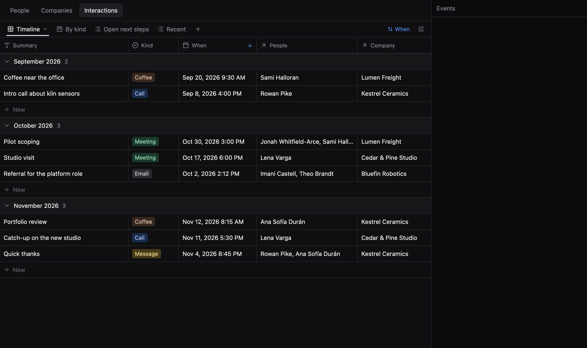
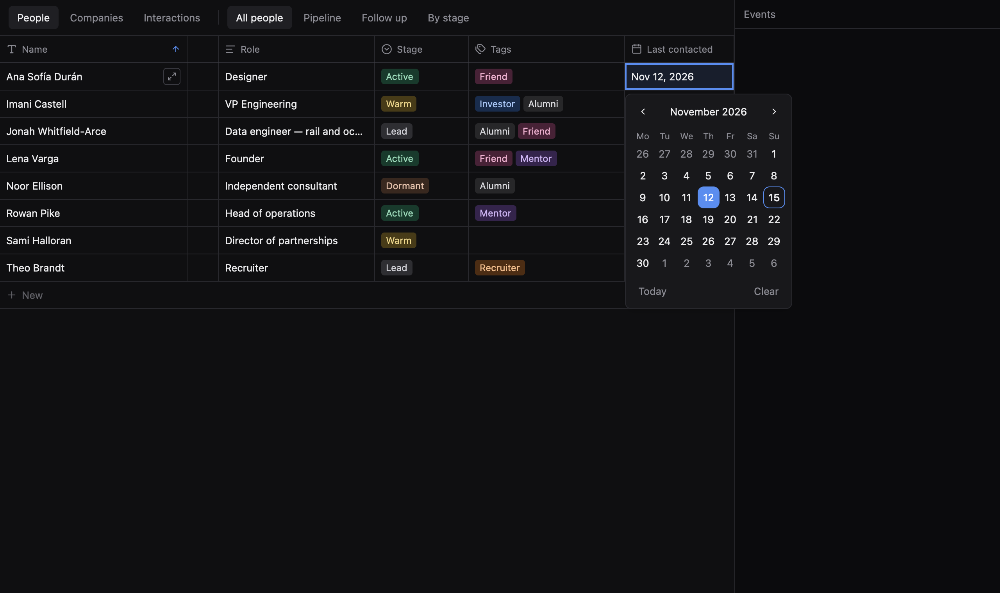
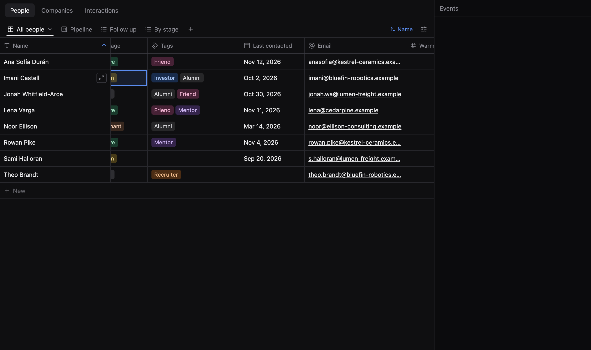
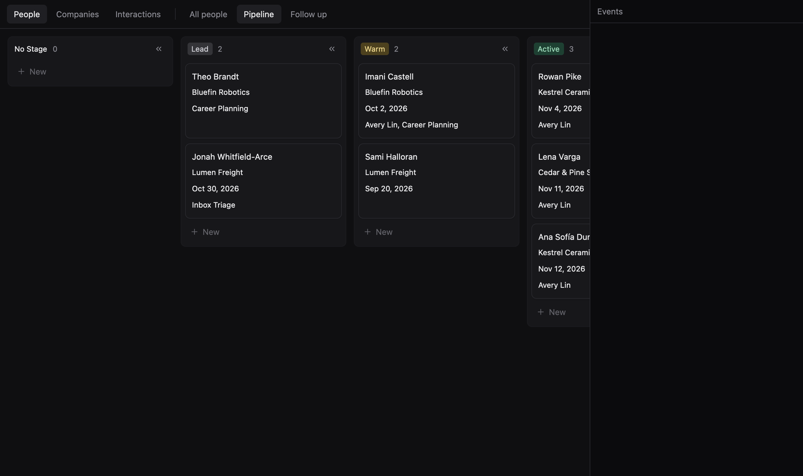
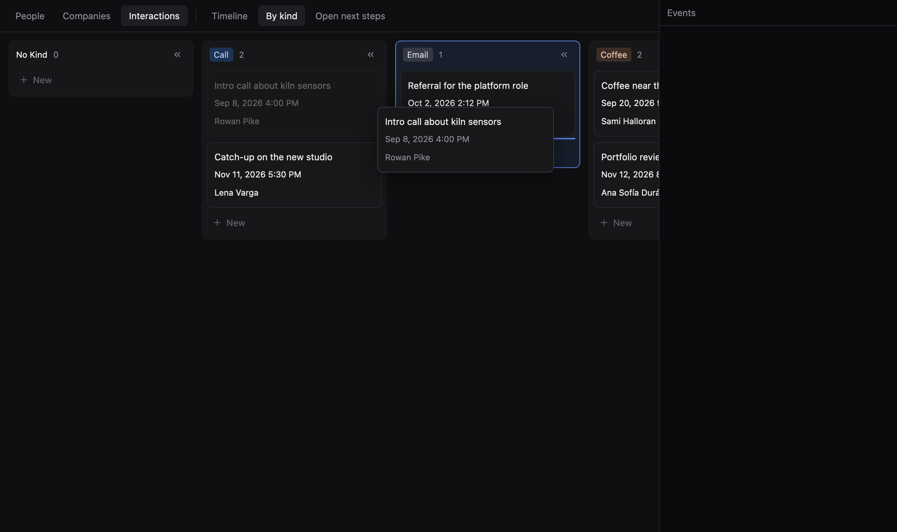
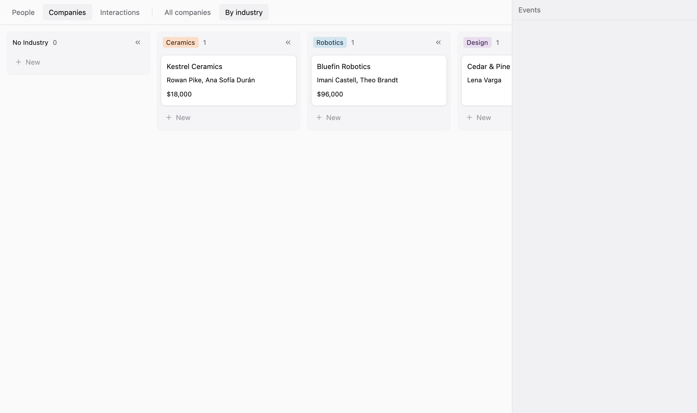
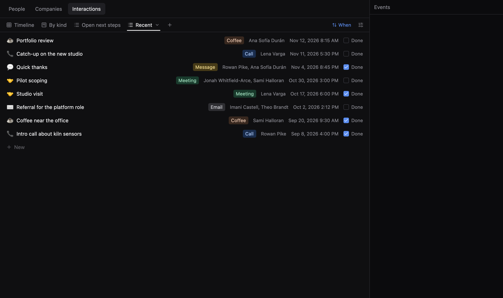
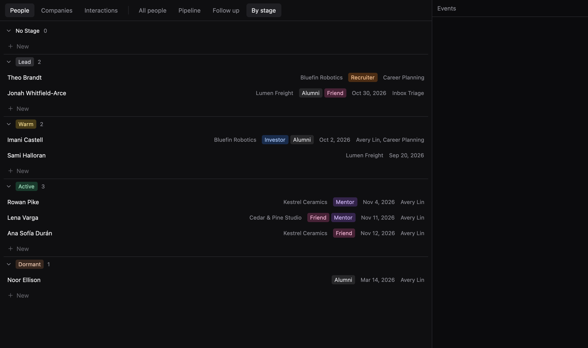
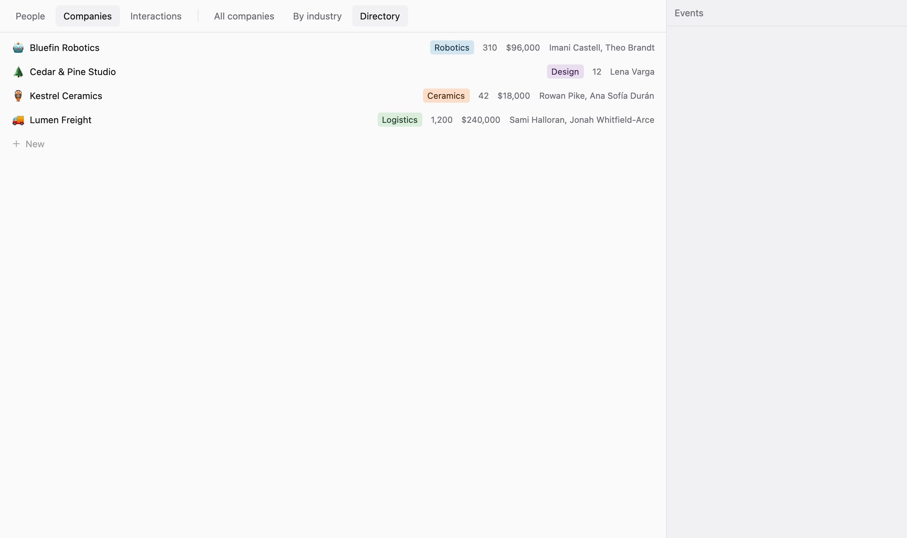

# gpui-tables

Notion-style databases for [GPUI](https://www.gpui.rs) apps: tables, boards and lists over rows
your app owns.

A database here is a doc with typed properties (its columns) and saved views. Each of its rows is
a doc too: a page your app opens with its own editor. The crate reads the docs as JSON, works out
what each view shows (filter, sort, group), and hands every change back to your app as an edit.
It never stores anything, fetches anything or navigates.

It's being built for a personal CRM in a Notion-like docs app: People, Companies and Interactions
databases related to each other, an agent or two logging calls and follow-ups, and every person
and company a page of notes.

**Status: the model, the engine, and the table, board and list views.** The JSON model, the
engine that filters, sorts and groups, fractional-index ordering and the limits on what a
database may hold need no GPUI. The [table view](#table-view), the [board view](#board-view) and
the [list view](#list-view) draw on GPUI and gpui-core, behind the default `gpui` feature. This
README is the design for all of it.


## Contents

- [Use it](#use-it)
- [Table view](#table-view)
- [Board view](#board-view)
- [List view](#list-view)
- [Databases and rows are docs](#databases-and-rows-are-docs)
- [Properties and values](#properties-and-values)
- [Views](#views)
- [Filters](#filters)
- [Edits and events](#edits-and-events)
- [Relations](#relations)
- [Order](#order)
- [Limits](#limits)
- [The host's part](#the-hosts-part)
- [Performance](#performance)
- [iOS and touch](#ios-and-touch)
- [Not in v1](#not-in-v1)
- [Tests](#tests)

## Use it

It needs Rust 1.100 or newer.

```toml
[dependencies]
gpui-tables = { git = "https://github.com/trevin-lee/gpui-essentials", rev = "<a commit>" }
```

Pin a commit: until it's on crates.io, any commit can change the API. The views draw through
the workspace's pinned GPUI (`gpui-pre` 0.3.12, which your app depends on under the name `gpui`)
and gpui-core, and your app must use the same GPUI. A window on macOS also needs
`gpui-pre-platform` with its `font-kit` feature, or it draws no text.

A crate that only reads and checks databases (a server, a sync layer, an agent's tool) turns the
views off and gets no GPUI at all:

```toml
gpui-tables = { git = "https://github.com/trevin-lee/gpui-essentials", rev = "<a commit>", default-features = false }
```

Reading a database and working out a view:

```rust
use gpui_tables::engine::{query, Context, GroupKey};
use gpui_tables::Doc;

let database: Doc = serde_json::from_str(r#"{
    "id": "7d1c2f0e-4b8a-4e55-9d3c-2a6b1f0e9c11", "kind": "database", "title": "People",
    "order": "a0", "folderId": null, "parentDocId": null, "parentObjectId": null,
    "cover": null, "favorite": false, "agents": [], "author": {"kind": "owner"},
    "updatedBy": {"kind": "owner"}, "created": 1793000000000, "updated": 1793000000000,
    "rev": 1, "seq": 10, "deleted": null,
    "database": {
        "properties": [
            {"id": "name", "name": "Name", "type": "title", "config": {}, "order": "a0"},
            {"id": "stage", "name": "Stage", "type": "select", "order": "a1", "config": {
                "options": [{"id": "lead", "name": "Lead", "color": "gray"},
                            {"id": "warm", "name": "Warm", "color": "yellow"}]}}
        ],
        "views": [{
            "id": "pipeline", "name": "Pipeline", "type": "board", "order": "a0",
            "sort": [{"propertyId": "name", "direction": "ascending"}], "filter": null,
            "groupBy": "stage", "columns": [], "cardProperties": [], "collapsedGroups": []
        }]
    }
}"#).unwrap();

let rows: Vec<Doc> = serde_json::from_str(r#"[
    {"id": "r1", "kind": "page", "title": "Rowan Pike", "order": "a0",
     "parentDocId": "7d1c2f0e-4b8a-4e55-9d3c-2a6b1f0e9c11", "values": {"stage": "warm"}},
    {"id": "r2", "kind": "page", "title": "Imani Castell", "order": "a1",
     "parentDocId": "7d1c2f0e-4b8a-4e55-9d3c-2a6b1f0e9c11", "values": {"stage": "warm"}},
    {"id": "r3", "kind": "page", "title": "Theo Brandt", "order": "a2",
     "parentDocId": "7d1c2f0e-4b8a-4e55-9d3c-2a6b1f0e9c11", "values": {}}
]"#).unwrap();

let fields = database.database.as_ref().unwrap();
let pipeline = fields.view("pipeline").unwrap();
let now = 1_794_744_000_000; // milliseconds since the epoch
let shown = query(fields, pipeline, &rows, &Context::new(now));

let groups = shown.groups.unwrap();
assert_eq!(groups[0].key, GroupKey::Empty); // "No stage": Theo
assert_eq!(groups[2].key, GroupKey::Option("warm".into()));
let warm: Vec<&str> = groups[2].rows.iter().map(|&i| rows[i].title.as_str()).collect();
assert_eq!(warm, ["Imani Castell", "Rowan Pike"]);
```

`tests/fixtures` has a whole CRM in this JSON: `people.json`, `companies.json` and
`interactions.json` (each a database doc and its rows), `crm-page.json` (the page Interactions
sits inline in), and `events.json` (one of every event a view emits). All the names in them are
made up.

## Table view

`gpui_tables::view::TableView` is a GPUI entity that draws a database's rows as a table, in the
active view's sort, filter, grouping and columns. It's built on gpui-core (its `Press`, icons,
theme, `Input`, and its menus, pickers and month in `Popover`, `PopupMenu`, `Picker` and
`MonthGrid`), never on GPUI Kit. The host gives it the docs and a `TableHost`, and gets every
change back as a `TableEvent`:

```rust,ignore
use gpui_tables::view::{TableHost, TableTheme, TableView};

struct Host; // the app's store, its server, its names for people

impl TableHost for Host {
    fn theme(&self, cx: &App) -> TableTheme {
        TableTheme::from_core(gpui_core::Theme::global(cx))
    }

    fn event(&self, event: TableEvent, window: &mut Window, cx: &mut App) {
        // Apply the edits (a batch at once) and hand the table its new docs:
        // table.update(cx, |t, cx| t.set_docs(database, rows, cx)).
        // Or open the row's page, for an openRow.
    }
}

gpui_core::init(cx);
gpui_tables::view::init(cx); // the keys
let table = cx.new(|cx| TableView::new(Rc::new(Host), database, rows, cx).with_view(view_id));
```

`cargo run --release -p gpui-tables --example crm` opens the CRM in the fixtures with a log of
every event, and its views (tables, boards and lists) as tabs (the pictures here are its `--shot`s,
rendered offscreen).

| | |
|---|---|
|  |  |
|  |  |
|  |  |
|  | |


- **The host's part.** `TableHost` gives the theme (`TableTheme`: colours, the ten option
  colours, fonts, sizes, the rem base, and touch), names for people (`person_name`) and related
  rows (`row_title`), the choices of the person and relation pickers (`people`,
  `relation_rows`), the time now and the viewer's zone, and the limits, and may give a text
  field of its own (`edit_text`). It receives every `TableEvent` in `event`. Both are called after the table's own update, so the host can hand
  the table its new docs from there.
- **Rows.** Only the rows on screen are drawn (GPUI's `uniform_list`; group headers and New
  rows are lines of the same height). The rows are worked out again, through `engine::query`,
  only when the docs or the view change. The title column stays in place while the others
  scroll sideways (by trackpad, wheel or finger).
- **Groups.** A grouped view shows each group under a header with its count, and a New row at
  its end. Pressing the header folds it: a `viewChanged` with the group in `collapsedGroups`.
- **Cells.** Each type draws as the [table above](#properties-and-values) says: options as
  chips in their colours, numbers in their format and to the right, dates and times in the
  viewer's zone, people (created-by and edited-by too) and related rows by name, created and
  edited times muted. Every one ends in an ellipsis rather than leave its cell. The title has an
  Open button (on hover with a pointer, always on touch); pressing it, or Enter on the title, is
  an `openRow`.
- **Columns.** Drag a column's edge to resize it and its header to move it; both are a
  `viewChanged` with the whole view, its columns written out with fresh order keys. The header's
  menu sorts (shift adds a sort to the others), filters by the column (an option, checked or
  not, a person, a related row, a span of dates, empty or not, or a typed value), clears the
  filter, moves the column left or right, and hides it. The + after the last column shows and
  hides any property.
- **Editing.** A press focuses a cell and a second press edits it (Enter and F2 do too). A
  checkbox toggles at once. Selects, multi-selects, people and relations open a picker; a
  relation's change comes with its `relationChanged`, and a new option made in a select's or
  multi-select's picker with its `propertyChanged` ([Edits and events](#edits-and-events)). A
  date opens its month. Delete and
  Backspace empty a cell. Created and edited times and people are read-only: their column's
  menu sorts, filters (by a person, for created-by and edited-by) and groups by them, but a
  press only focuses the cell.
- **Typed values** (titles, text, numbers, URLs, emails, phones) are edited in place, in
  gpui-core's `Input`, so input methods, selection, the clipboard, undo and the platform's
  editing keys work as in any field. Enter, F2, a second press or a double-click opens the field
  holding the value (a title's opens with F2 or a press, as Enter opens its row). A title,
  number, URL, email or phone is typed on one line inside its cell, sized to it, a number at the
  right as its cell shows it. A text value
  can have several lines: its field is a textarea over the cell, at least a menu's width, that
  grows down over the rows below as lines are added (to eight, then it scrolls), with
  Shift-Enter making a new line. Enter commits, Tab and Shift-Tab commit and move to the next
  or previous cell, a press anywhere else commits (the field losing the focus; the window going
  to the background doesn't), and Escape closes it with nothing changed. Typing stops at the
  value's limit ([Limits](#limits)) and a paste is cut to fit, as the web's `maxlength`; a value
  already longer (an agent's) opens whole. The table reads the text as the property's type
  (`1,200`, `$1,200`, `25%`), cuts it to the limits and emits the edit (`rowTitleChanged` for a
  title); text committed unchanged, or that isn't a number for a number, emits nothing. The field is drawn in the theme: the table's text and font, the
  accent's caret and selection, faint placeholder text, the focus colour's edge.
- **Filter values** (a text column's Contains…, a number's Equals…, Greater than… and Less
  than…) are typed the same way, in a field under the column's header, to the limit of a
  value of the column's type: Enter, Tab or a press elsewhere filters by it, Escape doesn't.
- **A field of the host's own.** A host that implements `TableHost::edit_text` gets each typed
  value instead (a `TextEdit` with the target, the type, the text, its limit and the cell's
  bounds) and answers with `reply.commit(text)` or `reply.cancel()`; the table reads, limits and
  emits the answer as it does its own field's. `reply.edit_in_place()` hands an edit back to the
  table's field. The trait's default does just that, so hosts that never implemented it edit in
  place and hosts that did keep their field.
- **Keys.** The arrows move the focused cell, Tab and shift-Tab move along a row and on to the
  next, Enter edits a cell, opens a row from its title, folds a group or makes a row; Escape
  closes a menu and then lets go of the cell; ⌥↓ opens the column's menu. While a value is
  typed in place the keys are the field's: the arrows move its caret, never the focused cell,
  and Delete and Backspace delete text, not the cell's value. Menus take the keyboard while
  open and open on their first entry: Up and Down move the highlight, Home and End go to the
  ends, Enter picks, Shift-Enter picks adding a sort to the others (as a Shift-click does), and
  Escape or a press elsewhere closes them and hands the keyboard back to the table, on the same
  cell. A picker opens on the current value with its search field focused: typing searches,
  Up and Down move through the matches, Enter picks the highlighted one (the first match after
  typing). A date's month takes the arrows by days and weeks, Page Up and Page Down by months,
  Enter picks, Escape closes.
- **Menus.** The column's menu and the Columns menu are gpui-core's `PopupMenu` in a `Popover`:
  entries with icons under their sections' headings (at the table's small size), the picked sort,
  filters and shown columns checked, the check in a column before the label as in Notion (every
  entry keeps its room, so the labels line up). A select's, multi-select's, person's or relation's
  picker is gpui-core's `Picker`: a search field over its choices, an option drawn as its coloured
  pill as in a cell (its name is still the entry's label, which assistive tech reads and the search
  matches), the value's checked, before it as in the menus. Its search field is drawn as the table's
  fields typed in place: the caret and the selection in the accent, a faint placeholder. A
  multi-select's (and people's and relations') stays open as choices are toggled, a select's closes
  on a pick. A select's or multi-select's offers Create “text” while what's typed names no option,
  up to the options' limit. Rows are 28 points at the table's text size (44 on touch). They hang
  below what opened them, or above it where there's more room, inside the window and scrolling past
  520 points, at least a menu's width and as wide as their cell or header, in the theme's popover,
  text, hover, line and accent (checks) colours. A menu whose column is scrolled out of view stays
  open at the window's edge.
- **Dates.** A date's month is gpui-core's `MonthGrid` in a `Popover`, in the week the host
  starts on, its days 28 points (44 on touch), the picked day in the theme's accent, today
  ringed in it, a range's days between its ends in the selection colour, Today and Clear under
  it. A pick keeps the
  value's time of day and its range's length.
- **New rows.** The New row at the end of the table, or of each group, emits a `rowCreated` with
  an order key after every row's (`order::between`) and the values that keep the row where it was
  made: the group's value, and what the filter's conditions ask for. When the host hands the row
  back, its title is focused.
- **Touch.** With `TableTheme::with_touch(true)` (the default on iOS) rows, headers, the Open
  button, group headers, New rows, menu entries and the month's days are at least 44 points
  each way, column edges take a finger's drag across 44 points while their line stays thin, and
  a finger's swipe scrolls either way.
- **Nothing redraws while nothing changes,** and the table keeps no timers.

Not in this first table: dragging rows to reorder them, deleting rows, making and editing
properties and views (beyond a new option from a picker), picking ranges and times in the month
(it shows a range, and keeps a value's time of day and the length of its range), long-press column drags on touch (the menu's Move left and Move right do
it), and showing the engine's `Issue`s beside the view.

## Board view

A view of type `board` draws as a board: the same `TableView` entity, the same `TableHost` and
the same `TableEvent`s as a table. `TableView` reads the view's type each time it draws and
draws a board for `board` and a table for any other type, so a host shows a database's views as
tabs over one entity and switches with `set_view`.



| | |
|---|---|
|  |  |



- **Columns** are the view's groups (`groupBy`): a select's options, a multi-select's, people,
  checked and unchecked, or date buckets, in the engine's order, with the empty group's column
  ("No Stage") first. Each shows its option's chip (or name) and its count. A board whose
  `groupBy` is missing, or names a property that can't group, is one column of every row.
- **Folding.** The button in a column's header folds it: a `viewChanged` with its key in
  `collapsedGroups`. Folded columns are lines in a "Collapsed" column at the board's end, each
  with its count; pressing one unfolds it.
- **Cards** show the title and the view's `cardProperties` under it, each drawn as the table
  draws its cell (chips in their colours, dates in the viewer's zone, people by name, a checkbox
  with its property's name); empty values are left out. Every line ends in an ellipsis rather
  than leave its card. Pressing a card is an `openRow`.
- **Scrolling.** The board scrolls sideways, and each column up and down on its own (by trackpad,
  wheel or finger). Only the cards on screen are drawn (a `uniform_list` per column), so every
  card in a board is the same height: as tall as the view's card properties need.
- **Dragging.** With a mouse, a card drags through GPUI's drag and drop (`on_drag`, with
  `on_drag_move` and `on_drop` on the board); with a finger, a long press picks it up and the
  finger carries it, while a plain pan scrolls. The card fades where it was, a copy of it
  follows the pointer, the column it would land in is outlined, and a line shows where. Near
  the board's edges, or a column's top or bottom, each move scrolls them a step. Escape puts it
  back.
- **Dropping** is one batch:
  - Within a column, a `rowsMoved` with a key between its new neighbours' (`order::between`).
  - In another column, that and a `rowValueChanged` setting the group property: the column's
    option, person, checkbox or date (a date keeps its time of day and length). A multi-select
    or person value swaps the column it left for the one it joined, in its place; in the empty
    column it empties. A column with no one value (a date bucket such as "Past 7 days") and a
    derived property's columns (created and edited times and people) take no cards from others.
  - In a **sorted** view the sort places the cards, as in Notion: a drop in another column is
    the `rowValueChanged` alone, and dragging within a column does nothing.
  - Neighbours whose keys can't be put between (two the same, an older scheme's) renumber the
    whole manual order with `order::spread`, in the same `rowsMoved`.
  - `TableView::move_card` does the same for a host's own control or assistive technology.
- **New cards.** "New" under each column is a `rowCreated` with the column's value, what the
  filter asks for, and an order key after every row's. When the host hands it back, the new card
  is focused.
- **Keys.** The arrows move between cards (down past the last is its column's New) and across
  columns at the same height, into the folded ones at the end; Tab goes down the columns in turn.
  Enter opens a card, makes one from New and unfolds a folded column. Escape lets go.
- **Touch.** With `TableTheme::with_touch(true)` cards, New buttons and folded columns are at
  least 44 points each way, and the fold button takes a 44-point press (`Press::min_hit`) while
  it's drawn small.
- **The theme** adds `TableColors::card` and `TableSizes::board_column_width` (264 points).
- **Nothing redraws while nothing changes,** and the board keeps no timers.

Not in this first board: dragging several cards at once, a + in the column header that adds at
the top, moving whole columns (the options' order is the property's), and showing the view's
sorts and filters on the board itself.

## List view

A view of type `list` draws as a list: again the same `TableView` entity, `TableHost` and
`TableEvent`s, chosen by the view's type each time it draws.







- **Lines.** One per row: the doc's emoji icon if it has one (its `icon` field, as `Doc::icon`
  reads it; an image icon draws nothing for now), the title, then the view's `cardProperties` to the right, each drawn as the table draws its
  cell: chips for selects and multi-selects, dates in the viewer's zone, people and related rows
  by name, a checkbox with its property's name. Empty values are left out. The title has the room
  it needs first (up to three fifths of the line); the values that fit after it are shown in
  order, the first that doesn't fit is cut short with an ellipsis when there's room left, and the
  rest drop off, so nothing leaves its line at any width. Pressing a line is an `openRow`.
- **Groups.** A grouped view shows each group under a header with its chip (or name) and count,
  and a New line at its end. Pressing a header folds it: a `viewChanged` with its key in
  `collapsedGroups`, as in the table. Sort, filter and grouping come from the view through the
  engine, as for the table and board.
- **Dragging** reorders rows, by the board's rules and the board's code (`TableView::move_card`
  and the drop behind it, with the list's groups in place of the board's columns): a row dragged
  within its group is a `rowsMoved` with a key between its new neighbours'; into another group,
  that and a `rowValueChanged` setting the group's value, in one batch, with multi-select and
  person values swapping the group they left for the one they joined. A sorted view takes no
  reordering by hand (a drop in another group is the `rowValueChanged` alone, and the header of
  the group it would join is marked rather than a place in it), and keys that can't be put
  between renumber the manual order. Over a line's upper half the row lands above it, over its
  lower half below; over a header, at its group's top; over a New line, at its group's end. With a
  mouse it's GPUI's drag and drop; with a finger, a long press picks the row up while a plain pan
  scrolls. Escape puts it back. `TableView::list_groups` gives the groups `move_card` takes.
- **New rows.** The New line of each group (or of the list) is a `rowCreated` with the group's
  value, what the filter asks for and an order key after every row's. When the host hands it
  back, the new row's line is focused.
- **Keys.** Up and Down (and Tab and shift-Tab) move between lines, Page Up and Page Down by a
  screenful; Enter opens a row, folds or unfolds a group, or makes a row from New. Escape lets
  go.
- **Touch.** With `TableTheme::with_touch(true)` lines, headers and New lines are 44 points tall
  and take presses through `Press::min_hit`.
- **Scale.** Every line is the same height, so only those on screen are drawn (`uniform_list`),
  however many rows and groups. `TableView::line_bounds` says where a row's line is.
- **Nothing redraws while nothing changes,** and the list keeps no timers.

Not in this first list: dragging several rows at once, a row's Open button and inline editing
(a press opens the row), and showing the view's sorts and filters above it.

## Databases and rows are docs

Everything is a doc in the host's tree, the same shape for pages, databases and rows:

| Field | |
|---|---|
| `id` | A lowercase UUID, made by whoever creates the doc. |
| `kind` | `"page"` or `"database"` (other kinds are carried as they are). |
| `title` | The page's or database's name. For a row, its title property's value. |
| `order` | A fractional index among its siblings ([Order](#order)). For a row, its place in the database's manual order. |
| `folderId` | The folder a full-page doc is in, or null. |
| `parentDocId` | The page it's under, or null. A row's is its database. |
| `parentObjectId` | For an inline database, the block in its parent page that embeds it. |
| `cover`, `favorite`, `agents` | The host's; carried, never read. |
| `icon` | Optional, on every kind of doc: a string or null, written last-write-wins like the other fields, never in `values` ([Icons](#icons)). |
| `author`, `updatedBy` | Who created and last changed it: `{"kind": "owner"}` or `{"kind": "agent", "agentId": "career-planning"}`. A row's `createdBy` and `editedBy` properties show them. An older doc may have no `updatedBy`. |
| `created`, `updated` | Milliseconds since the Unix epoch. |
| `rev`, `seq` | The host's revision and sequence numbers; carried, never read. |
| `deleted` | A tombstone: the time it was deleted, in milliseconds since the Unix epoch, or null while it isn't. Views leave deleted rows out. The crate reads it as `Option<i64>` (`Doc::is_deleted` says whether it's set) and writes the number or null. For older data it also reads `false` as null and `true` as 0 (deleted at an unknown time). |
| `database` | Only on a database: `{properties: [Property], views: [View]}`. |
| `values` | Only on a row: `{propertyId: value}`. |

- **A full-page database** is a database doc in a folder or under a page.
- **An inline database** is a database doc whose `parentDocId` is the page that shows it and whose
  `parentObjectId` is the block that embeds it.
- **A row** is a page doc whose `parentDocId` is the database. Opening a row opens that page.
- A row's **created time** and **edited time** are its doc's `created` and `updated`; its
  **created by** and **edited by** are `author` and `updatedBy` (or `author`, for an older doc
  without `updatedBy`). None of these are stored in `values`.

In Rust these are one type, `Doc`, with the fields above typed and a `database:
Option<DatabaseFields>` and `values: Option<Values>`. Every type keeps the JSON fields it doesn't
know in an `extra` map, and every enum keeps strings it doesn't know as `Other(String)`, so a doc
from a newer host or an agent reads and writes back unchanged. The round-trip tests check this
for every fixture.

### Icons

A doc's `icon` is null (no icon) or a string, one of:

- **An emoji:** one grapheme cluster of at most 16 bytes (`"☕"`, `"✉️"`, `"🇯🇵"`, `"👍🏽"`,
  `"👩‍👧"`). A family of three (18 bytes) is too long.
- **An image:** `asset:` and the image's SHA-256 in 64 lowercase hex characters. A string
  starting with `asset:` is never an emoji, whatever follows.

`Doc::icon` gives the emoji, and None for anything else (an image, an empty or invalid string,
or a value that isn't a string), so an image's or a bad icon's text is never drawn.
`Doc::icon_asset` gives an image icon's SHA-256 for a host that draws images; the views draw
nothing for one yet. `Limits::check_doc` reports an icon that's neither ([Limits](#limits)). The
crate carries the field in `Doc::extra`.

## Properties and values

A property is `{id, name, type, config, order}`. Its `id` is a UUID, which rows' values are keyed
by, so renaming a property changes no row. The value's JSON depends on the type:

| Type | `config` | Value | Sorts by | Groups |
|---|---|---|---|---|
| `title` | | the row doc's `title` | text | |
| `text` | | `"..."` | text | |
| `number` | `format` (`plain`, `percent`, `currency` with `currency`, an ISO 4217 code), `precision` | `12.5` | number | |
| `select` | `options: [{id, name, color}]` | an option id | the options' order | a column per option |
| `multiSelect` | `options` | `[option id]` | the options' order | the row in each of its options |
| `date` | `includeTime`, `range` (what a new value gets) | `{start, end?, includeTime}` | `start` | relative, day, week, month, year |
| `checkbox` | | `true` / `false` (missing is false) | unchecked first | unchecked, checked |
| `url`, `email`, `phone` | | `"..."` | text | |
| `person` | `kinds: ["owner", "agent"]` | `[{kind: "owner"}, {kind: "agent", agentId}]` | the host's names | the row with each person |
| `relation` | `databaseId`, `twoWay`, `backPropertyId` | `[row doc id]` | the related rows' titles | |
| `createdTime` | | the doc's `created` | time | as dates |
| `editedTime` | | the doc's `updated` | time | as dates |
| `createdBy` | | the doc's `author` | the host's names | the row with its person |
| `editedBy` | | the doc's `updatedBy`, else its `author` | the host's names | the row with its person |

- **Option colours** are names (`default`, `gray`, `brown`, `orange`, `yellow`, `green`, `blue`,
  `purple`, `pink`, `red`); the host's theme says what each looks like.
- **Dates** are milliseconds since the epoch. Without `includeTime`, `start` and `end` are
  midnight UTC of the dates meant, and read as those dates in every time zone. With it they're
  instants, shown in the viewer's zone. A range's `end` is inclusive.
- **Created and edited times and people are derived.** Their values are read from the row doc
  (the table above), never stored in `values`, and they're read-only: the table draws them and
  filters, sorts and groups by them, but never edits them, and a new row gets no value for
  them (the host fills in the doc's own fields). Their `config` is empty: `{"id": "<uuid>",
  "name": "Added by", "type": "createdBy", "config": {}, "order": "a9"}`. A created-by or
  edited-by value is one person, of the shape a `person` value's items have; a doc without an
  `author` has none (an empty cell), and one without `updatedBy`, written before the host kept
  it, shows its `author` as its editor.
- **There's no contacts type.** People are rows in a People database, reached from other
  databases through a `relation` property. The `person` type is only ever the owner or one of
  their agents.
- **Text sorts** ignore case. Every sort puts empty values last, whichever way it runs, and is
  stable: rows that tie keep the database's manual order.
- **Missing and malformed values** are empty: a select whose option was deleted, a number stored
  as text, a shape the crate doesn't read. They're kept as they are, and never break a view.

## Views

A database has several saved views, each `{id, name, type, order, sort, filter, groupBy,
columns, cardProperties, collapsedGroups}`. They're tabs above the database, in `order`, and
every person (and agent) sees the same ones.

- **`sort`** is a list of `{propertyId, direction}` (`ascending` or `descending`), applied in
  turn. With no sort, rows are in the manual order (each row's `order`).
- **`filter`** is a tree of conditions ([Filters](#filters)).
- **`groupBy`** is a property id. Grouping by a date also reads **`groupDate`** (`relative`,
  `day`, `week`, `month`, `year`; relative when absent), an addition to the first proposal.
- **`columns`** is a table's `[{propertyId, width, hidden, order}]`. Properties without a column
  show after the others at the default width; `width` null means the default.
- **`cardProperties`** are the properties a board card shows under the title, or a list line
  beside it.
- **`collapsedGroups`** are the groups folded shut, by key: `empty`, `option:<id>`, `checked`,
  `unchecked`, `owner`, `agent:<id>`, `relative:today`, `day:2026-11-15`, `week:2026-11-09`
  (the week's first day), `month:2026-11`, `year:2026`.

How each type behaves (the table, board and list are drawn; galleries come later):

- **Table.** A row per row and a column per property. Columns resize by dragging their edge and
  reorder by dragging their header; both are a `viewChanged`. The header's menu sorts, filters,
  hides and edits the property. Text, number, checkbox, select, multi-select, date, URL, email
  and phone cells edit in place; a person or relation cell opens a picker. The title cell has an
  Open button: opening a row is an `openRow` event, and the host shows the page. Grouped tables
  show each group under a header with its count, which folds. Dragging rows reorders them when
  the view has no sort (as in Notion, a sorted view can't be reordered by hand).
- **Board.** Columns of cards, one per group, grouped by a select (or a multi-select, checkbox,
  person or date). Dragging a card to another column changes its value, and its place in the
  manual order (when the view has no sort). A card shows its title and `cardProperties`. Each
  column has a New to add a row with that column's value. See [Board view](#board-view).
- **List.** One line per row: the title, then `cardProperties` to the right. Grouping folds as in
  a table, and rows drag to reorder and between groups as cards do. See [List view](#list-view).
- **Gallery.** Cards in a grid. In the JSON from the start, drawn in a later version.

A new row made in a filtered or grouped view gets the values that keep it in that view (the
group's option, a checked box the filter wants), as Notion does.

## Filters

A filter is a tree: `{"and": [..]}` and `{"or": [..]}` over conditions `{propertyId, op,
value}`. For example, people to follow up with:

```json
{"and": [
  {"propertyId": "<Follow up>", "op": "isChecked"},
  {"or": [
    {"propertyId": "<Last contacted>", "op": "before", "value": "2026-10-15"},
    {"propertyId": "<Last contacted>", "op": "isEmpty"}
  ]}
]}
```

| Property type | Operators | `value` |
|---|---|---|
| title, text, url, email, phone | `is`, `isNot`, `contains`, `doesNotContain`, `startsWith` | a string; case is ignored |
| number | `is`, `isNot`, `greater`, `greaterOrEqual`, `less`, `lessOrEqual` | a number |
| select | `is`, `isNot` | an option id |
| multiSelect | `contains`, `doesNotContain` | an option id |
| person | `contains`, `doesNotContain` | a person, or `"owner"` or `"agent:<id>"` |
| createdBy, editedBy | `is`, `isNot`, `contains`, `doesNotContain` (with one person, `is` is `contains`) | a person, or `"owner"` or `"agent:<id>"` |
| relation | `contains`, `doesNotContain` | a row id |
| date, createdTime, editedTime | `is`, `isNot`, `before`, `after`, `onOrBefore`, `onOrAfter` | a day: `"2026-11-15"`, milliseconds, or a date value |
| date, createdTime, editedTime | `within` | `today`, `pastWeek`, `pastMonth`, `pastYear`, `nextWeek`, `nextMonth`, `nextYear` |
| checkbox | `isChecked`, `isNotChecked`, or `is` with `true` or `false` | |
| all but checkbox | `isEmpty`, `isNotEmpty` | |

- Dates compare whole days in the viewer's zone. A range matches when any of its days does.
  `within` spans include today.
- The negative operators (`isNot`, `doesNotContain`) match empty values, as Notion's do.
- A condition with no value yet (one being written) is left out. One whose property is gone, whose
  operator doesn't fit the type, or whose value can't be read is left out and reported as an
  `Issue`, which the view can show beside it. An `and` or `or` with nothing left matches every
  row.

## Edits and events

The crate never changes the host's data. Everything a person does in a view comes out as a
`TableEvent`:

- `{"type": "openRow", "rowId"}`: open the row's page. The crate never navigates.
- `{"type": "edits", "edits": [Edit]}`: changes to apply together, in one batch.

| Edit | Fields | The host |
|---|---|---|
| `rowCreated` | `rowId`, `databaseId`, `order`, `title`, `values` | makes a page doc under the database (filling in times, author, rev, seq) |
| `rowTitleChanged` | `rowId`, `title` | patches the row doc's `title` |
| `rowValueChanged` | `rowId`, `propertyId`, `value` | patches the row's `values` for that one property (null removes it) |
| `relationChanged` | `rowId`, `propertyId`, `databaseId`, `backPropertyId`, `added`, `removed` | writes the other side of a two-way relation ([Relations](#relations)) |
| `rowsMoved` | `rowIds`, `orders` | sets each row's `order` (`orders[i]` for `rowIds[i]`) |
| `rowsDeleted` | `rowIds` | tombstones the rows: sets each one's `deleted` to the time now |
| `propertyCreated`, `propertyChanged` | `databaseId`, `property` | writes the whole property into the database's `database.properties` |
| `propertyDeleted` | `databaseId`, `propertyId` | removes it (rows' values for it may stay; they're ignored) |
| `viewCreated`, `viewChanged` | `databaseId`, `view` | writes the whole view |
| `viewDeleted` | `databaseId`, `viewId` | removes it |

How the host writes them to the server:

- **Row values and titles are patched, never put.** The server writes a doc's `values` only when
  the doc is created, and by `patch`. A `put` on an existing doc leaves its `values` alone.
  `patch` is the batch op `{op: "patch", type: "doc", id, title?, values?: {propertyId: value |
  null}}`, merged key by key, with the last write to each key winning. So:
  - `rowValueChanged {rowId, propertyId, value}` is `{op: "patch", type: "doc", id: rowId,
    values: {propertyId: value}}`, with null removing the value.
  - `rowTitleChanged {rowId, title}` is `{op: "patch", type: "doc", id: rowId, title}`. The title
    is the row doc's `title`, never a value in `values`, so a title edit is this event and not a
    `rowValueChanged`.
  - The edits of one batch for one row can go in one `patch`, with `title` and several `values`
    keys.
  - An agent and a person editing different cells of one row don't overwrite each other.
- **New rows** (`rowCreated`) are the only time a row's `values` are written whole.
- **Moving and deleting rows** set the docs' `order` and `deleted` (the time of the delete),
  never their `values` (so a `put` of the doc is safe: it leaves `values` alone). Undoing a
  delete sets `deleted` back to null.
- **Properties and views are last-write-wins** inside the database doc's `database` field, and
  their edits carry the whole property or view.
- **One action, one batch.** Dropping a card in another board column is a `rowsMoved` and a
  `rowValueChanged`; changing a two-way relation is a `rowValueChanged` and a `relationChanged`.
  The host applies a batch together, and can undo it by applying the inverse.
- **A new option** made in a select's or multi-select's picker (Create “text”) is a
  `propertyChanged` with the whole property, the new option after the others (a new id, the
  typed name cut to its limit, the `default` colour), then the row's `rowValueChanged` naming
  it (for a multi-select, added to the options it had), in that order in one batch. The host
  writes the property before the value, so the value never names an option the property
  hasn't. It's last-write-wins like any property edit: two people making options at once can
  lose one, and the row then names an option the property hasn't, which the views draw as no
  option and `Limits::check_row` reports.

For example, Theo dragged from Lead to Warm, between two cards, on the Pipeline board without
its sort:

```json
{"type": "edits", "edits": [
  {"type": "rowsMoved", "rowIds": ["<Theo>"], "orders": ["a2V"]},
  {"type": "rowValueChanged", "rowId": "<Theo>", "propertyId": "<Stage>", "value": "<Warm>"}
]}
```

## Relations

A relation's value is a list of row doc ids in `config.databaseId` (which may be its own
database). A two-way relation is a pair of relation properties, one in each database, each naming
the other as `backPropertyId`: People's Company lists companies, and Companies' People lists
people back.

When one side changes, the batch has the change on that side and a `relationChanged` saying which
rows on the other side gain this row (`added`) and which lose it (`removed`). The host writes the
other side in the same batch; `engine::relation::back_edits` turns the `relationChanged` into
those rows' `rowValueChanged`s from the host's current values, and says which rows it couldn't
find or that are already full. `relation::set` makes the pair of edits, `relation::two_way_pair`
makes a new pair of properties, `relation::check_two_way` checks that a pair names each other, and
`RowIndex` resolves ids to rows (or lists the dangling ones).

The CRM in the fixtures has three two-way relations: People ↔ Companies (Company / People),
People ↔ Interactions (Interactions / People), and Companies ↔ Interactions (Interactions /
Company).

## Order

Rows, properties, views and columns are placed by `order` strings, fractional indexes that sort
by plain byte comparison. Moving something changes only its own key: `order::between(a, b)` makes
a key between two neighbours, `order::n_between` makes several for a multi-row drop, and
`order::spread(n)` makes fresh keys for renumbering a list.

The scheme is rocicorp's `fractional-indexing` (as Figma's before it): an integer part whose first
character gives its length (`a0` … `az`, `b00` …), then a base-62 fraction that never ends in `0`.
Keys are at most 256 characters. Appends step the integer part, so 10,000 appends make
four-character keys. The app's Swift and Go code is moving to the same scheme, and keys will
mix with the app's once it adopts it. Until then, and for any key that's malformed or too long (an
older scheme's, or an agent's), `between` returns an error rather than guessing, and the host
renumbers the list. A key that would grow past 256 characters is an error too (`tooLong`), and the host
renumbers.

`tests/fixtures/order-vectors.json` holds the cases every client tests against: `between`
(`{a, b, expected}` or `{a, b, error}`, with a or b null for the ends), `n_between` (`{a, b, n,
expected: [...]}`) and `spread` (`{n, expected: [...]}`). They cover a fresh list, appends,
prepends, adjacent keys, keys at and over the 256 cap, and invalid keys. The expected keys come
from `fractional-indexing` 3.4.0 itself. The one difference: a key with a character outside the
alphabet is invalid here, where that library accepts some.

## Limits

Agents write rows too, so `Limits` caps what a database and its rows may hold. The server checks
writes against the same numbers, the crate stops typing at them and cuts what people paste and
commit (`Limits::clamp_value`), and the engine ignores what's over (a filter too deep, a sort too
many) and reports it. Nothing over a limit panics. Strings count Unicode characters (scalar
values, as gpui-core's `InputState::max_chars` does).

`Limits::check_doc` lists every problem with a doc, each a path from the doc's root and a message,
like `database.properties[3].config.options: 201 is more than 200` or `values.<phone>: 65
characters is more than 64` (`check_database`, `check_row` and `check_value` check the parts).
`tests/fixtures/limits` holds valid docs and invalid ones with the exact problems each must give,
one or more for every limit and check below. The crate's tests run them all, and the server runs
the same files. Its README gives the format and every message.

| Limit | Default |
|---|---|
| Properties per database | 200 |
| Columns and card properties per view, values per row | 200 (the properties limit) |
| Views per database | 50 |
| Sorts per view | 10 |
| Options per select or multi-select | 200 |
| Values per multi-select | 100 |
| Values per relation (a two-way back side too) | 2,000 |
| People per person value | 50 |
| Collapsed groups per view | 500 |
| Filter depth (a lone condition is 1) | 4 |
| Filter nodes (groups and conditions) | 100 |
| Title (a row's or a database's) | 2,000 characters |
| Text | 10,000 characters |
| URL | 2,048 characters |
| Email | 320 characters |
| Phone | 64 characters |
| Option name | 100 characters |
| Property or view name | 200 characters |
| Any id | 128 characters |
| An `order` key | 256 characters |

The checks also catch ids used twice, a database with no title property or two, a value of the
wrong shape for its type, a select or multi-select value naming an option the property hasn't, a
person of a kind the property doesn't allow, a date range ending before it starts, and a value
stored for a derived property (a created or edited time, created by or edited by). A filter
depth of 4 is three levels of nested groups and their conditions, as Notion allows.

A doc's `icon` ([Icons](#icons)) is checked too: an emoji of more than one grapheme cluster or
over 16 bytes, an empty string, an `asset:` value that isn't followed by 64 lowercase hex
characters, or a value that isn't a string or null. Icons count graphemes and bytes, not
characters.

## The host's part

The host is the app around the views. It:

- **Stores everything.** It hands the views the database doc and its row docs, applies the edits
  they emit (to its store and its server), and hands back the changed docs. The views redraw only
  when it does. It deletes a row by setting its `deleted` to the time (`rowsDeleted`); the views
  leave out every doc whose `deleted` is set.
- **Opens rows.** On `openRow` it shows the row's page, with gpui-blocks in the docs app. The crate
  never navigates and knows nothing of page content.
- **Knows people and agents.** Through a host trait it gives the names of the owner and agents,
  the titles of related rows, the list of people and agents for the person picker, and rows of a
  related database for the relation picker. The engine's `Lookup` trait is the part sorting and
  grouping need.
- **Gives the theme.** Colours (text, lines, fills, the ten option colours, the accent), fonts,
  sizes and row heights, scaled by the window's rem, as gpui-chatwidgets' `CardTheme` does.
- **Writes both sides of relations** in one batch, with `relation::back_edits`.
- **Checks agents' writes** against `Limits`.

## Performance

The target: a 10,000-row database scrolls, filters, sorts and regroups with no dropped frame, and
nothing draws while nothing changes.

- **The engine** builds each row's keys once and sorts indexes, never rows. Measured with `cargo
  test --release --test performance -- --nocapture` on an Apple M4 Pro, for 10,000 rows of every
  property type:

  | | median |
  |---|---|
  | The manual order alone | 0.06 ms |
  | Sort by title | 1.5 ms |
  | Sort by a select, then a number | 1.6 ms |
  | A filter of three conditions, two sorts, grouped by a select | 1.4 ms |
  | Twelve conditions, one per type | 1.7 ms |
  | Group by multi-select / person / date | 0.7 / 1.0 / 0.5 ms |
  | Read 10,000 rows from JSON (5.4 MB) | 17 ms |
  | Check 10,000 rows against the limits | 2.3 ms |
  | 10,000 fresh order keys | 0.4 ms |

  The tests fail past bounds well above these (25 ms for any of a view's work in a release build,
  forty times that in a debug one), loose enough for a shared CI runner and tight enough to catch
  a step that goes quadratic.
- **The table view** draws only the rows on screen (GPUI's `uniform_list`), works the rows out
  again only when the docs or the view change, and keeps no timers. Measured with `cargo test
  --release --test view_performance -- --nocapture` on an Apple M4 Pro, 10,000 rows of every
  type in a 1400 by 900 window, text laid out with Core Text:

  | | median |
  |---|---|
  | The first draw | 2.5 ms |
  | A frame while scrolling down a page, or sideways | 2.8 ms |
  | A sort, a filter and a group by select, worked out and drawn | 18 ms |

  The test fails past 50, 12 and 50 ms in a release build (forty times that in a debug one).
- **The board view** draws only the cards on screen in each column (a `uniform_list` each).
  Measured the same way, the same 10,000 rows as a board of seven columns, each card showing four
  values:

  | | median |
  |---|---|
  | The first draw | 2.3 ms |
  | A frame while scrolling a column down a page, or the board sideways | 2.3 ms |
  | A frame while dragging a card across the columns | 2.7 ms |

  The test fails past 50, 12 and 12 ms in a release build.
- **The list view** draws only the lines on screen (one `uniform_list`). Measured the same way,
  the same 10,000 rows as a list grouped by stage, each line showing four values:

  | | median |
  |---|---|
  | The first draw | 1.6 ms |
  | A frame while scrolling down a page | 1.7 ms |
  | A frame while dragging a row down the list | 1.7 ms |

  The test fails past 50, 12 and 12 ms in a release build.
- **No text overflows its cell** at any width: cells, headers, group headers, menus and cards
  end in an ellipsis, and a list's values drop off. A headless Core Text test, as
  gpui-chatwidgets has, checks every cell type (and a board's cards and a list's lines, with
  every property on them) with the worst text at 360, 700 and 1400 wide.

## iOS and touch

The views are for the Mac and for iPhone and iPad, through GPUI's iOS backend (`gpui-pre-ios`
0.3.12). The crate builds for `aarch64-apple-ios-sim`, and CI checks it.

- Every control is at least 44 points on touch (in the table view, `TableTheme::with_touch`): cell targets, header menus, the Open button,
  group headers and column resize handles (whose visible line stays thin).
- Nothing is hover-only. What a pointer finds by hovering (the Open button, a column's menu, a
  card's handle) is a tap away on touch.
- A tap selects a cell and a second tap edits it: a typed value's field takes the focus, so the
  keyboard comes up (gpui-core's `Input` is the platform's text input client, input methods and
  dictation included), with suggestions and capitals for titles and text and none for numbers,
  links, addresses and phones. Pickers open as popovers on iPad and sheets on iPhone. A long press picks up a card or row to drag. Tables scroll both ways with momentum, and
  the title column stays put.

## Not in v1

- **Formulas.** They need an expression language, an evaluator, dependency tracking between
  properties, and a server that computes the same answers, which is as much work as the rest of
  the crate. Agents can write computed values into ordinary properties in the meantime.
- **Rollups.** A rollup aggregates a property across related rows, so it needs the related
  databases loaded together and recomputes whenever any related row changes. That's worth doing
  once relations have been used for a while.
- **Templates.** A template is a page with content, which belongs to the docs app and its editor;
  the crate would only pass a template id through `rowCreated`. Prefilled values for a new row in a
  view are in v1.
- **Also later:** the gallery view, files, a status type, unique ids, sums and counts under a
  column, and linked views of a database on another page.

## Tests

```sh
cargo test -p gpui-tables                              # everything
cargo test -p gpui-tables --no-default-features        # the same, with no GPUI in the build
cargo test -p gpui-tables --release --test performance -- --nocapture
cargo test -p gpui-tables --release --test view_performance -- --nocapture
cargo run --release -p gpui-tables --features shots --example crm -- --shot out.png --scene menu
```

- `tests/model.rs`: every fixture reads into the typed model and writes back as the same JSON;
  values read as their types; the fixtures are within the limits and their relations agree on
  both sides; unknown fields and kinds survive; over-limit and malformed input is reported or
  clamped; icons read as an emoji only when valid, and `asset:` icons never do.
- `tests/engine.rs`: the fixtures' saved views work out as a person would expect; every operator
  on every type; sorts, groups and their keys; relations and back edits; what the engine leaves
  out and reports; and hostile values (every shape in every property, every operator with every
  value, the extremes of time) that must never panic.
- `tests/order.rs`: every case in `tests/fixtures/order-vectors.json` ([Order](#order)).
- `tests/limits.rs`: every case in `tests/fixtures/limits`, each with exactly its problems
  ([Limits](#limits)).
- `tests/performance.rs`: 10,000 rows, timed, as above.
- `tests/view.rs`: the table view driven by mouse, keyboard and finger: sorting (and adding a
  sort with shift), filtering, grouping and folding, resizing and moving columns, hiding and
  showing them, an edit of every editable type, typed values in place (typed, then committed
  with Enter, Tab, Shift-Tab or a press elsewhere, or closed with Escape; numbers read with
  grouping, currency and percent signs; text cut to its limits; a text value over several lines;
  a filter's value in the column's menu; the arrows, Delete and Backspace kept to the field; a
  tap editing a focused cell on touch), the host's own field winning when it has one, keyboard
  navigation (in menus too, opening on their first entry, Shift-Enter adding a sort, and back
  to the table when one closes), options drawn as pills, pickers opening on the current value
  and searching as you type, a new option made from a picker (its `propertyChanged` and the
  row's value in one batch), the month in the table's colours with Today and Clear under it and
  a range shown and moved whole, opening rows, new rows in
  groups and filters, created-by and edited-by cells
  (named by the host, never edited, filtered and grouped by), 44-point targets on touch, a finger
  resizing a column, swipes both ways with the title in place, and no frames while idle.
- `tests/board.rs`: the board view driven by mouse, keyboard and finger: its columns and cards,
  one entity drawing a table or a board by the view's type, drags within a column (order keys)
  and across (the value and the key in one batch), sorted boards, multi-select swaps, keys that
  renumber, folding, new cards, opening, keyboard navigation, a long press carrying a card while
  pans scroll the board and a column, 44-point targets on touch, and no frames while idle.
- `tests/list.rs`: the list view driven by mouse, keyboard and finger: its lines and values,
  one entity drawing a table, a board or a list, opening rows, keyboard navigation, groups that
  fold, drags within a group (order keys) and across (the value and the key in one batch), drops
  on headers and New lines, sorted lists refusing reorder, multi-select swaps, new rows with
  their group's and filter's values, a long press carrying a row while a pan scrolls, 44-point
  targets on touch, no frames while idle, and no icon drawn for an `asset:` or invalid one.
- `tests/overflow.rs`: worst-case text in every cell, header, group and menu at 360, 700 and
  1400 wide (and in each typed value's field open in place, which stays in its cell, a text
  value's in the window), columns at their widths and their narrowest, on a board's cards, columns and
  folded columns (scrolled, and with a finger's sizes), and on a list's lines and headers
  (grouped or not, focused, with a finger's sizes, and the worst valid icons), laid out with
  Core Text; no glyph leaves its place.
- `tests/fields.rs`: the fields values are typed in, in place, laid out with Core Text: typing
  stops at a value's limit (counted in characters, a title's, an email's, a filter value's), a
  paste is cut to fit, a value already over its limit opens whole and commits cut, a host's
  field is told the limit and its answer is cut, and a number is typed at the right, where its
  cell shows it.
- `tests/view_performance.rs`: the table, the board and the list with 10,000 rows, timed, as
  above.
- Unit tests for fractional indexes and calendar arithmetic.

## License

Apache-2.0. See [LICENSE](../LICENSE) and [NOTICE](../NOTICE).
