# gpui-tables

Notion-style databases for [GPUI](https://www.gpui.rs) apps: tables, boards and lists over rows
your app owns.

A database here is a doc with typed properties (its columns) and saved views. Each of its rows is
a doc too: a page your app opens with its own editor. The crate reads the docs as JSON, works out
what each view shows (filter, sort, group), and hands every change back to your app as an edit.
It never stores anything, fetches anything or navigates.

The examples and tests use a small made-up CRM: People, Companies and Interactions databases
related to each other, an agent or two logging calls and follow-ups, and every person and company
a page of notes.

**Status: the model, the engine, and the table, board and list views.** The JSON model, the
engine that filters, sorts and groups, fractional-index ordering and the limits on what a
database may hold need no GPUI. The [table view](#table-view), the [board view](#board-view) and
the [list view](#list-view) draw on GPUI and gpui-core, behind the default `gpui` feature. This
README is the design for all of it.

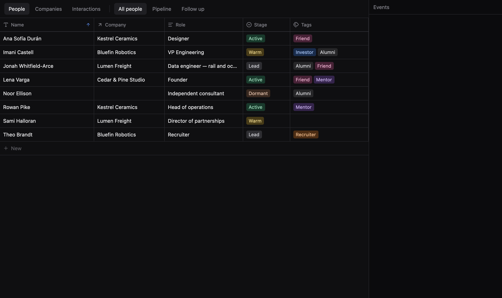

## Contents

- [Use it](#use-it)
- [Table view](#table-view)
- [Board view](#board-view)
- [List view](#list-view)
- [Changing properties](#changing-properties)
- [Changing views](#changing-views)
- [Databases and rows are docs](#databases-and-rows-are-docs)
- [Properties and values](#properties-and-values)
- [Views](#views)
- [Filters](#filters)
- [Edits and events](#edits-and-events)
- [Relations](#relations)
- [Order](#order)
- [Limits](#limits)
- [The host's part](#the-hosts-part)
- [Performance](#performance)
- [iOS and touch](#ios-and-touch)
- [Accessibility](#accessibility)
- [Not in v1](#not-in-v1)
- [Tests](#tests)

## Use it

It needs Rust 1.100 or newer.

```toml
[dependencies]
gpui-tables = { git = "https://github.com/trevin-lee/gpui-essentials", rev = "<a commit>" }
```

Pin a commit: until it's on crates.io, any commit can change the API. The views draw through
the workspace's pinned GPUI (`gpui-pre` 0.3.12, which your app depends on under the name `gpui`)
and gpui-core, and your app must use the same GPUI. A window on macOS also needs
`gpui-pre-platform` with its `font-kit` feature, or it draws no text.

A crate that only reads and checks databases (a server, a sync layer, an agent's tool) turns the
views off and gets no GPUI at all:

```toml
gpui-tables = { git = "https://github.com/trevin-lee/gpui-essentials", rev = "<a commit>", default-features = false }
```

Reading a database and working out a view:

```rust
use gpui_tables::engine::{query, Context, GroupKey};
use gpui_tables::Doc;

let database: Doc = serde_json::from_str(r#"{
    "id": "7d1c2f0e-4b8a-4e55-9d3c-2a6b1f0e9c11", "kind": "database", "title": "People",
    "order": "a0", "folderId": null, "parentDocId": null, "parentObjectId": null,
    "cover": null, "favorite": false, "agents": [], "author": {"kind": "owner"},
    "updatedBy": {"kind": "owner"}, "created": 1793000000000, "updated": 1793000000000,
    "rev": 1, "seq": 10, "deleted": null,
    "database": {
        "properties": [
            {"id": "name", "name": "Name", "type": "title", "config": {}, "order": "a0"},
            {"id": "stage", "name": "Stage", "type": "select", "order": "a1", "config": {
                "options": [{"id": "lead", "name": "Lead", "color": "gray"},
                            {"id": "warm", "name": "Warm", "color": "yellow"}]}}
        ],
        "views": [{
            "id": "pipeline", "name": "Pipeline", "type": "board", "order": "a0",
            "sort": [{"propertyId": "name", "direction": "ascending"}], "filter": null,
            "groupBy": "stage", "columns": [], "cardProperties": [], "collapsedGroups": []
        }]
    }
}"#).unwrap();

let rows: Vec<Doc> = serde_json::from_str(r#"[
    {"id": "r1", "kind": "page", "title": "Rowan Pike", "order": "a0",
     "parentDocId": "7d1c2f0e-4b8a-4e55-9d3c-2a6b1f0e9c11", "values": {"stage": "warm"}},
    {"id": "r2", "kind": "page", "title": "Imani Castell", "order": "a1",
     "parentDocId": "7d1c2f0e-4b8a-4e55-9d3c-2a6b1f0e9c11", "values": {"stage": "warm"}},
    {"id": "r3", "kind": "page", "title": "Theo Brandt", "order": "a2",
     "parentDocId": "7d1c2f0e-4b8a-4e55-9d3c-2a6b1f0e9c11", "values": {}}
]"#).unwrap();

let fields = database.database.as_ref().unwrap();
let pipeline = fields.view("pipeline").unwrap();
let now = 1_794_744_000_000; // milliseconds since the epoch
let shown = query(fields, pipeline, &rows, &Context::new(now));

let groups = shown.groups.unwrap();
assert_eq!(groups[0].key, GroupKey::Empty); // "No stage": Theo
assert_eq!(groups[2].key, GroupKey::Option("warm".into()));
let warm: Vec<&str> = groups[2].rows.iter().map(|&i| rows[i].title.as_str()).collect();
assert_eq!(warm, ["Imani Castell", "Rowan Pike"]);
```

`tests/fixtures` has a whole CRM in this JSON: `people.json`, `companies.json` and
`interactions.json` (each a database doc and its rows), `crm-page.json` (the page Interactions
sits inline in), and `events.json` (one of every event a view emits). All the names in them are
made up.

## Table view

`gpui_tables::view::TableView` is a GPUI entity that draws a database's rows as a table, in the
active view's sort, filter, grouping and columns. It's built on gpui-core (its `Press`, icons,
theme, `Input`, and its menus, pickers and month in `Popover`, `PopupMenu`, `Picker` and
`MonthGrid`), never on GPUI Kit. The host gives it the docs and a `TableHost`, and gets every
change back as a `TableEvent`:

```rust,ignore
use gpui_tables::view::{TableHost, TableTheme, TableView};

struct Host; // your app's store, its server, its names for people

impl TableHost for Host {
    fn theme(&self, cx: &App) -> TableTheme {
        TableTheme::from_core(gpui_core::Theme::global(cx))
    }

    fn event(&self, event: TableEvent, window: &mut Window, cx: &mut App) {
        // Apply the edits (a batch at once) and hand the table its new docs:
        // table.update(cx, |t, cx| t.set_docs(database, rows, cx)).
        // Or open the row's page, for an openRow.
    }
}

gpui_core::init(cx);
gpui_tables::view::init(cx); // the keys
let table = cx.new(|cx| TableView::new(Rc::new(Host), database, rows, cx).with_view(view_id));
```

`cargo run --release -p gpui-tables --example crm` opens the CRM in the fixtures with a log of
every event, and its views (tables, boards and lists) as tabs in the crate's bar of views
([Changing views](#changing-views)); the pictures here are its `--shot`s, rendered offscreen.

| | |
|---|---|
|  | 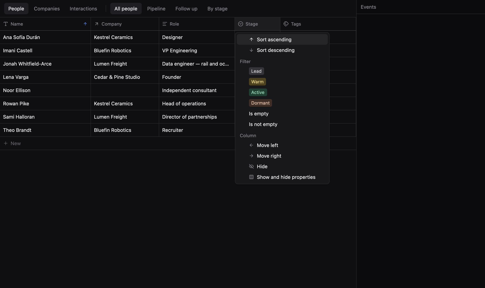 |
| 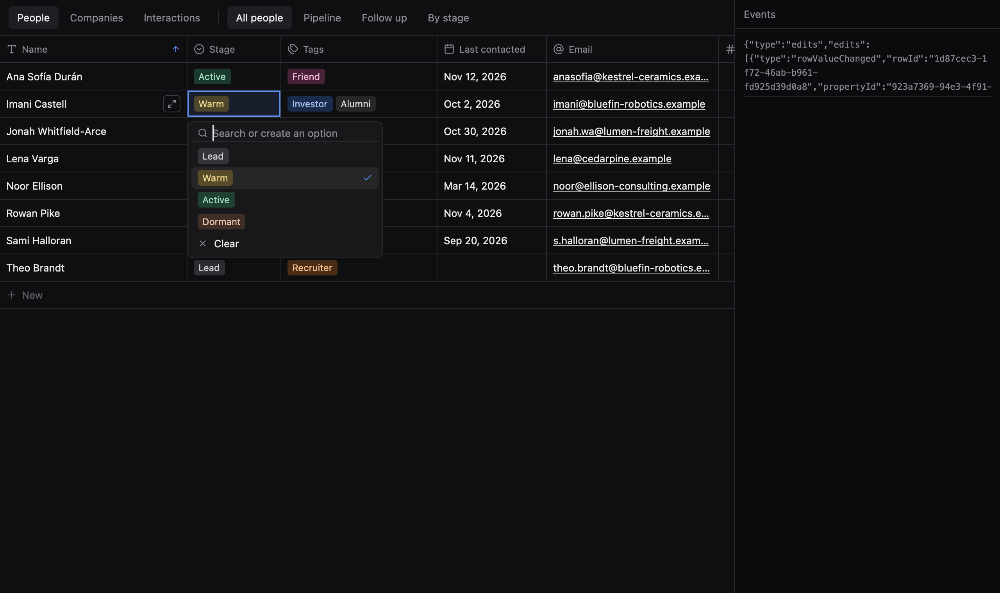 |  |
|  | 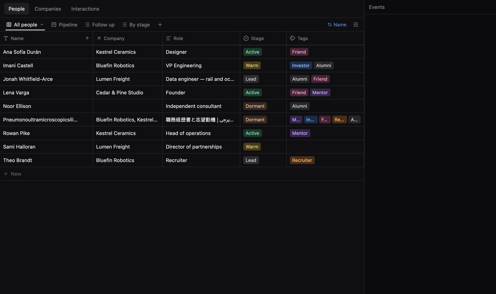 |
| 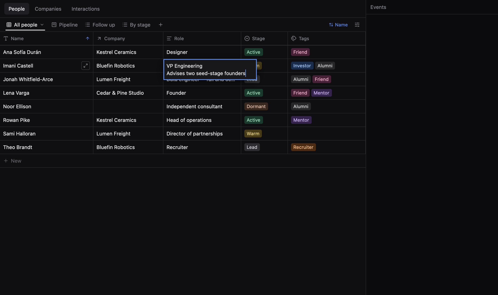 | 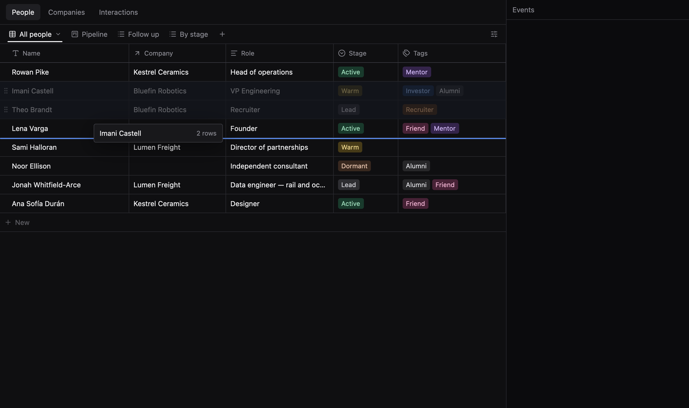 |
| 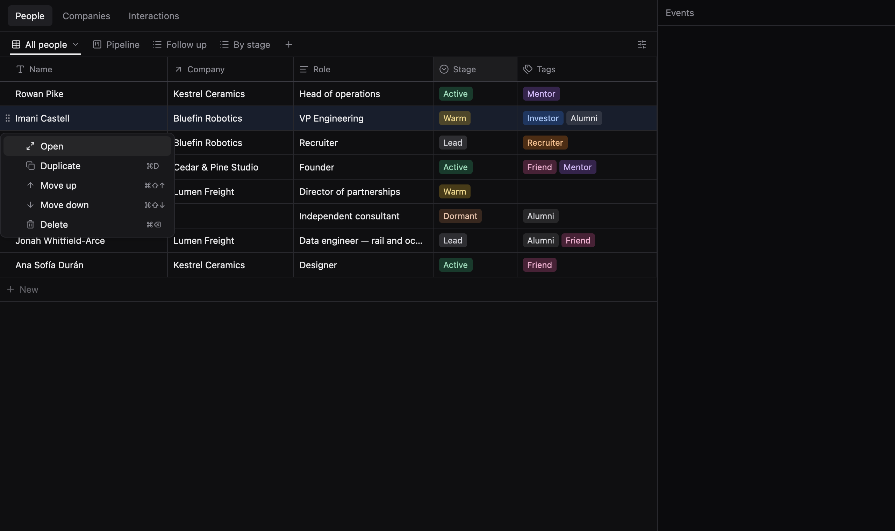 | 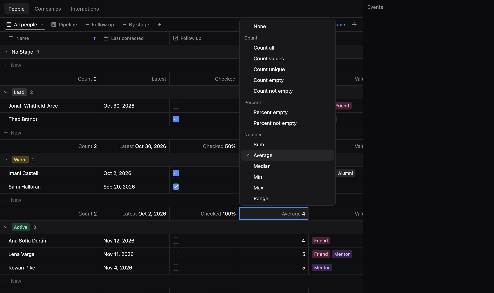 |

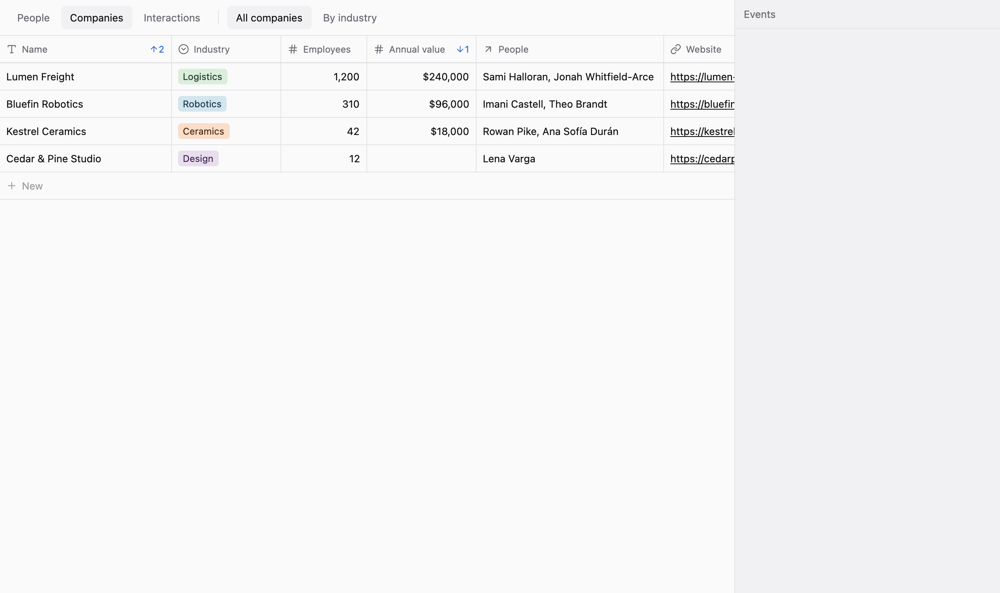

- **The host's part.** `TableHost` gives the theme (`TableTheme`: colours, the ten option
  colours, fonts, sizes, the rem base, and touch), names for people (`person_name`) and related
  rows (`row_title`), the choices of the person and relation pickers (`people`,
  `relation_rows`), the databases a relation can point at (`databases`), the time now and the viewer's zone, and the limits, and may give a text
  field of its own (`edit_text`). It receives every `TableEvent` in `event`. Both are called after the table's own update, so the host can hand
  the table its new docs from there.
- **Rows.** Only the rows on screen are drawn (GPUI's `uniform_list`; group headers and New
  rows are lines of the same height). The rows are worked out again, through `engine::query`,
  only when the docs or the view change. The title column stays in place while the others
  scroll sideways (by trackpad, wheel or finger).
- **Groups.** A grouped view shows each group under a header with its count, and a New row at
  its end. Pressing the header folds it: a `viewChanged` with the group in `collapsedGroups`.
- **Cells.** Each type draws as the [table above](#properties-and-values) says: options as
  chips in their colours, numbers in their format and to the right, dates and times in the
  viewer's zone, people (created-by and edited-by too) and related rows by name, created and
  edited times muted. Every one ends in an ellipsis rather than leave its cell. The title has an
  Open button (on hover with a pointer, always on touch); pressing it, or Enter on the title, is
  an `openRow`.
- **Columns.** Drag a column's edge to resize it and its header to move it; both are a
  `viewChanged` with the whole view, its columns written out with fresh order keys. The header's
  menu changes its property (renames it, changes its type, edits its options, number format,
  date's time, relation or people, deletes it: [Changing properties](#changing-properties)),
  sorts (shift adds a sort to the others), filters by the column (an option, checked or not, a
  person, a related row, a span of dates, empty or not, or a typed value), clears the filter,
  moves the column left or right, hides it, shows and hides any property, and adds one. The +
  after the last column adds a property.
- **Editing.** A press focuses a cell and a second press edits it (Enter and F2 do too). A
  checkbox toggles at once. Selects, multi-selects, people and relations open a picker; a
  relation's change comes with its `relationChanged`, and a new option made in a select's or
  multi-select's picker with its `propertyChanged` ([Edits and events](#edits-and-events)). A
  date opens its month. Delete and
  Backspace empty a cell. Created and edited times and people are read-only: their column's
  menu sorts, filters (by a person, for created-by and edited-by) and groups by them, but a
  press only focuses the cell.
- **Typed values** (titles, text, numbers, URLs, emails, phones) are edited in place, in
  gpui-core's `Input`, so input methods, selection, the clipboard, undo and the platform's
  editing keys work as in any field. Enter, F2, a second press or a double-click opens the field
  holding the value (a title's opens with F2 or a press, as Enter opens its row). A title,
  number, URL, email or phone is typed on one line inside its cell, sized to it, a number at the
  right as its cell shows it. A text value
  can have several lines: its field is a textarea over the cell, at least a menu's width, that
  grows down over the rows below as lines are added (to eight, then it scrolls), with
  Shift-Enter making a new line. Enter commits, Tab and Shift-Tab commit and move to the next
  or previous cell, a press anywhere else commits (the field losing the focus; the window going
  to the background doesn't), and Escape closes it with nothing changed. Typing stops at the
  value's limit ([Limits](#limits)) and a paste is cut to fit, as the web's `maxlength`; a value
  already longer (an agent's) opens whole. The table reads the text as the property's type
  (`1,200`, `$1,200`, `25%`), cuts it to the limits and emits the edit (`rowTitleChanged` for a
  title); text committed unchanged, or that isn't a number for a number, emits nothing. The field is drawn in the theme: the table's text and font, the
  accent's caret and selection, faint placeholder text, the focus colour's edge.
- **Filter values** (a text column's Contains…, a number's Equals…, Greater than… and Less
  than…) are typed the same way, in a field under the column's header, to the limit of a
  value of the column's type: Enter, Tab or a press elsewhere filters by it, Escape doesn't.
- **A field of the host's own.** A host that implements `TableHost::edit_text` gets each typed
  value instead (a `TextEdit` with the target, the type, the text, its limit and the cell's
  bounds) and answers with `reply.commit(text)` or `reply.cancel()`; the table reads, limits and
  emits the answer as it does its own field's. `reply.edit_in_place()` hands an edit back to the
  table's field. The trait's default does just that, so hosts that never implemented it edit in
  place and hosts that did keep their field.
- **Keys.** The arrows move the focused cell, Tab and shift-Tab move along a row and on to the
  next, Enter edits a cell, opens a row from its title, folds a group or makes a row; Escape
  closes a menu, then lets go of selected rows, then of the cell; ⌥↓ opens the column's menu
  (the rows' while rows are selected); rows have keys of their own (below). While a value is
  typed in place the keys are the field's: the arrows move its caret, never the focused cell,
  and Delete and Backspace delete text, not the cell's value. Menus take the keyboard while
  open and open on their first entry (a column's menu on Sort ascending, under its property's
  entries): Up and Down move the highlight, Home and End go to the
  ends, Enter picks, Shift-Enter picks adding a sort to the others (as a Shift-click does), and
  Escape or a press elsewhere closes them and hands the keyboard back to the table, on the same
  cell. A picker opens on the current value with its search field focused: typing searches,
  Up and Down move through the matches, Enter picks the highlighted one (the first match after
  typing). A date's month takes the arrows by days and weeks, Page Up and Page Down by months,
  Enter picks, Escape closes.
- **Menus.** The column's menu and the Columns menu are gpui-core's `PopupMenu` in a `Popover`:
  entries with icons under their sections' headings (at the table's small size), the picked sort,
  filters and shown columns checked, the check in a column before the label as in Notion (every
  entry keeps its room, so the labels line up). A select's, multi-select's, person's or relation's
  picker is gpui-core's `Picker`: a search field over its choices, an option drawn as its coloured
  pill as in a cell (its name is still the entry's label, which assistive tech reads and the search
  matches), the value's checked, before it as in the menus. Its search field is drawn as the table's
  fields typed in place: the caret and the selection in the accent, a faint placeholder. A
  multi-select's (and people's and relations') stays open as choices are toggled, a select's closes
  on a pick. A select's or multi-select's offers Create “text” while what's typed names no option,
  up to the options' limit. Rows are 28 points at the table's text size (44 on touch). They hang
  below what opened them, or above it where there's more room, inside the window and scrolling past
  520 points, at least a menu's width and as wide as their cell or header, in the theme's popover,
  text, hover, line and accent (checks) colours. A menu whose column is scrolled out of view stays
  open at the window's edge.
- **Dates.** A date's month is gpui-core's `MonthGrid` in a `Popover`, in the week the host
  starts on, its days 28 points (44 on touch), the picked day in the theme's accent, today
  ringed in it, a range's days between its ends in the selection colour, Today and Clear under
  it. A pick keeps the
  value's time of day and its range's length.
- **New rows.** The New row at the end of the table, or of each group, emits a `rowCreated` with
  an order key after every row's (`order::between`) and the values that keep the row where it was
  made: the group's value, and what the filter's conditions ask for. When the host hands the row
  back, its title is focused.
- **Calculations.** Under the table's rows, and under each open group's (after its New row),
  is a footer with a cell per column, as Notion's. A cell without a calculation is blank until a
  pointer is over it (or it's focused, or always on touch), when it says "Calculate". Pressing it,
  or Enter on it, opens a menu (gpui-core's `PopupMenu`) of the calculations that fit its column:
  None; Count all, Count values, Count unique, Count empty and Count not empty; Percent empty and
  Percent not empty; and a number's Sum, Average, Median, Min, Max and Range, a date's (and a
  created or edited time's) Earliest, Latest and Range, or a checkbox's Checked, Unchecked,
  Percent checked and Percent unchecked. A pick is a `viewChanged` with the view's
  `calculations` ([Views](#views)), so every footer of the view shows it. The result is at the
  cell's right after a short muted label ("Sum 1,240", "Checked 37.5%", "Latest Nov 12, 2026",
  "Range 8 months"), formatted as the column's cells are: a number in its format, currency and
  decimal places, a date as its cells show dates, in the viewer's zone. The results are worked
  out with the rows, by `engine::calc`, when the docs or the view change, never while drawing;
  `TableView::calculation_text` says what a footer cell shows, and
  `TableView::open_calculation_menu` opens its menu for a host's own control. A calculation left
  from another type (a Sum on a column now a date) shows nothing until another is picked. Boards
  and lists have no footer.
- **A row's handle.** Each row has a handle (⋮⋮) at its left edge, in its title cell's padding:
  shown while a pointer is over the row, on the focused row and on selected rows, and always on
  touch. A press on it selects the row and opens the rows' menu under it; ⌘-press adds the row to
  the selection (or takes it out) and Shift-press selects every row from the last one picked,
  without the menu. A right-click anywhere on a row opens the menu at the pointer, for the
  selected rows when it's one of them.
- **Selecting rows.** Selected rows are drawn in the selection colour. Space selects the focused
  row (and again lets go of it), Shift-Up and Shift-Down run the selection on, and Up and Down
  carry it to the next row. Left, Right, Tab, a press on a cell, editing a cell and Escape let go
  of it (Escape first lets go of the rows, then of the cell). `TableView::select_row` and
  `selected_rows` do the same for a host. Selected rows drag, duplicate, move and delete
  together.
- **Dragging rows.** Dragging a handle moves its row, and the selected rows with it when it's
  one of them (dragging a row that isn't selected lets go of the others). Where it lands and the
  move are the board's and the list's rules and code; the drag itself is
  [gpui-dnd](../gpui-dnd)'s: the handle is its source and the table its target, with a mouse past
  a few pixels or a finger's long press on the handle (a pan, from the handle too, scrolls).
  gpui-dnd draws the picture of the rows, takes Escape, and slides the picture back when the
  rows can't land where they're let go. A host with its own `DndProvider` round the window
  keeps working: the table's own provider steps aside.
  The rows fade where they were, a picture of the row (and how many rows) follows the pointer,
  and a line shows where they'll land: above a row over its upper half, below it over its lower
  half, a group's top over its header, its end over its New row. Near the top or bottom each
  move scrolls a step. Escape puts them back. Dropping is one batch, as on a board:
  - Within a group, a `rowsMoved` with keys between the new neighbours' (`order::n_between`,
    the rows in the view's order).
  - In another group of a grouped table, that and a `rowValueChanged` setting the group property
    for each row that changes group (a multi-select or person swapping the group left for the
    one joined).
  - In a **sorted** view the sort places rows: a drop within a group does nothing, no line is
    drawn, the group a row would join is marked instead, and a note at the table's foot says
    which sort. A drop in another group is the `rowValueChanged` alone.
  - Neighbours whose keys can't be put between renumber the manual order with `order::spread`,
    in the same `rowsMoved`.
  - `TableView::move_rows` does the same for a host's own control, by the groups in
    `TableView::row_lanes`.
- **The rows' menu** (gpui-core's `PopupMenu` in a `Popover`, as the column's): Open (for one
  row), Duplicate, Move up, Move down and Delete, with their keys beside them, under a heading
  with the count when there are several. Move up and Move down move the rows a place within
  their group (for the keyboard and touch); they're off in a sorted view (the menu says why),
  for rows in different groups, and at the group's ends. Delete removes one row at once, as
  Notion does (the host can undo it); several, it asks first: "Delete 3 rows?", with Cancel
  where it opens. The edits are in [Edits and events](#edits-and-events).
- **Keys for rows.** Delete and Backspace empty the focused cell, as before, unless whole rows
  are selected: then they delete those rows. ⌘⌫ deletes the selected rows, or the focused cell's
  row. ⌘D duplicates them, ⌘/ opens their menu (as ⌥↓ does while rows are selected; with none,
  ⌥↓ is still the column's menu), and ⌘⇧↑ and ⌘⇧↓ move them. While a value is typed in place
  all of these are the field's.
- **Touch.** With `TableTheme::with_touch(true)` (the default on iOS) rows, headers, the Open
  button, a row's handle, group headers, New rows, footer cells (which say "Calculate" without
  a pointer over them), menu entries and the month's days are at least 44 points each way, column edges take a finger's drag across 44 points while their line
  stays thin, and a finger's swipe scrolls either way.
- **Nothing redraws while nothing changes,** and the table keeps no timers.

Not in this first table: picking ranges and times in the month
(it shows a range, and keeps a value's time of day and the length of its range), long-press column drags on touch (the menu's Move left and Move right do
it), and showing the engine's `Issue`s beside the view.

## Board view

A view of type `board` draws as a board: the same `TableView` entity, the same `TableHost` and
the same `TableEvent`s as a table. `TableView` reads the view's type each time it draws and
draws a board for `board` and a table for any other type, so a host shows a database's views as
tabs over one entity and switches with `set_view`.


| | |
|---|---|
|  | 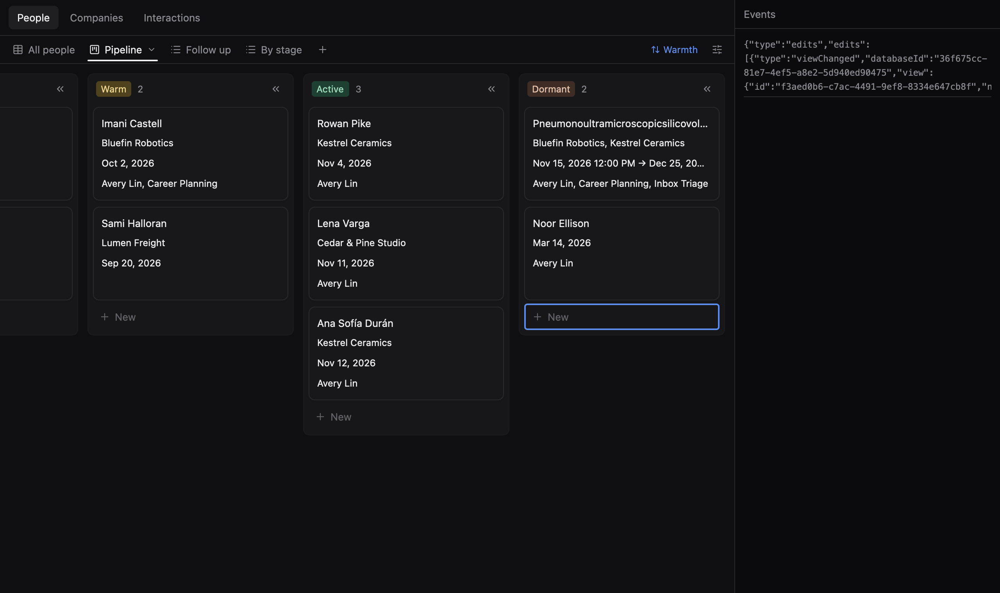 |


- **Columns** are the view's groups (`groupBy`): a select's options, a multi-select's, people,
  checked and unchecked, or date buckets, in the engine's order, with the empty group's column
  ("No Stage") first. Each shows its option's chip (or name) and its count. A board whose
  `groupBy` is missing, or names a property that can't group, is one column of every row.
- **Folding.** The button in a column's header folds it: a `viewChanged` with its key in
  `collapsedGroups`. Folded columns are lines in a "Collapsed" column at the board's end, each
  with its count; pressing one unfolds it.
- **Cards** show the title and the view's `cardProperties` under it, each drawn as the table
  draws its cell (chips in their colours, dates in the viewer's zone, people by name, a checkbox
  with its property's name); empty values are left out. Every line ends in an ellipsis rather
  than leave its card. Pressing a card is an `openRow`.
- **Scrolling.** The board scrolls sideways, and each column up and down on its own (by trackpad,
  wheel or finger). Only the cards on screen are drawn (a `uniform_list` per column), so every
  card in a board is the same height: as tall as the view's card properties need.
- **Dragging.** A card drags through [gpui-dnd](../gpui-dnd): the card is its source and the
  board its target, so a mouse past a few pixels or a finger's long press picks it up (a plain
  pan scrolls), gpui-dnd draws the card's picture and takes Escape, and a card let go where it
  can't land slides back. Boards side by side, each with its own provider, keep their drags
  apart. The card fades where it was, a copy of it
  follows the pointer, the column it would land in is outlined, and a line shows where. Near
  the board's edges, or a column's top or bottom, each move scrolls them a step. Escape puts it
  back.
- **Dropping** is one batch:
  - Within a column, a `rowsMoved` with a key between its new neighbours' (`order::between`).
  - In another column, that and a `rowValueChanged` setting the group property: the column's
    option, person, checkbox or date (a date keeps its time of day and length). A multi-select
    or person value swaps the column it left for the one it joined, in its place; in the empty
    column it empties. A column with no one value (a date bucket such as "Past 7 days") and a
    derived property's columns (created and edited times and people) take no cards from others.
  - In a **sorted** view the sort places the cards, as in Notion: a drop in another column is
    the `rowValueChanged` alone, and dragging within a column does nothing.
  - Neighbours whose keys can't be put between (two the same, an older scheme's) renumber the
    whole manual order with `order::spread`, in the same `rowsMoved`.
  - `TableView::move_card` does the same for a host's own control or assistive technology.
- **New cards.** "New" under each column is a `rowCreated` with the column's value, what the
  filter asks for, and an order key after every row's. When the host hands it back, the new card
  is focused.
- **Keys.** The arrows move between cards (down past the last is its column's New) and across
  columns at the same height, into the folded ones at the end; Tab goes down the columns in turn.
  Enter opens a card, makes one from New and unfolds a folded column. Escape lets go. What a
  drag or a mouse does to the focused card, keys do too: ⌘⇧↑ and ⌘⇧↓ move it in its column
  (with no sort), ⌘⇧← and ⌘⇧→ to the next column at the same place (its group value
  changing, the keyboard going with it), ⌘D duplicates it and ⌘⌫ deletes it.
- **Touch.** With `TableTheme::with_touch(true)` cards, New buttons and folded columns are at
  least 44 points each way, and the fold button takes a 44-point press (`Press::min_hit`) while
  it's drawn small.
- **The theme** adds `TableColors::card` and `TableSizes::board_column_width` (264 points).
- **Nothing redraws while nothing changes,** and the board keeps no timers.

Not in this first board: dragging several cards at once, a + in the column header that adds at
the top, moving whole columns (the options' order is the property's), and showing the view's
sorts and filters on the board itself.

## List view

A view of type `list` draws as a list: again the same `TableView` entity, `TableHost` and
`TableEvent`s, chosen by the view's type each time it draws.


- **Lines.** One per row: the doc's emoji icon if it has one (its `icon` field, as `Doc::icon`
  reads it; an image icon draws nothing for now), the title, then the view's `cardProperties` to the right, each drawn as the table draws its
  cell: chips for selects and multi-selects, dates in the viewer's zone, people and related rows
  by name, a checkbox with its property's name. Empty values are left out. The title has the room
  it needs first (up to three fifths of the line); the values that fit after it are shown in
  order, the first that doesn't fit is cut short with an ellipsis when there's room left, and the
  rest drop off, so nothing leaves its line at any width. Pressing a line is an `openRow`.
- **Groups.** A grouped view shows each group under a header with its chip (or name) and count,
  and a New line at its end. Pressing a header folds it: a `viewChanged` with its key in
  `collapsedGroups`, as in the table. Sort, filter and grouping come from the view through the
  engine, as for the table and board.
- **Dragging** reorders rows, by the board's rules and the board's code (`TableView::move_card`
  and the drop behind it, with the list's groups in place of the board's columns): a row dragged
  within its group is a `rowsMoved` with a key between its new neighbours'; into another group,
  that and a `rowValueChanged` setting the group's value, in one batch, with multi-select and
  person values swapping the group they left for the one they joined. A sorted view takes no
  reordering by hand (a drop in another group is the `rowValueChanged` alone, and the header of
  the group it would join is marked rather than a place in it), and keys that can't be put
  between renumber the manual order. Over a line's upper half the row lands above it, over its
  lower half below; over a header, at its group's top; over a New line, at its group's end. With a
  mouse or a finger's long press it's gpui-dnd's drag (a plain pan scrolls), as on the board.
  Escape puts it back. `TableView::list_groups` gives the groups `move_card` takes.
- **New rows.** The New line of each group (or of the list) is a `rowCreated` with the group's
  value, what the filter asks for and an order key after every row's. When the host hands it
  back, the new row's line is focused.
- **Keys.** Up and Down (and Tab and shift-Tab) move between lines, Page Up and Page Down by a
  screenful; Enter opens a row, folds or unfolds a group, or makes a row from New. Escape lets
  go. ⌘⇧↑ and ⌘⇧↓ move the focused line in its group (with no sort), ⌘D duplicates it and ⌘⌫
  deletes it (or the selected lines, after asking for several), as in a table.
- **Touch.** With `TableTheme::with_touch(true)` lines, headers and New lines are 44 points tall
  and take presses through `Press::min_hit`.
- **Scale.** Every line is the same height, so only those on screen are drawn (`uniform_list`),
  however many rows and groups. `TableView::line_bounds` says where a row's line is (as last
  drawn: none from new rows until they're drawn).
- **Nothing redraws while nothing changes,** and the list keeps no timers.

Not in this first list: dragging several rows at once, a row's Open button and inline editing
(a press opens the row), and showing the view's sorts and filters above it.

## Changing properties

A database's properties are added, changed and deleted from the table, as in Notion. Every
change is a batch of edits for the host ([Edits and events](#edits-and-events)), shown at once
(as a view's change is) and kept until the host hands the table new docs.

| | |
|---|---|
| 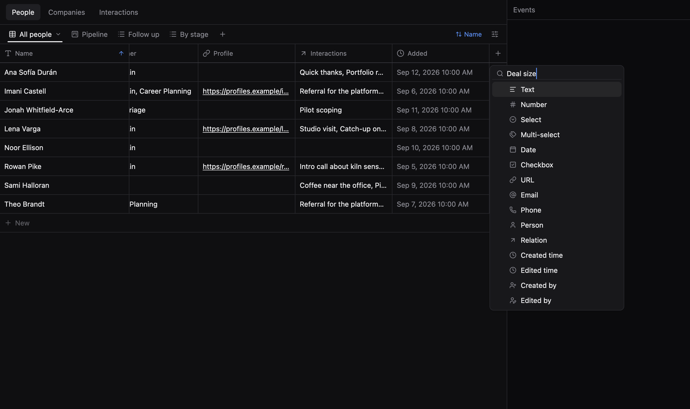 | 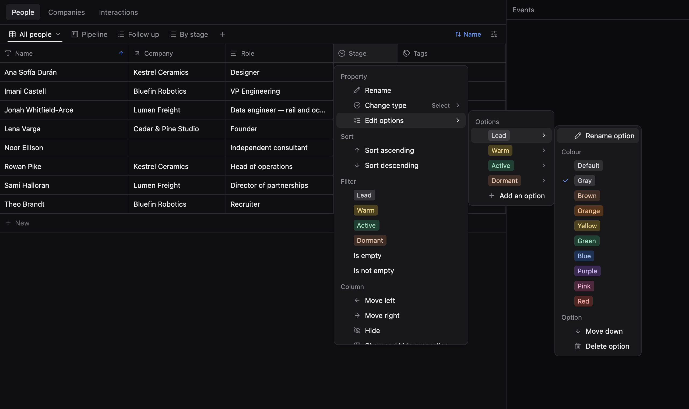 |

- **Adding.** The + after the last column (or Add a property in a column's menu) opens a field
  for the name over the types: every type but the title (gpui-core's `Picker`, its field naming
  rather than filtering). Typing names it, Up and Down move through the types while the field
  keeps the keyboard, Enter or a press on a type makes it.
  Nothing typed names it for its type ("Number", then "Number 2"). It's a `propertyCreated` with a
  new id, `PropertyConfig::default_for` its type (a number plain, a select with no options, a date
  without its time, a person allowing the owner and agents) and an `order` after every
  property's (`order::between`), then a `viewChanged` adding its column at the end of the view
  shown, in one batch. The table scrolls to it. A relation asks for its database and whether it's
  two-way first (below).
- **The column's menu** starts with its property's entries. Those with a chevron open a submenu
  beside them (gpui-core's `PopupMenuItem::submenu`), which stays open while its picks apply:
  - **Rename** opens a field with the name selected: Enter (or Save) is a `propertyChanged`.
  - **Change type** lists the types, the current one checked: a pick is a `propertyChanged` with
    the new type and `Property::retyped`'s config (below). The title's menu has no Change type.
  - **Edit options** (selects and multi-selects) lists the options as their pills. Each opens its
    own submenu: Rename option, the ten colours, Delete option. The options reorder in place
    (gpui-core's menu reorder groups): drag one, long-press one by touch, or Alt-Up and Alt-Down
    on the highlighted one. Add an option and Rename option open a field. Every change is a
    `propertyChanged` with the whole property: options are placed by their order in the list. A deleted option's rows keep naming it and
    show empty, as any value naming an option the property hasn't does.
  - **Number format**: Number, Percent or Currency, the currency in a submenu of its own (USD,
    EUR, GBP, JPY, CNY, INR, KRW, CAD, AUD, CHF), and decimal places (default, or 0 to 4).
  - **Include time** (dates) toggles `includeTime`: what a new value gets. A value keeps its own
    `includeTime`; one picked in an empty cell then holds the day's start in the viewer's zone.
  - **Relation**: the database it relates to (the host's `databases`, and this one), and **Show
    on** that database, which makes it two-way or one-way.
  - **People**: whether it allows the owner, agents or both (not neither).
  - **Delete property** asks first, opening on Cancel: Delete property is a `propertyDeleted`.
    The title can't be deleted.
  - **Steps, not submenus, for a name or a confirm.** A rename, a new option's name and a
    delete's confirm replace the menu in its popover, as Notion's name field sits over its menu:
    a field (gpui-core's `Input`) keeps the keys a submenu would take, and a confirm that opens on
    Cancel can't be crossed by a pointer on its way past. Save, Back and Cancel go back to the
    column's menu on the entry the step came from.
- **Two-way relations** are both databases' properties, written in one batch:
  - A new two-way relation is two `propertyCreated`s: this database's, then the related one's
    (`relation::two_way_pair`), each naming the other as `backPropertyId` with `twoWay` set. The
    other side is named for this database (unlike the other's property names: "People 2" if it
    has a People), goes after its properties, and the batch ends with the `viewChanged` adding this
    side's column. A relation to its own database makes both in it.
  - Turning **Show on** on for a one-way relation is its `propertyChanged`, the other side's
    `propertyCreated`, and a `relationChanged` for every row it already lists (`added` its ids),
    which the host's `relation::back_edits` writes on the other side as for any change.
  - Turning it off, picking another database, changing the type, or deleting the property, also
    deletes the other side: a `propertyDeleted` in the other database, in the same batch.
- **Changing type never rewrites rows.** The new config is the type's default, keeping the
  options it had (so a select becomes a multi-select with them, and a select changed to text and
  back finds them again) and config keys this version doesn't know. Values stay as stored and are
  read as the new type reads them, as Notion keeps and reinterprets them:
  - Text, URL, email and phone share strings, so their values carry over.
  - A select and a multi-select read each other's: a select's one option as a list of one, a
    multi-select's first option as a select (`Value::option_ids`, `Value::option_id`), in
    cells, filters, sorts, groups and pickers. The first edit writes the new shape.
  - A select or multi-select changed to text (or a URL, email or phone) shows its option's name
    (`Property::shown_text`), and its field opens on it; sorts and filters see the name too.
    (The stored id stays until the value is edited.)
  - A value of another shape (text under a number, a number under a date, option ids under a
    relation) shows empty and stays stored, so changing back shows it again. A relation pointed
    at another database keeps its row ids, which show as untitled rows.
  - Filters, sorts and groups that no longer fit the type are left out and reported as
    `Issue`s, as for any view.
- **Limits** are kept in the menus, each refused with a note in the menu: no new property past
  `properties` (the + menu's types are shown but can't be picked; a two-way relation needs room
  in both databases, and its other side can't be turned on while that database is full), no
  option past `options`, names typed up to `name_chars` (options' to `option_name_chars`), with a
  note at the limit. A name another property (or option) has, case aside, or an empty name, is
  refused too.
- **Keys and touch.** Everything is in menus the keyboard drives (⌥↓ opens a column's menu; Up,
  Down, Home, End and Enter move and pick; Enter, Space or → opens a submenu and ← or Escape
  closes it; Escape closes the menu). Fields take Enter to save. A submenu opens on a tap, as on
  a press. On touch every entry, the rename fields and the + are at least 44 points tall.
- **Moving an option** shows its list in the new order with the option's submenu still open
  beside it, on the entry that moved it (gpui-core keeps a menu's highlight and open submenu on
  their entries). Back from a step (a rename, a new option, a delete confirmed) opens the
  column's menu on the entry the step came from, inside the submenus it was in; Back from a new
  relation's database opens the + menu on Relation, its name as typed.
- **For a host's own control**, `TableView::open_add_property_menu` and
  `TableView::open_property_menu(property_id, PropertyMenu::Options, ..)` open the same menus:
  a submenu or step on its own, hanging from the column's header.
- **Boards and lists** have no column headers, so they have no property menus yet; their
  properties change from a table view of the same database.

## Changing views

A database's views are made, changed and deleted from a bar of views the table draws over
itself, as Notion's tabs over a database. Every change is a batch of edits for the host
([Edits and events](#edits-and-events)), shown at once and kept until the host hands the table
new docs, as a header's change is.

| | |
|---|---|
| 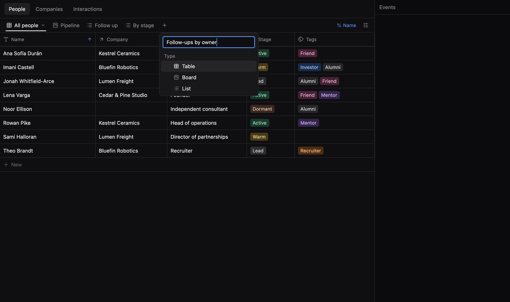 | 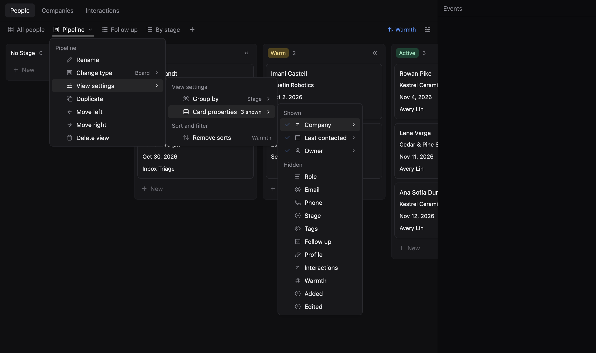 |

```rust,ignore
let table = cx.new(|cx| TableView::new(host, database, rows, cx).with_view_bar(true));
```

- **The bar is an option on `TableView`** (`with_view_bar(true)`, or `set_view_bar`), not an
  element of its own. The bar, the table under it and their menus share one entity: the view
  shown, the one popover open at a time, the keyboard going back where it came from, and the
  edits shown at once all stay the table's, with one host and no second object for the host to
  place or keep in step. A host that draws its own tabs leaves it off and calls `set_view`, and
  can still open the same menus (`open_add_view_menu`, `open_view_menu(view_id, ViewMenu::..)`),
  which then hang from the view's top left.
- **Tabs.** The views in their `order`, each with its type's icon, the shown one marked (a line
  under it, a chevron) and scrolled into view; past the bar's width they scroll sideways while +
  and the settings stay put. Pressing a tab shows its view (`set_view`); the table keeps which
  view is shown, so the host needn't store it, and `TableHost::view_shown` tells a host that wants
  to remember it. Pressing the shown view's tab, or right-clicking any tab, opens its menu.
- **Adding.** + opens a field for the name over the types: Table, Board, List and Gallery,
  in gpui-core's naming `Picker` as for properties. Typing names it, Up and Down move through the types while the field keeps
  the keyboard, Enter or a press makes it; nothing typed names it for its type ("Board", then
  "Board 2"). It's a `viewCreated` with a new id, an `order` after every view's
  (`order::between`) and the type's defaults (no sort, filter or columns; a table shows every
  property), and the new view is shown. A **board** groups by the first select property; with no
  select it asks which property to group by (any multi-select, checkbox, person or date), and
  with nothing that can group it says so (add one from a table first).
- **A view's menu**, its chevroned entries opening submenus beside them:
  - **Rename** opens a field with the name selected: Enter (or Save) is a `viewChanged`.
  - **Change type** lists Table, Board and List: a `viewChanged` with the new type. A table or
    list keeps its grouping; a board keeps one that can group, else takes the first select,
    else asks, as + does.
  - **View settings** (below).
  - **Duplicate** is a `viewCreated`: a copy with a new id, named "Name copy", its `order`
    between the view's and the next one's. The copy is shown.
  - **Move left** and **Move right**, or dragging a tab onto another, is a `viewChanged` with the
    view's new `order` between its new neighbours'; where they can't be put between (two the
    same, an older scheme's), every view is renumbered (`order::spread`), a `viewChanged` each in
    one batch.
  - **Delete view** asks first, opening on Cancel: Delete view is a `viewDeleted`. The last view
    can't be deleted. Deleting the view shown shows its neighbour (the next, else the one
    before). As for properties, the rename and the confirm are steps in the popover, not
    submenus.
- **View settings**, a submenu of a view's menu, or a menu of its own from the bar's settings
  button (with Change type at its top); each of these is a submenu of it:
  - **Group by** lists the properties that can group, the current one checked, and None for a
    table or list (a board always groups). A pick is a `viewChanged` with `groupBy`, its folded
    groups let go and its `groupDate` kept only for a date.
  - **Date grouping**, while it groups by a date: Relative, Day, Week, Month or Year
    (`groupDate`, absent for relative). Grouping by a date adds it under Group by and moves
    the settings' highlight to it, so → opens it.
  - **Card properties** (a board) and **Properties** (a list) list the properties shown on cards
    or lines, in order, then the hidden ones. A hidden one pressed is shown after the others; a
    shown one opens its own submenu, to hide it (the list then has the keyboard, on the one
    hidden). The shown ones reorder in place, as options do: a drag, a long press by touch, or
    Alt-Up and Alt-Down. Each is a `viewChanged` with `cardProperties`.
  - **Properties** (a table) opens the Properties menu the column headers have (Show and hide
    properties).
  - **Filter**, the filter builder (Notion's advanced filter): the view's filter as rules,
    Rule 1, Rule 2... each with what it tests beside it, then **Add a filter rule** (the
    properties) and **Delete filter**. With two rules or more, **Match all** or **Match any**
    (`and` or `or`). Each rule's submenu changes its **Property**, its **Condition** (the
    operators its type takes) and its **Value**: options, people and related rows picked from a
    list, a span (Today to Next year) for "is within", and text, numbers and dates (as
    2026-11-15) typed on a step of their own. **Delete rule** takes it out. A new rule has no
    value and filters nothing until it's given one, as in Notion; a condition changed to one
    that takes no value (is empty, is checked) loses its value. A rule that's a group (from the
    JSON or another app) stays whole, and can be deleted. Every change is a `viewChanged`.
  - **Remove sorts** and **Clear filter**, while it sorts or filters, each a `viewChanged`.
    Sorts are made from the headers, and filters from the headers or the Filter submenu; the bar
    sums up the shown view's (its sort's first property and how many more, its filter's
    property or how many rules), and pressing either opens the settings (the filter's, on its
    rules).
- **Peek.** With `TableView::set_peek(true)`, opening a row (its Open button, a card, a list's
  line, Enter) shows it in a panel at the view's right instead of an `openRow`: its title, then
  every property with its value as its cell shows it. The panel steps to the row above or below
  (in the view's order), has **Open as page** (the `openRow`, and the panel closes) and Close;
  Escape closes it too. A host can peek a row itself (`peek`, `close_peek`, `peeked_row`), and
  the panel goes when its row leaves the docs. Pressing the title or a value edits it with its
  cell's own editor, in the panel: a field where the value was (Enter saves, Escape leaves it),
  or the options, people or rows, or the month hung from it, or a checkbox's toggle. Each change
  is the cell's `rowValueChanged`. A property the view hides as a column is edited the same way.

  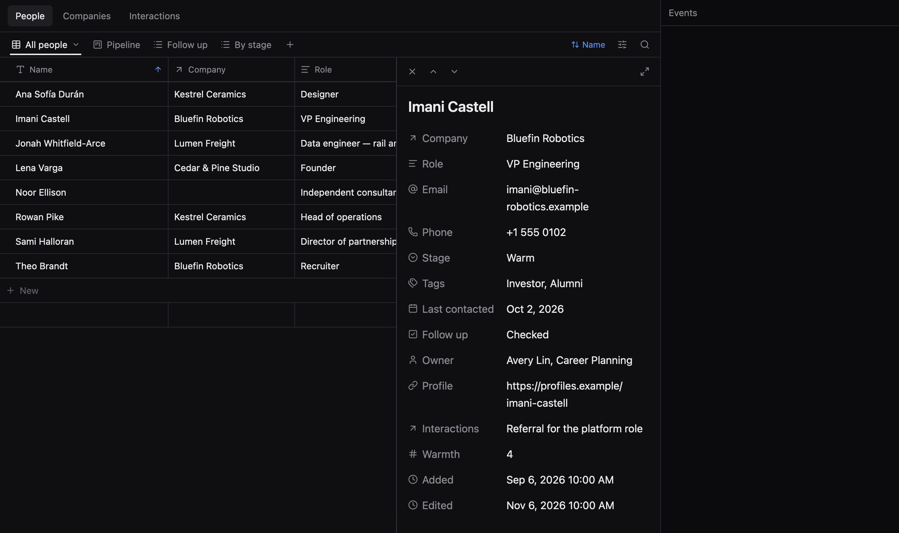
- **Search.** The search button at the bar's right end, or ⌘F while the view has the keyboard,
  opens a field in its place ("Search", with a × to clear it). As it's typed, the table, board
  or list shows only the rows whose title or any shown property's text (a table's columns, a
  board's cards' or a list's lines' properties) contains it, without regard to case or accents,
  by what the cells show (an option's or a person's name, a related row's title, a number in
  its format, never an id), on top of the view's own filter, sorts and groups. Groups with
  nothing found are left out, and the counts are of what's found; "No results for “…”" stands
  where the rows would be when nothing is. Escape clears what's typed, then closes the field;
  clearing it shows the view as it was, scrolled where it was, with its focused cell and
  selected rows. The search is the entity's alone: never saved, never an edit, kept across the
  views it shows. While the field is open the sort and filter summaries are their icons alone,
  so a narrow bar keeps room for the tabs. `TableView::set_search(Option<String>)` and `search()` let a host drive it
  (and `open_search` opens the field), and `engine::search` is the same without the UI: rows'
  words folded once into a `SearchText`, then `search(&view_rows, &text, &Query::new(..))` for
  each query. The view folds them off the main thread as the field opens (asking the host for
  people's names and related rows' titles on it), so the first key only searches; a key typed
  before that's done folds them then. Nothing is folded while the field is closed, and what was
  folded is kept until the docs or the view change.

  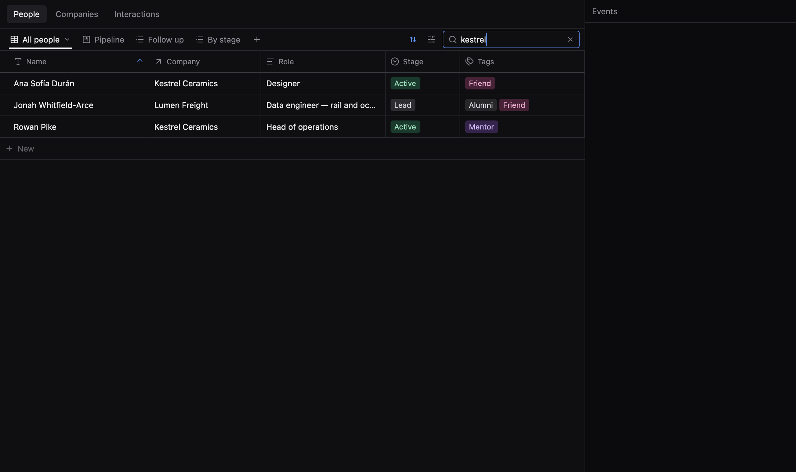
- **Limits** are kept in the menus, each refused with a note: no view past `views` (+ shows its
  types but can't make one, and Duplicate is refused), names typed up to `name_chars` with a note
  at the limit and an empty name refused, and in a column's menu no sort added past `sorts`
  (Shift-click, Shift-Enter).
- **Keys.** Up from a table's or list's top line, or a board's top card, goes to the shown
  view's tab (`TableView::focus_view_bar` does too). In the bar Left and Right move along the
  tabs, Enter shows the focused one (or opens the shown one's menu), ⌥↓ opens its menu, Tab
  reaches +, the sort and filter summary and the settings, and Down or Escape goes back to the
  view. The menus are driven as the property menus are (Up, Down, Home, End, Enter; → and ←
  open and close a submenu, Escape closes the innermost), and a menu opened from the bar gives
  the keyboard back to it when it closes.
- **Touch.** With `TableTheme::with_touch(true)` tabs, +, the summaries, the settings button
  and the search (its button, field and ×) are 44 points tall (+, the settings, the search
  button and its × 44 wide), as is every menu and submenu entry and the
  rename field; a tap opens a submenu.

## Databases and rows are docs

Everything is a doc in the host's tree, the same shape for pages, databases and rows:

| Field | |
|---|---|
| `id` | A lowercase UUID, made by whoever creates the doc. |
| `kind` | `"page"` or `"database"` (other kinds are carried as they are). |
| `title` | The page's or database's name. For a row, its title property's value. |
| `order` | A fractional index among its siblings ([Order](#order)). For a row, its place in the database's manual order. |
| `folderId` | The folder a full-page doc is in, or null. |
| `parentDocId` | The page it's under, or null. A row's is its database. |
| `parentObjectId` | For an inline database, the block in its parent page that embeds it. |
| `cover`, `favorite`, `agents` | The host's; carried, never read. |
| `icon` | Optional, on every kind of doc: a string or null, written last-write-wins like the other fields, never in `values` ([Icons](#icons)). |
| `author`, `updatedBy` | Who created and last changed it: `{"kind": "owner"}` or `{"kind": "agent", "agentId": "concierge"}`. A row's `createdBy` and `editedBy` properties show them. An older doc may have no `updatedBy`. |
| `created`, `updated` | Milliseconds since the Unix epoch. |
| `rev`, `seq` | The host's revision and sequence numbers; carried, never read. |
| `deleted` | A tombstone: the time it was deleted, in milliseconds since the Unix epoch, or null while it isn't. Views leave deleted rows out. The crate reads it as `Option<i64>` (`Doc::is_deleted` says whether it's set) and writes the number or null. For older data it also reads `false` as null and `true` as 0 (deleted at an unknown time). |
| `database` | Only on a database: `{properties: [Property], views: [View]}`. |
| `values` | Only on a row: `{propertyId: value}`. |

- **A full-page database** is a database doc in a folder or under a page.
- **An inline database** is a database doc whose `parentDocId` is the page that shows it and whose
  `parentObjectId` is the block that embeds it.
- **A row** is a page doc whose `parentDocId` is the database. Opening a row opens that page.
- A row's **created time** and **edited time** are its doc's `created` and `updated`; its
  **created by** and **edited by** are `author` and `updatedBy` (or `author`, for an older doc
  without `updatedBy`). None of these are stored in `values`.

In Rust these are one type, `Doc`, with the fields above typed and a `database:
Option<DatabaseFields>` and `values: Option<Values>`. Every type keeps the JSON fields it doesn't
know in an `extra` map, and every enum keeps strings it doesn't know as `Other(String)`, so a doc
from a newer host or an agent reads and writes back unchanged. The round-trip tests check this
for every fixture.

### Icons

A doc's `icon` is null (no icon) or a string, one of:

- **An emoji:** one grapheme cluster of at most 16 bytes (`"☕"`, `"✉️"`, `"🇯🇵"`, `"👍🏽"`,
  `"👩‍👧"`). A family of three (18 bytes) is too long.
- **An image:** `asset:` and the image's SHA-256 in 64 lowercase hex characters. A string
  starting with `asset:` is never an emoji, whatever follows.

`Doc::icon` gives the emoji, and None for anything else (an image, an empty or invalid string,
or a value that isn't a string), so an image's or a bad icon's text is never drawn.
`Doc::icon_asset` gives an image icon's SHA-256 for a host that draws images; the views draw
nothing for one yet. `Limits::check_doc` reports an icon that's neither ([Limits](#limits)). The
crate carries the field in `Doc::extra`.

## Properties and values

A property is `{id, name, type, config, order}`. Its `id` is a UUID, which rows' values are keyed
by, so renaming a property changes no row. The value's JSON depends on the type:

| Type | `config` | Value | Sorts by | Groups |
|---|---|---|---|---|
| `title` | | the row doc's `title` | text | |
| `text` | | `"..."` | text | |
| `number` | `format` (`plain`, `percent`, `currency` with `currency`, an ISO 4217 code), `precision` | `12.5` | number | |
| `select` | `options: [{id, name, color}]` | an option id | the options' order | a column per option |
| `multiSelect` | `options` | `[option id]` | the options' order | the row in each of its options |
| `date` | `includeTime`, `range` (what a new value gets) | `{start, end?, includeTime}` | `start` | relative, day, week, month, year |
| `checkbox` | | `true` / `false` (missing is false) | unchecked first | unchecked, checked |
| `url`, `email`, `phone` | | `"..."` | text | |
| `person` | `kinds: ["owner", "agent"]` | `[{kind: "owner"}, {kind: "agent", agentId}]` | the host's names | the row with each person |
| `relation` | `databaseId`, `twoWay`, `backPropertyId` | `[row doc id]` | the related rows' titles | |
| `createdTime` | | the doc's `created` | time | as dates |
| `editedTime` | | the doc's `updated` | time | as dates |
| `createdBy` | | the doc's `author` | the host's names | the row with its person |
| `editedBy` | | the doc's `updatedBy`, else its `author` | the host's names | the row with its person |

- **Option colours** are names (`default`, `gray`, `brown`, `orange`, `yellow`, `green`, `blue`,
  `purple`, `pink`, `red`); the host's theme says what each looks like.
- **Dates** are milliseconds since the epoch. Without `includeTime`, `start` and `end` are
  midnight UTC of the dates meant, and read as those dates in every time zone. With it they're
  instants, shown in the viewer's zone. A range's `end` is inclusive.
- **Created and edited times and people are derived.** Their values are read from the row doc
  (the table above), never stored in `values`, and they're read-only: the table draws them and
  filters, sorts and groups by them, but never edits them, and a new row gets no value for
  them (the host fills in the doc's own fields). Their `config` is empty: `{"id": "<uuid>",
  "name": "Added by", "type": "createdBy", "config": {}, "order": "a9"}`. A created-by or
  edited-by value is one person, of the shape a `person` value's items have; a doc without an
  `author` has none (an empty cell), and one without `updatedBy`, written before the host kept
  it, shows its `author` as its editor.
- **There's no contacts type.** People are rows in a People database, reached from other
  databases through a `relation` property. The `person` type is only ever the owner or one of
  their agents.
- **Text sorts** ignore case. Every sort puts empty values last, whichever way it runs, and is
  stable: rows that tie keep the database's manual order.
- **Missing and malformed values** are empty: a select whose option was deleted, a number stored
  as text, a shape the crate doesn't read. They're kept as they are, and never break a view.
  After a type change, values are read as the new type reads them, never rewritten
  ([Changing properties](#changing-properties)).

## Views

A database has several saved views, each `{id, name, type, order, sort, filter, groupBy,
columns, cardProperties, collapsedGroups, calculations, cardPreview, cardSize}`. They're tabs above the database, in `order`, and
every person (and agent) sees the same ones.

- **`sort`** is a list of `{propertyId, direction}` (`ascending` or `descending`), applied in
  turn. With no sort, rows are in the manual order (each row's `order`).
- **`filter`** is a tree of conditions ([Filters](#filters)).
- **`groupBy`** is a property id. Grouping by a date also reads **`groupDate`** (`relative`,
  `day`, `week`, `month`, `year`; relative when absent), an addition to the first proposal.
- **`columns`** is a table's `[{propertyId, width, hidden, order}]`. Properties without a column
  show after the others at the default width; `width` null means the default.
- **`cardProperties`** are the properties a board card shows under the title, or a list line
  beside it.
- **`cardPreview`** is what a gallery's cards show above their title: `none`, or `cover` for each
  row doc's `cover` (an addition to the first proposal). Absent or null is none, and it's left
  out of the JSON when absent. A value the crate doesn't know draws nothing and is kept as
  written, but `Limits` refuses it (`not none or cover (view <id>)`), as a host that stores views should, and the
  view's settings only ever write `none` or `cover`.
- **`cardSize`** is how big a gallery's cards are (Notion's card size): `small`, `medium` or
  `large`, 172, 252 or 340 points wide and never wider than the view, so at a 736-point view three,
  two and two cards a line, and at a phone's 393 two, one and one. Absent or null is medium
  (today's card), and it's left out of the JSON when absent; the view's settings write it left
  out for medium. A value the crate doesn't know draws medium and is kept as written, but
  `Limits` refuses it (`not small, medium or large (view <id>)`), as a host that stores views
  should.
- **`calculations`** are a table's footer: `{propertyId: calculation}`, at most one per
  property, left out when there are none (an addition to the first proposal). A calculation is
  one of `countAll`, `countValues`, `countUnique`, `countEmpty`, `countNotEmpty`,
  `percentEmpty`, `percentNotEmpty` (every type); `sum`, `average`, `median`, `min`, `max`,
  `range` (numbers); `earliest`, `latest`, `range` (dates, created and edited times; the range a
  duration); and `checked`, `unchecked`, `percentChecked`, `percentUnchecked` (checkboxes). A
  name the crate doesn't know is kept as written, as is one that no longer fits its property's
  type after a change of type; both work out as nothing. Each is worked out over the rows the
  view shows (after its filter), or a group's, by `engine::calculate` (or every one of a view
  at once by `engine::calculate_view`), so a host or a server can show the same totals with no
  UI. Empty is what the `isEmpty` filter matches (no value, `""`, `[]`, an option the property
  no longer has, a value of the wrong shape for its type), a checkbox's empty being unchecked;
  Count values counts a list's items (options, people, related rows) each; Count unique counts
  the distinct ones.

  ```rust
  use gpui_tables::engine::{calculate, query, Calculated, Context};
  use gpui_tables::{Calculation, DatabaseFields, Doc, Property, PropertyType, Value, View, ViewType};

  let mut db = DatabaseFields::default();
  db.properties.push(Property::new("name", "Name", PropertyType::Title, "a0"));
  db.properties.push(Property::new("deal", "Deal", PropertyType::Number, "a1"));
  let rows: Vec<Doc> = [400., 840.]
      .iter()
      .enumerate()
      .map(|(i, x)| {
          let values = [("deal".to_owned(), Value::number(*x))].into();
          Doc::row(format!("r{i}"), "db", format!("Deal {i}"), "a0", values)
      })
      .collect();
  let view = View::new("v", "All", ViewType::Table, "a0");
  let shown = query(&db, &view, &rows, &Context::new(0));
  let sum = calculate(db.property("deal").unwrap(), &Calculation::Sum, &rows, &shown.rows);
  assert_eq!(sum, Some(Calculated::Number(1240.)));
  ```
- **`collapsedGroups`** are the groups folded shut, by key: `empty`, `option:<id>`, `checked`,
  `unchecked`, `owner`, `agent:<id>`, `relative:today`, `day:2026-11-15`, `week:2026-11-09`
  (the week's first day), `month:2026-11`, `year:2026`.

How each type behaves:

- **Table.** A row per row and a column per property. Columns resize by dragging their edge and
  reorder by dragging their header; both are a `viewChanged`. The header's menu sorts, filters,
  hides and edits the property. Text, number, checkbox, select, multi-select, date, URL, email
  and phone cells edit in place; a person or relation cell opens a picker. The title cell has an
  Open button: opening a row is an `openRow` event, and the host shows the page. Grouped tables
  show each group under a header with its count, which folds. Dragging rows reorders them when
  the view has no sort (as in Notion, a sorted view can't be reordered by hand).
- **Board.** Columns of cards, one per group, grouped by a select (or a multi-select, checkbox,
  person or date). Dragging a card to another column changes its value, and its place in the
  manual order (when the view has no sort). A card shows its title and `cardProperties`. Each
  column has a New to add a row with that column's value. See [Board view](#board-view).
- **List.** One line per row: the title, then `cardProperties` to the right. Grouping folds as in
  a table, and rows drag to reorder and between groups as cards do. See [List view](#list-view).
- **Gallery.** The rows as cards in a grid, as many to a line as the view's width takes: each
  the board's card, its title and the view's `cardProperties`. Pressing a card opens its row (or
  peeks it); the arrows move between cards and Enter opens one; New after the cards makes a row.
  ⌘⇧← and ⌘⇧→ move the focused card a place back or on (with no sort), ⌘⇧↑ and ⌘⇧↓ a line,
  and ⌘D and ⌘⌫ duplicate and delete it.
  A card dragged to another place (with no sort) is a `rowsMoved`, the board's drag, with a line
  where it'll land. With the view's **Card preview** on Page cover (`cardPreview: "cover"`), each
  card starts with a 16:9 band showing its row's `cover`: the image (`{"style": "image",
  "assetId": ..}`, which the host gives through `TableHost::image`, as the crate fetches
  nothing) or the colour (`{"style": "solid", "color": "#rrggbbaa"}`). A row with neither, or
  whose image the host doesn't have yet, gets an empty band, so the cards line up. Grouped by
  `groupBy` (its settings' Group by, as a table's and a list's), each group is a header (its value
  and its count, pressed to fold it, in `collapsedGroups`) over its own grid of cards and a New
  that makes a row with its value. A card dragged into another group takes that group's value,
  as a board's card dragged to another column does; the arrows go on from one group's cards to
  the next's, and ⌘⇧↑ and ⌘⇧↓ past a group's first or last line move the card to the end of the
  group before or the start of the one after.

  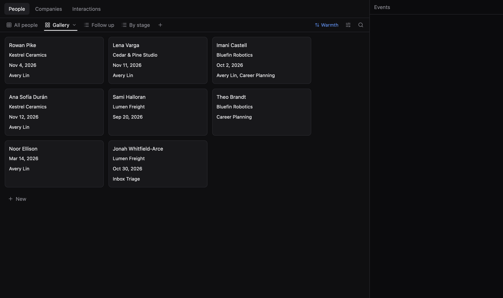

  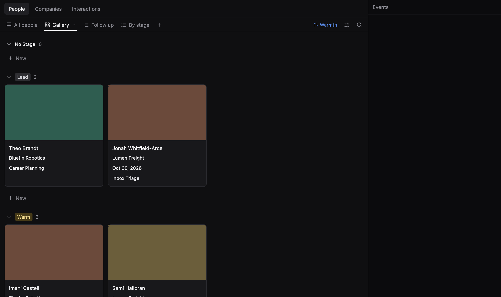

A new row made in a filtered or grouped view gets the values that keep it in that view (the
group's option, a checked box the filter wants), as Notion does.

## Filters

A filter is a tree: `{"and": [..]}` and `{"or": [..]}` over conditions `{propertyId, op,
value}`. For example, people to follow up with:

```json
{"and": [
  {"propertyId": "<Follow up>", "op": "isChecked"},
  {"or": [
    {"propertyId": "<Last contacted>", "op": "before", "value": "2026-10-15"},
    {"propertyId": "<Last contacted>", "op": "isEmpty"}
  ]}
]}
```

| Property type | Operators | `value` |
|---|---|---|
| title, text, url, email, phone | `is`, `isNot`, `contains`, `doesNotContain`, `startsWith` | a string; case is ignored |
| number | `is`, `isNot`, `greater`, `greaterOrEqual`, `less`, `lessOrEqual` | a number |
| select | `is`, `isNot` | an option id |
| multiSelect | `contains`, `doesNotContain` | an option id |
| person | `contains`, `doesNotContain` | a person, or `"owner"` or `"agent:<id>"` |
| createdBy, editedBy | `is`, `isNot`, `contains`, `doesNotContain` (with one person, `is` is `contains`) | a person, or `"owner"` or `"agent:<id>"` |
| relation | `contains`, `doesNotContain` | a row id |
| date, createdTime, editedTime | `is`, `isNot`, `before`, `after`, `onOrBefore`, `onOrAfter` | a day: `"2026-11-15"`, milliseconds, or a date value |
| date, createdTime, editedTime | `within` | `today`, `pastWeek`, `pastMonth`, `pastYear`, `nextWeek`, `nextMonth`, `nextYear` |
| checkbox | `isChecked`, `isNotChecked`, or `is` with `true` or `false` | |
| all but checkbox | `isEmpty`, `isNotEmpty` | |

- Dates compare whole days in the viewer's zone. A range matches when any of its days does.
  `within` spans include today.
- The negative operators (`isNot`, `doesNotContain`) match empty values, as Notion's do.
- A condition with no value yet (one being written) is left out. One whose property is gone, whose
  operator doesn't fit the type, or whose value can't be read is left out and reported as an
  `Issue`, which the view can show beside it. An `and` or `or` with nothing left matches every
  row.

## Edits and events

The crate never changes the host's data. Everything a person does in a view comes out as a
`TableEvent`:

- `{"type": "openRow", "rowId"}`: open the row's page. The crate never navigates.
- `{"type": "edits", "edits": [Edit]}`: changes to apply together, in one batch.

| Edit | Fields | The host |
|---|---|---|
| `rowCreated` | `rowId`, `databaseId`, `order`, `title`, `values` | makes a page doc under the database (filling in times, author, rev, seq) |
| `rowTitleChanged` | `rowId`, `title` | patches the row doc's `title` |
| `rowValueChanged` | `rowId`, `propertyId`, `value` | patches the row's `values` for that one property (null removes it) |
| `relationChanged` | `rowId`, `propertyId`, `databaseId`, `backPropertyId`, `added`, `removed` | writes the other side of a two-way relation ([Relations](#relations)) |
| `rowsMoved` | `rowIds`, `orders` | sets each row's `order` (`orders[i]` for `rowIds[i]`) |
| `rowsDeleted` | `rowIds` | tombstones the rows: sets each one's `deleted` to the time now |
| `propertyCreated`, `propertyChanged` | `databaseId`, `property` | writes the whole property into the database's `database.properties` |
| `propertyDeleted` | `databaseId`, `propertyId` | removes it (rows' values for it may stay; they're ignored) |
| `viewCreated`, `viewChanged` | `databaseId`, `view` | writes the whole view |
| `viewDeleted` | `databaseId`, `viewId` | removes it |

How a host writes them to its store, here one that takes batches of `put` and `patch` ops:

- **Row values and titles are patched, never put.** The store writes a doc's `values` only when
  the doc is created, and by `patch`. A `put` on an existing doc leaves its `values` alone.
  `patch` is the batch op `{op: "patch", type: "doc", id, title?, values?: {propertyId: value |
  null}}`, merged key by key, with the last write to each key winning. So:
  - `rowValueChanged {rowId, propertyId, value}` is `{op: "patch", type: "doc", id: rowId,
    values: {propertyId: value}}`, with null removing the value.
  - `rowTitleChanged {rowId, title}` is `{op: "patch", type: "doc", id: rowId, title}`. The title
    is the row doc's `title`, never a value in `values`, so a title edit is this event and not a
    `rowValueChanged`.
  - The edits of one batch for one row can go in one `patch`, with `title` and several `values`
    keys.
  - An agent and a person editing different cells of one row don't overwrite each other.
- **New rows** (`rowCreated`) are the only time a row's `values` are written whole.
- **Moving and deleting rows** set the docs' `order` and `deleted` (the time of the delete),
  never their `values` (so a `put` of the doc is safe: it leaves `values` alone). Undoing a
  delete sets `deleted` back to null.
- **Properties and views are last-write-wins** inside the database doc's `database` field, and
  their edits carry the whole property or view.
- **One action, one batch.** Dropping a card in another board column is a `rowsMoved` and a
  `rowValueChanged`; changing a two-way relation is a `rowValueChanged` and a `relationChanged`.
  The host applies a batch together, and can undo it by applying the inverse.
- **Properties changed from the table** ([Changing properties](#changing-properties)):
  - Adding one: `propertyCreated`, then `viewChanged` with its column at the end of the view.
  - Adding a two-way relation: `propertyCreated` here, `propertyCreated` in the related
    database (each naming the other), then the `viewChanged`.
  - Renaming, changing the type, options, number format, `includeTime`, a relation's database or
    a person's kinds: one `propertyChanged` with the whole property.
  - Making a relation two-way: its `propertyChanged`, the other side's `propertyCreated`, and a
    `relationChanged` for each row it lists. Making it one-way (or retargeting, retyping or
    deleting it): its `propertyChanged` (or `propertyDeleted`) and the other side's
    `propertyDeleted`.
  - Deleting one: `propertyDeleted`.
- **Rows changed from the table** ([Table view](#table-view)):
  - Dragging rows: `rowsMoved`, and a `rowValueChanged` for each one that changes group, in one
    batch (as a board's drop). Move up and Move down: the same `rowsMoved`.
  - Duplicating rows: for each, a `rowCreated` with a new id, the row's title and its values
    (derived ones aside), ordered between the row and the next one (`order::between`; a
    `rowsMoved` renumbering the manual order comes first when those can't be put between). A
    relation's values are copied, and each two-way relation the row lists rows in adds a
    `relationChanged` (`added` the rows it lists, made with `relation::set`), so the rows on the
    other side list the copy too: the host writes them with `relation::back_edits`, as for any
    relation edit. All the copies' edits are one batch. A row's icon and page content aren't in
    a `rowCreated`; a host that copies them does so itself.
  - Deleting rows: one `rowsDeleted` with every row. The other side of a two-way relation isn't
    touched: it keeps the deleted row's id, which the views leave out while the row is
    tombstoned, so undoing the delete (setting `deleted` back to null) brings the row back
    whole, its relations included.
- **Views changed from the bar** ([Changing views](#changing-views)):
  - Adding one, or duplicating one: `viewCreated` with the whole view.
  - Renaming, changing type, grouping, `groupDate`, card properties, removing sorts, clearing
    the filter: one `viewChanged` with the whole view.
  - A calculation picked (or set to None) in a table's footer: one `viewChanged` with the whole
    view, its `calculations` changed, as for a column's width.
  - Moving one (Move left or right, a dragged tab): `viewChanged` with its new `order`, or a
    `viewChanged` for every view renumbered, in one batch.
  - Deleting one: `viewDeleted`.
- **A new option** made in a select's or multi-select's picker (Create “text”) is a
  `propertyChanged` with the whole property, the new option after the others (a new id, the
  typed name cut to its limit, the `default` colour), then the row's `rowValueChanged` naming
  it (for a multi-select, added to the options it had), in that order in one batch. The host
  writes the property before the value, so the value never names an option the property
  hasn't. It's last-write-wins like any property edit: two people making options at once can
  lose one, and the row then names an option the property hasn't, which the views draw as no
  option and `Limits::check_row` reports.

For example, Theo dragged from Lead to Warm, between two cards, on the Pipeline board without
its sort:

```json
{"type": "edits", "edits": [
  {"type": "rowsMoved", "rowIds": ["<Theo>"], "orders": ["a2V"]},
  {"type": "rowValueChanged", "rowId": "<Theo>", "propertyId": "<Stage>", "value": "<Warm>"}
]}
```

## Relations

A relation's value is a list of row doc ids in `config.databaseId` (which may be its own
database). A two-way relation is a pair of relation properties, one in each database, each naming
the other as `backPropertyId`: People's Company lists companies, and Companies' People lists
people back.

When one side changes, the batch has the change on that side and a `relationChanged` saying which
rows on the other side gain this row (`added`) and which lose it (`removed`). A duplicated row's
`rowCreated` comes with one too, for each two-way relation it lists rows in. The host writes the
other side in the same batch; `engine::relation::back_edits` turns the `relationChanged` into
those rows' `rowValueChanged`s from the host's current values, and says which rows it couldn't
find or that are already full. `relation::set` makes the pair of edits, `relation::two_way_pair`
makes a new pair of properties, `relation::check_two_way` checks that a pair names each other, and
`RowIndex` resolves ids to rows (or lists the dangling ones).

The CRM in the fixtures has three two-way relations: People ↔ Companies (Company / People),
People ↔ Interactions (Interactions / People), and Companies ↔ Interactions (Interactions /
Company).

## Order

Rows, properties, views and columns are placed by `order` strings, fractional indexes that sort
by plain byte comparison. Moving something changes only its own key: `order::between(a, b)` makes
a key between two neighbours, `order::n_between` makes several for a multi-row drop, and
`order::spread(n)` makes fresh keys for renumbering a list.

The scheme is rocicorp's `fractional-indexing` (as Figma's before it): an integer part whose first
character gives its length (`a0` … `az`, `b00` …), then a base-62 fraction that never ends in `0`.
Keys are at most 256 characters. Appends step the integer part, so 10,000 appends make
four-character keys. Keys from other code that uses the same scheme mix with these. For any key
that's malformed or too long (an older scheme's, or an agent's), `between` returns an error
rather than guessing, and the host renumbers the list. A key that would grow past 256
characters is an error too (`tooLong`), and the host renumbers.

`tests/fixtures/order-vectors.json` holds the cases another implementation can test against: `between`
(`{a, b, expected}` or `{a, b, error}`, with a or b null for the ends), `n_between` (`{a, b, n,
expected: [...]}`) and `spread` (`{n, expected: [...]}`). They cover a fresh list, appends,
prepends, adjacent keys, keys at and over the 256 cap, and invalid keys. The expected keys come
from `fractional-indexing` 3.4.0 itself. The one difference: a key with a character outside the
alphabet is invalid here, where that library accepts some.

## Limits

Agents write rows too, so `Limits` caps what a database and its rows may hold. A host's server can
check writes against the same numbers, the crate stops typing at them and cuts what people paste and
commit (`Limits::clamp_value`), and the engine ignores what's over (a filter too deep, a sort too
many) and reports it. Nothing over a limit panics. Strings count Unicode characters (scalar
values, as gpui-core's `InputState::max_chars` does).

`Limits::check_doc` lists every problem with a doc, each a path from the doc's root and a message,
like `database.properties[3].config.options: 201 is more than 200` or `values.<phone>: 65
characters is more than 64` (`check_database`, `check_row` and `check_value` check the parts).
`tests/fixtures/limits` holds valid docs and invalid ones with the exact problems each must give,
one or more for every limit and check below. The crate's tests run them all, and a server can
run the same files. Its README gives the format and every message.

| Limit | Default |
|---|---|
| Properties per database | 200 |
| Columns, card properties and calculations per view, values per row | 200 (the properties limit) |
| Views per database | 50 |
| Sorts per view | 10 |
| Options per select or multi-select | 200 |
| Values per multi-select | 100 |
| Values per relation (a two-way back side too) | 2,000 |
| People per person value | 50 |
| Collapsed groups per view | 500 |
| Filter depth (a lone condition is 1) | 4 |
| Filter nodes (groups and conditions) | 100 |
| Title (a row's or a database's) | 2,000 characters |
| Text | 10,000 characters |
| URL | 2,048 characters |
| Email | 320 characters |
| Phone | 64 characters |
| Option name | 100 characters |
| Property or view name | 200 characters |
| Any id | 128 characters |
| An `order` key | 256 characters |

The checks also catch ids used twice, a database with no title property or two, a value of the
wrong shape for its type (a select and a multi-select each take an option id or a list of them,
as a property changed from one to the other keeps its values; a list holds at most 100, a
select's too), a select or multi-select value naming an option the property hasn't, a
person of a kind the property doesn't allow, a date range ending before it starts, and a value
stored for a derived property (a created or edited time, created by or edited by). A filter
depth of 4 is three levels of nested groups and their conditions, as Notion allows.

A doc's `icon` ([Icons](#icons)) is checked too: an emoji of more than one grapheme cluster or
over 16 bytes, an empty string, an `asset:` value that isn't followed by 64 lowercase hex
characters, or a value that isn't a string or null. Icons count graphemes and bytes, not
characters.

## The host's part

The host is the app around the views. It:

- **Stores everything.** It hands the views the database doc and its row docs, applies the edits
  they emit (to its store and its server), and hands back the changed docs. The views redraw only
  when it does. It deletes a row by setting its `deleted` to the time (`rowsDeleted`); the views
  leave out every doc whose `deleted` is set.
- **Opens rows.** On `openRow` it shows the row's page, with its own editor (gpui-blocks, say). The crate
  never navigates and knows nothing of page content.
- **Knows people and agents.** Through a host trait it gives the names of the owner and agents,
  the titles of related rows, the list of people and agents for the person picker, and rows of a
  related database for the relation picker. The engine's `Lookup` trait is the part sorting and
  grouping need.
- **Gives the theme.** Colours (text, lines, fills, the ten option colours, the accent), fonts,
  sizes and row heights, scaled by the window's rem, as gpui-agents' `CardTheme` does.
- **Writes both sides of relations** in one batch, with `relation::back_edits`, and both
  databases' properties for a two-way relation made or unmade from a table.
- **May remember the view each person had open**, from `TableHost::view_shown`, and show it
  next time with `with_view`.
- **Lists the databases a relation can point at**, with their properties
  (`TableHost::databases`), for the relation menu and a two-way relation's other side.
- **Gives images** by asset id (`TableHost::image`), for a gallery's covers, and draws the table
  again once one it didn't have is loaded.
- **Checks agents' writes** against `Limits`.

## Performance

The target: a 10,000-row database scrolls, filters, sorts and regroups with no dropped frame, and
nothing draws while nothing changes.

- **The engine** builds each row's keys once and sorts indexes, never rows. A text filter or sort
  reads each row's text lowercased once and kept (`RowText`) until the rows change, so a filter
  typed a key at a time, or a sort changed, lowercases nothing again. Measured with `cargo
  test --release --test performance -- --nocapture` on an Apple M4 Pro, for 10,000 rows of every
  property type:

  | | median |
  |---|---|
  | The manual order alone | 0.06 ms |
  | Sort by title / again, the titles kept | 1.2 / 0.9 ms |
  | A text filter alone (the note contains a word) / again, the notes kept | 1.5 / 1.0 ms |
  | Sort by a select, then a number | 1.6 ms |
  | A filter of three conditions, two sorts, grouped by a select | 1.4 ms |
  | Twelve conditions, one per type | 1.7 ms |
  | Group by select / multi-select / person / date by month | 0.6 / 1.0 / 0.8 / 0.6 ms |
  | One row's value changed, then regrouped (any of those) | 1.0 ms or less |
  | Read 10,000 rows from JSON (5.4 MB) | 17 ms |
  | Check 10,000 rows against the limits | 2.3 ms |
  | 10,000 fresh order keys | 0.4 ms |
  | Fold 10,000 rows' words for a search | 7.7 ms |
  | Search them, a query at a time | 0.1 ms |
  | A median, a count of unique texts and a date's range (a footer's three costliest) | 1.6 ms |
  | A sum, a percent checked and a count not empty | 0.5 ms |

  The tests fail past bounds well above these (25 ms for any of a view's work in a release build,
  10 ms for a regroup and 5 ms for the group step alone, forty times that in a debug one), loose
  enough for a shared CI runner and tight enough to catch a step that goes quadratic. Grouping
  finds each row's group in a small map with a fast hash, building no string per row, and orders
  the groups once at the end. The calculations (`cargo test --release --test calculations --
  --nocapture`) fail past 2 ms for three, the footer's budget, four times that on CI. A table
  works its footers out with its rows, once each time the docs or the view change, and never
  while it draws or scrolls.
- **The table view** draws only the rows on screen (GPUI's `uniform_list`), works the rows out
  again only when the docs or the view change, and keeps no timers. Measured with `cargo test
  --release --test view_performance -- --nocapture` on an Apple M4 Pro, 10,000 rows of every
  type in a 1400 by 900 window, text laid out with Core Text. Each step is timed with the one
  draw that does its work (not a redraw after it, which GPUI serves from its caches):

  | | median |
  |---|---|
  | The first draw (the rows worked out and drawn) | 9.7 ms |
  | A frame while scrolling down a page, or sideways | 10 ms |
  | A sort, a filter and a group by select, worked out / and drawn | 5.9 / 15 ms |
  | A filter's value typed a key at a time, worked out (the notes kept) | 1.7 ms |
  | A value changed, regrouped by select / multi-select / date / person | 1.3 / 1.6 / 1.2 / 1.7 ms |
  | The same, regrouped and drawn | 5.8 / 6.0 / 5.8 / 6.3 ms |
  | Opening the search field, drawn (the rows' words then folded off the main thread, 11 ms) | 7.0 ms |
  | A search's first key / with its frame | 0.2 / 4.0 ms |
  | Each key after it / with its frame | 0.2 / 2.8 ms |
  | A first key typed before the fold is done (folded then) | 14 ms |

  Most of a draw that brings new rows on screen is laying out their text: Core Text shapes a
  line in about 30 µs, so a page scrolled (about 160 new lines) spends about 4.5 ms of its 10 ms
  on it, and the draw after a sort (about 180 lines) about 5 ms of its 7.6 ms. A draw of the
  same rows again takes about 2.5 ms, since GPUI keeps each line's layout from the frame
  before.

  The test fails past 50, 16 and 50 ms in a release build (forty times that in a debug one), a
  regroup past 10 ms worked out and 25 ms drawn, opening the search past 25 ms, and a search's
  keys, the first one included, past 3 ms and 12 ms drawn.
- **The board view** draws only the cards on screen in each column (a `uniform_list` each).
  Measured the same way, the same 10,000 rows as a board of seven columns, each card showing four
  values:

  | | median |
  |---|---|
  | The first draw (the cards worked out and drawn) | 10 ms |
  | A frame while scrolling a column down a page, or the board sideways | 2.6 ms |
  | A frame while dragging a card across the columns | 2.0 ms |

  The test fails past 50, 12 and 12 ms in a release build.
- **The list view** draws only the lines on screen (one `uniform_list`). Measured the same way,
  the same 10,000 rows as a list grouped by stage, each line showing four values:

  | | median |
  |---|---|
  | The first draw (the lines worked out and drawn) | 9.3 ms |
  | A frame while scrolling down a page | 2.7 ms |
  | A frame while dragging a row down the list | 1.5 ms |

  The test fails past 50, 12 and 12 ms in a release build.
- **No text overflows its cell** at any width: cells, headers, group headers, menus and cards
  end in an ellipsis, and a list's values drop off. A headless Core Text test, as
  gpui-agents has, checks every cell type (and a board's cards and a list's lines, with
  every property on them, and the bar of views' tabs and menus) with the worst text at 360, 700
  and 1400 wide.

## iOS and touch

The views are for the Mac and for iPhone and iPad, through GPUI's iOS backend (`gpui-pre-ios`
0.3.12). The crate builds for `aarch64-apple-ios-sim`, and CI checks it.

- Every control is at least 44 points on touch (in the table view, `TableTheme::with_touch`):
  cell targets, header menus, the Open button, rows' handles,
  group headers, column resize handles (whose visible line stays thin), and the bar of views'
  tabs, + and settings.
- Nothing is hover-only. What a pointer finds by hovering (the Open button, a column's menu, a
  card's handle) is a tap away on touch.
- A tap selects a cell and a second tap edits it: a typed value's field takes the focus, so the
  keyboard comes up (gpui-core's `Input` is the platform's text input client, input methods and
  dictation included), with suggestions and capitals for titles and text and none for numbers,
  links, addresses and phones. Pickers open as popovers on iPad and sheets on iPhone. A long
  press picks up a card or row to drag (a table's row by its handle), and a tap on a table row's
  handle opens its menu, whose Move up and Move down move it without dragging. Tables scroll both
  ways with momentum, and
  the title column stays put.

## Accessibility

Every control the views draw tells assistive technology what it is and what it's called. A
table is a grid named after its view, with each column header named after its property. Each row
is named after its title and each cell after its property and value ("Stage: Lead"). A
column's resize handle is a splitter ("Width of Company"). Board columns and lists are named
lists, and cards and lines are named after their title and the properties they show. The bar of
views is a tab list, and the peek's title and values are buttons ("Title: Imani Castell"). Each
control reports its role and label to gpui-core's accessibility audit as it's drawn, so the
tests fail on any control without them.

## Not in v1

- **Formulas.** They need an expression language, an evaluator, dependency tracking between
  properties, and a server that computes the same answers, which is as much work as the rest of
  the crate. Agents can write computed values into ordinary properties in the meantime.
- **Rollups.** A rollup aggregates a property across related rows, so it needs the related
  databases loaded together and recomputes whenever any related row changes. That's worth doing
  once relations have been used for a while.
- **Templates.** A template is a page with content, which belongs to the host and its editor;
  the crate would only pass a template id through `rowCreated`. Prefilled values for a new row in a
  view are in v1.
- **Also later:** a gallery's card sizes, files, a status type, unique ids, and linked views of a
  database on another page.

## Tests

```sh
cargo test -p gpui-tables                              # everything
cargo test -p gpui-tables --no-default-features        # the same, with no GPUI in the build
cargo test -p gpui-tables --features test-support,gpui/bench-support  # off the Mac: all but Core Text's
cargo test -p gpui-tables --release --test performance -- --nocapture
cargo test -p gpui-tables --release --test view_performance -- --nocapture
cargo run --release -p gpui-tables --features shots --example crm -- --shot out.png --scene menu
cargo run --release -p gpui-tables --features shots --example crm -- --shot out.png --scene rows
cargo run --release -p gpui-tables --features shots --example crm -- --shot out.png --scene calculations
```

- `tests/model.rs`: every fixture reads into the typed model and writes back as the same JSON;
  values read as their types; the fixtures are within the limits and their relations agree on
  both sides; unknown fields and kinds survive; over-limit and malformed input is reported or
  clamped; icons read as an emoji only when valid, and `asset:` icons never do.
- `tests/engine.rs`: the fixtures' saved views work out as a person would expect; every operator
  on every type; sorts, groups and their keys; relations and back edits; what the engine leaves
  out and reports; and hostile values (every shape in every property, every operator with every
  value, the extremes of time) that must never panic.
- `tests/order.rs`: every case in `tests/fixtures/order-vectors.json` ([Order](#order)).
- `tests/limits.rs`: every case in `tests/fixtures/limits`, each with exactly its problems
  ([Limits](#limits)).
- `tests/performance.rs`: 10,000 rows, timed, as above.
- `tests/calculations.rs`: three calculations over 10,000 rows, timed; and a table's footers
  driven by mouse, keyboard and finger: a calculation set from a footer cell's menu (only those
  of the column's type offered) and cleared with None, as a `viewChanged` with camelCase
  `calculations` left out when empty; results formatted as their columns' cells (a currency, a
  date, a percent); a footer under every open group, none under a folded one, its menu closing
  when its group folds; Down past the New row to the footer and Enter opening its menu; 44
  points on touch. Each calculation's own cases (no rows, every value empty, a column of mixed
  shapes after a change of type, numbers at a double's edges) are unit tests in
  `src/engine/calc.rs`.
- `tests/view.rs`: the table view driven by mouse, keyboard and finger: sorting (and adding a
  sort with shift), filtering, grouping and folding, resizing and moving columns, hiding and
  showing them, an edit of every editable type, typed values in place (typed, then committed
  with Enter, Tab, Shift-Tab or a press elsewhere, or closed with Escape; numbers read with
  grouping, currency and percent signs; text cut to its limits; a text value over several lines;
  a filter's value in the column's menu; the arrows, Delete and Backspace kept to the field; a
  tap editing a focused cell on touch), the host's own field winning when it has one, keyboard
  navigation (in menus too, opening on their first entry, Shift-Enter adding a sort, and back
  to the table when one closes), options drawn as pills, pickers opening on the current value
  and searching as you type, a new option made from a picker (its `propertyChanged` and the
  row's value in one batch), the month in the table's colours with Today and Clear under it and
  a range shown and moved whole, opening rows, new rows in
  groups and filters, created-by and edited-by cells
  (named by the host, never edited, filtered and grouped by), 44-point targets on touch, a finger
  resizing a column, swipes both ways with the title in place, and no frames while idle.
- `tests/board.rs`: the board view driven by mouse, keyboard and finger: its columns and cards,
  one entity drawing a table or a board by the view's type, drags within a column (order keys)
  and across (the value and the key in one batch), sorted boards, multi-select swaps, keys that
  renumber, folding, new cards, opening, keyboard navigation, a long press carrying a card while
  pans scroll the board and a column, 44-point targets on touch, and no frames while idle.
- `tests/list.rs`: the list view driven by mouse, keyboard and finger: its lines and values,
  one entity drawing a table, a board or a list, opening rows, keyboard navigation, groups that
  fold, drags within a group (order keys) and across (the value and the key in one batch), drops
  on headers and New lines, sorted lists refusing reorder, multi-select swaps, new rows with
  their group's and filter's values, a long press carrying a row while a pan scrolls, 44-point
  targets on touch, no frames while idle, and no icon drawn for an `asset:` or invalid one.
- `tests/rows.rs`: a table's rows as wholes: a row dragged by its handle within its group (its
  key between its neighbours', a line where it lands, Escape putting it back) and into another
  (the value and the key in one batch, onto a header, onto an empty group's New row), keys that
  renumber, sorted tables refusing to reorder with a note (and a sorted grouped one changing only
  the group), scrolling at the edge, selected rows (⌘- and Shift-presses, Space, Shift-arrows,
  Escape) dragged together within and across groups, the rows' menu from the handle, a
  right-click, ⌘/ and ⌥↓, Move up and down within a group, duplicating (title, values, order and
  each two-way relation's `relationChanged`, which `relation::back_edits` writes back; keys that
  renumber), deleting one row at once and several after asking (Cancel and Escape keeping them),
  Delete emptying a cell but deleting selected rows and leaving a field's keys alone, a long
  press on the handle carrying a row while a pan scrolls, the handle's 44 points on touch, and no
  frames while idle.
- `tests/properties.rs`: properties changed from the table: a column added of each type (its
  `propertyCreated` and `viewChanged` in one batch), from the keyboard, named for its type when
  nothing's typed; renaming; changing type (rows untouched, a select and a multi-select reading
  each other's values, option names under text); options renamed, recoloured, moved, added and
  deleted; a number's format, currency and decimal places; a date's `includeTime`; a person's
  kinds; a two-way relation made in both databases at once and one turned two-way with its rows
  written back; deleting after a confirm (a two-way relation's other side too); the title
  refused; every limit refused with a note; 44-point targets on touch.
- `tests/views.rs`: views changed from the bar: switching tabs (`view_shown` told), + making a
  table, a board (grouped by the first select) and a list, each shown, named for its type when
  nothing's typed; a board asking what to group by with no select, and saying why with nothing to
  group by; renaming (an empty name refused), duplicating (after it, shown), changing type,
  deleting after a confirm (its neighbour shown) and never the last; moving by the menu and by
  dragging tabs, and renumbering keys that can't be put between; grouping, date buckets, card
  and line properties shown, hidden and ordered, a table's Properties menu; the sort and filter
  summary; every limit refused with a note; the keyboard (Up to the bar, Left, Right, Enter, ⌥↓,
  Down back, the + menu's field); 44-point targets on touch.
- `tests/search.rs`: searching from the bar: the button and ⌘F opening the field, typing
  narrowing a table, a board and a list by what the cells show (a related row's title, an email,
  an option's and a person's name; never an option's id or a hidden column), on top of the
  view's filter, groups with nothing found left out and counts of what's found, "No results",
  Escape clearing then closing, the × clearing, the view's scroll, focused cell and selection
  back once cleared, the host's `set_search`, no event ever emitted, and 44-point targets on
  touch. Unit tests in `engine::search` fold case and accents and keep the view's order.
- `tests/overflow.rs`: worst-case text in every cell, header, group and menu (the property
  menus too: the + menu, options, an option's page, number format, relation, delete, rename; a
  row's handle, the rows' menu and its delete confirm, and a row carried with the sort's note)
  at 360, 700 and 1400 wide (and in each typed value's field open in place, which stays in its cell, a text
  value's in the window), columns at their widths and their narrowest, on a board's cards, columns and
  folded columns (scrolled, and with a finger's sizes), and on a list's lines and headers
  (grouped or not, focused, with a finger's sizes, and the worst valid icons), and in the bar of
  views and its menus (the + menu, a view's menu, its settings, grouping, type, delete, card
  properties and rename, by a table, a board and a list, with a finger's sizes too), and its
  search field (a long query, and the worst one with "No results" for it, the tabs keeping
  room beside it), and in a table's footers (a calculation under every column, the sums near a
  double's limit) and a footer's menu, laid out with Core Text; no glyph leaves its place.
- `tests/fields.rs`: the fields values are typed in, in place, laid out with Core Text: typing
  stops at a value's limit (counted in characters, a title's, an email's, a filter value's), a
  paste is cut to fit, a value already over its limit opens whole and commits cut, a host's
  field is told the limit and its answer is cut, and a number is typed at the right, where its
  cell shows it.
- `tests/view_performance.rs`: the table, the board and the list with 10,000 rows, timed, as
  above.
- `tests/a11y.rs`: a table (a row peeked, a column's menu open), a board, a list and a gallery,
  each under its bar of views, drawn while gpui-core's audit records each control: none goes
  without a role and a label. The unit test `view::a11y` reads the views' source and fails on
  any click handler whose element isn't a labelled control.
- Unit tests for fractional indexes and calendar arithmetic.

## License

Apache-2.0. See [LICENSE](../LICENSE) and [NOTICE](../NOTICE).
